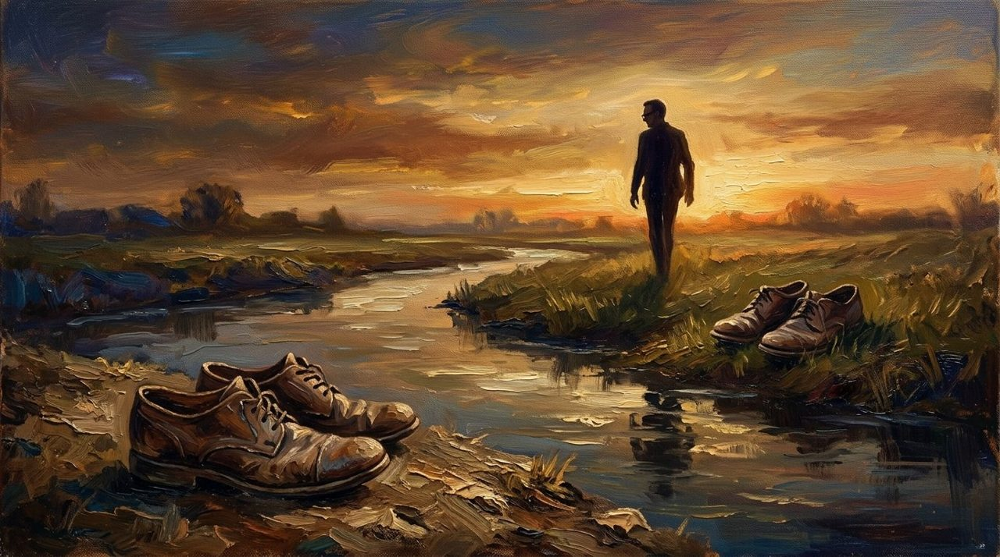
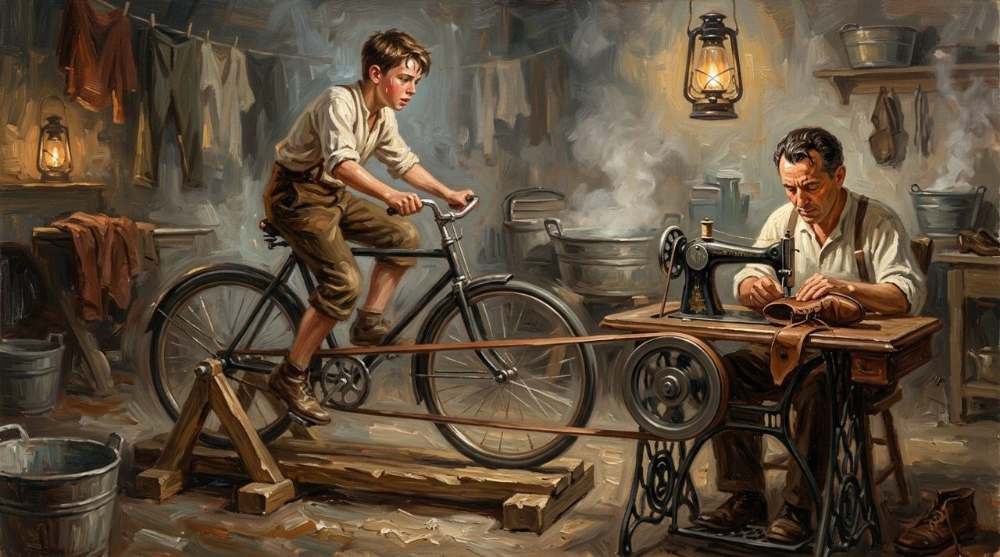
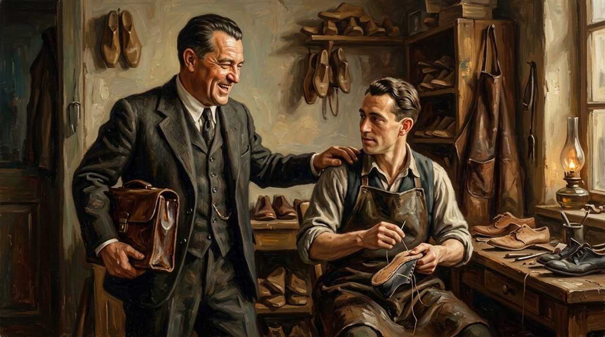
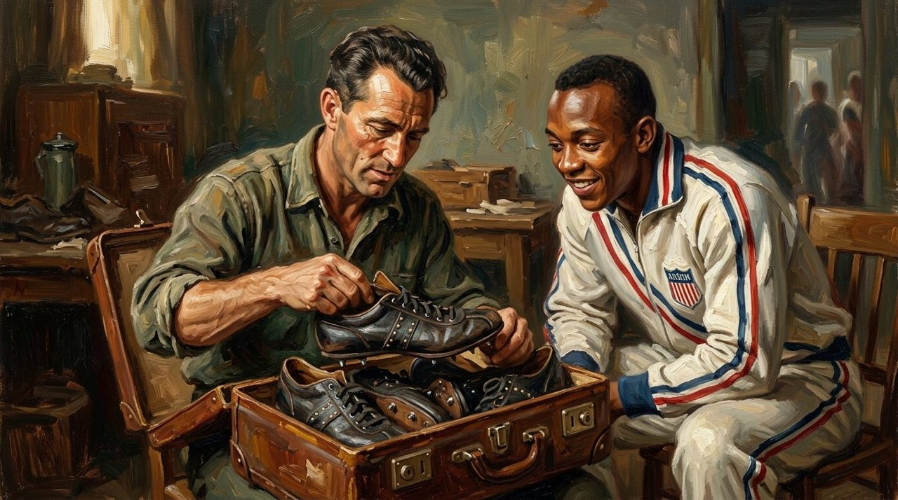
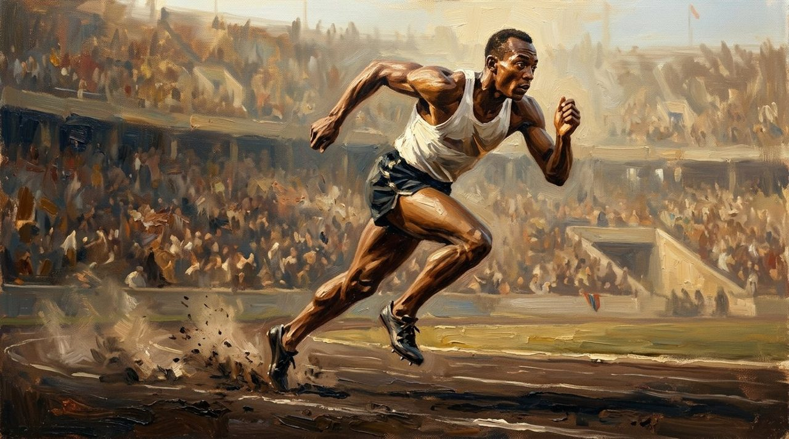
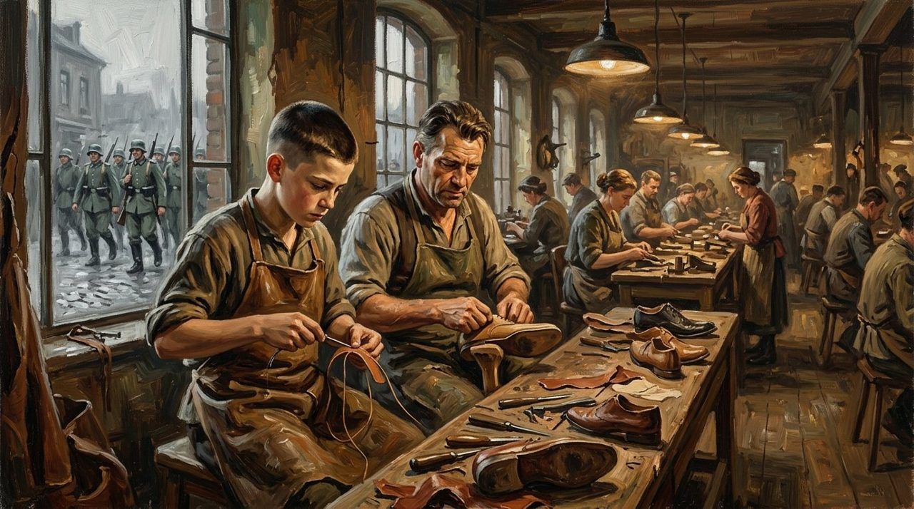
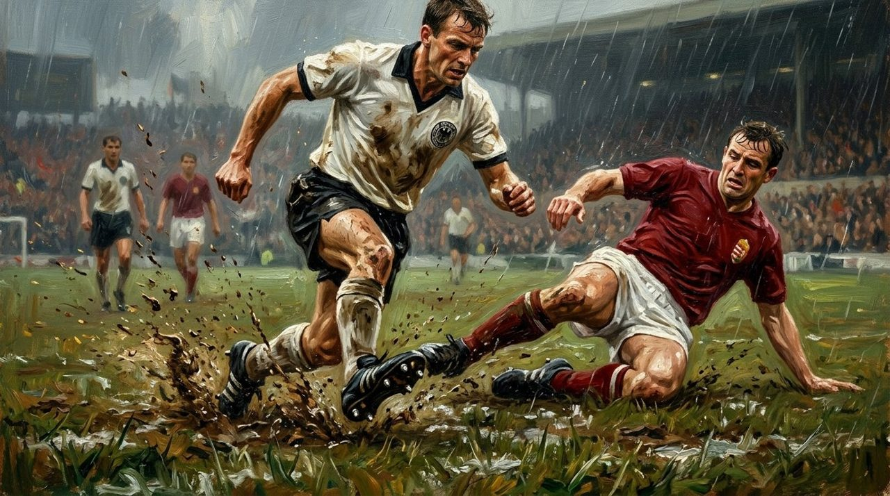
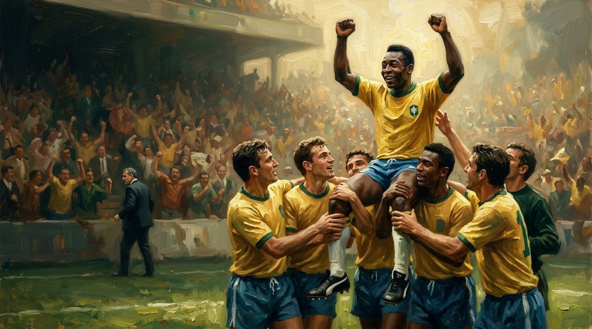
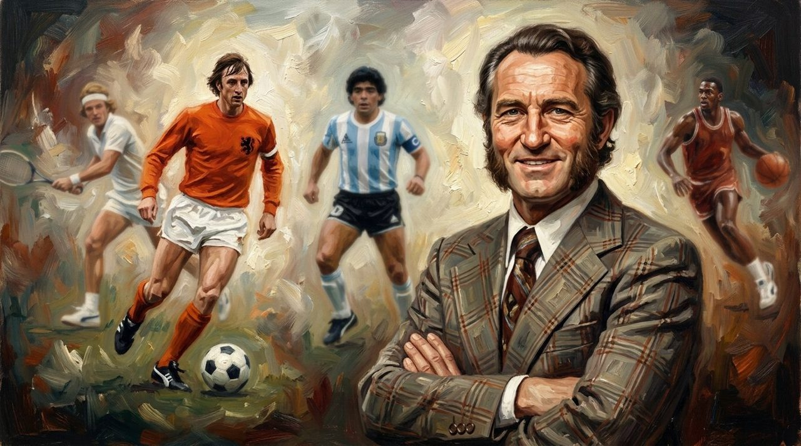
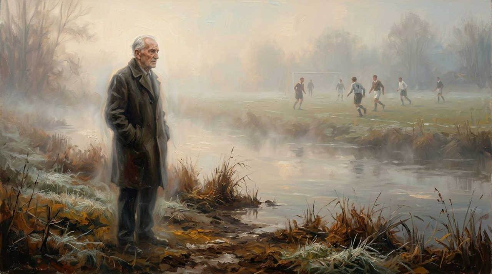

In the small German town of Herzogenaurach, people meet in a strange way. Before you say hello, you look down - at their shoes. For more than 60 years, those shoes told the whole town whose side you were on.

A small river runs through the town. On one side of it stood [Adidas](/stories/history-of-adidas/). On the other side stood Puma. And the two men who built those companies were brothers. They had worked side by side for over 20 years. Then they stopped speaking - and never truly spoke again. This is how Puma started: not in a boardroom, but in a broken family.

<figure><figcaption>Two pairs of shoes, one small river. Everything in this story stands on one of its banks.</figcaption></figure>

## The Maker and the Seller

Rudolf Dassler was born in 1898 in Herzogenaurach. He was the older brother. His younger brother Adi was the quiet one, a shoemaker at his workbench in their mother's laundry room.

<figure><figcaption>Where it all began: their mother's laundry room, one bicycle, one machine, and two brothers.</figcaption></figure> Rudolf was different: loud, full of energy, a man who loved to talk - and loved to sell.

In 1924, the brothers started their company: the Dassler Brothers Shoe Factory. Their work divided itself the way it does in many families: Adi made the shoes, Rudolf sold them.

<figure><figcaption>The maker and the seller: Adi at the bench, Rudolf with the smile and the sales bag.</figcaption></figure> Rudolf travelled, shook hands, and found the buyers.

## Gold in Berlin

Athletes began wearing Dassler shoes at the Olympic Games. Then, in 1936, came the moment that made their name known around the world.

At the Berlin Olympics, Jesse Owens, a young Black sprinter from America, wore the brothers' handmade spikes.

<figure><figcaption>Berlin, 1936: a suitcase of handmade spikes, opened in front of the fastest man alive.</figcaption></figure> In one week, he won four gold medals: the 100 metres, the 200 metres, the long jump, and the relay. Before the next war, the brothers were selling 200,000 pairs a year.

For Rudolf, these were beautiful days: his voice and his brother's spikes had carried a family workshop onto the feet of the fastest man alive.

<figure><figcaption>One week, four gold medals: the beautiful days, before the war came.</figcaption></figure> But war was coming - and war would do what no rival ever could.

## The War Broke Them

When the Second World War came, the shoe factory stopped making shoes and made parts for weapons instead.

<figure><figcaption>Inside, the benches still smelled of leather. Outside the window, the war was marching past.</figcaption></figure> Rudolf was sent to the army - and he blamed his brother for it.

After the war, Rudolf spent a year in a prison camp, believing his own brother Adi had told the Americans about him. Nobody knows if it was true - but Rudolf believed it. At home, the wives did not get along, and the arguments grew worse.

In 1948, the brothers divided everything - the machines, the money, even the workers, who had to choose a side. Rudolf crossed the small river, the Aurach, to the south side of town, and started Puma. Adi stayed on the north side and registered his own name a year later: Adidas.

The town took sides; people looked at your shoes before starting a conversation. Herzogenaurach became the town of bent necks.

## Running After His Brother

From that day, the brothers' private war became a public race. From Helsinki to Rome, from one Olympic Games and World Cup to the next, the same question followed every start line: whose shoes would the fastest feet be wearing - Adi's, or Rudolf's?

Puma was the younger company, always chasing the bigger name across the river. Every race was a chance to prove the south-side brother right. Year after year they pushed each other - and German sport shoes conquered the world, built by two brothers who were not speaking.

<figure><figcaption>Bern, 1954: mud, rain, and the whole world watching the boots of Herzogenaurach.</figcaption></figure>

## The Shoelace the World Watched

Then came the 1970 World Cup, and one quiet moment did what years of chasing could not.

Pelé of Brazil, the most famous player on Earth, was wearing Puma boots. Before millions watching on television, he stopped - and slowly tied his shoelaces.

For a few seconds, every camera was looking down at his feet - at a pair of Puma boots. It was not a goal, not a trophy. Just a man tying his shoes. But for Rudolf's company, it was the moment Puma stood in front of the entire world - and, for once, not behind anyone.

<figure><figcaption>Mexico, 1970: the most famous feet on Earth, in Puma boots, lifted above the world.</figcaption></figure>

## The Brother Who Did Not Come

The brothers grew old, and the race never stopped. In 1974, Rudolf was dying. The story goes that Adi was asked to come and see his brother, one last time. Most people say he did not go. Others whisper that the two men met in secret.

The brothers never made peace. Their sons continued the family war.

<figure><figcaption>The sons took up the race: under Rudolf's son Armin, Puma's stars filled the stadiums of the world.</figcaption></figure>

Then, in 2009 - more than 60 years after the split - something in Herzogenaurach finally changed. The workers of Adidas and Puma played a football match together, for peace. The founders had stayed on opposite sides of the river until the end. But that day, at last, the town looked up.

## What This Story Teaches Us

- **A team needs both the hands and the voice.** Adi made the shoes and Rudolf sold them. Together, they built something neither could build alone.
- **A rival can make you sharper.** Puma spent decades chasing Adidas, and Adidas could never rest. Their race pushed German shoes to the top of the world.
- **Some prices are too high.** The brothers won fame, money, and the whole world's feet. What they lost was each other. Peace came to their town only in 2009 - a generation too late for them.

## Look Up From Your Shoes

Maybe there is a small river in your life, too. A brother, a sister, an old friend - someone you once built something with, standing now on the other side. The water is not deep. The distance is not far. Only the years are long.

<figure><figcaption>The river was never deep. It was the years that were long.</figcaption></figure>

The people of Herzogenaurach looked down at each other's shoes for more than 60 years, before one football match taught them to look up. Their story carries a quiet warning and a quiet hope: pride can keep a river between two people for a whole lifetime - but it only takes one person, on one ordinary day, to cross it.
