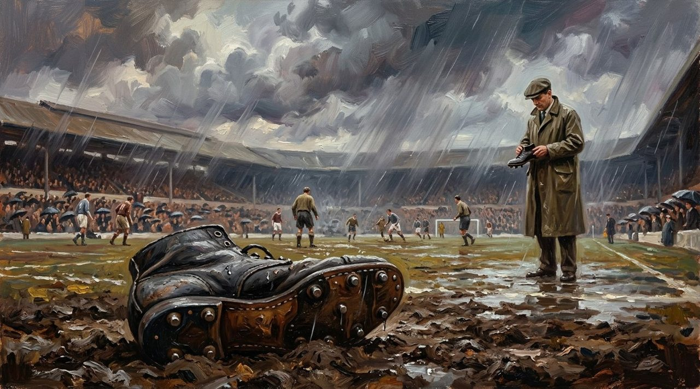
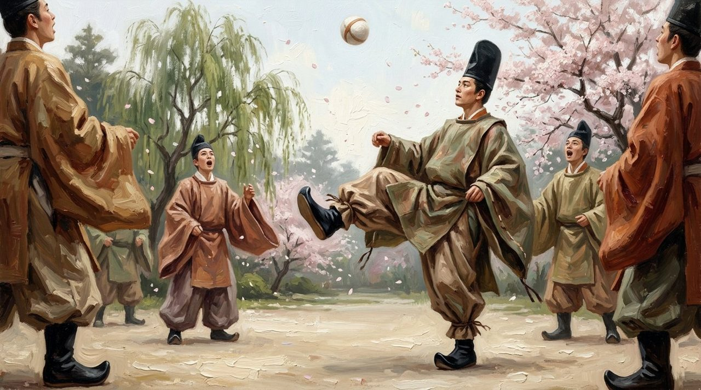
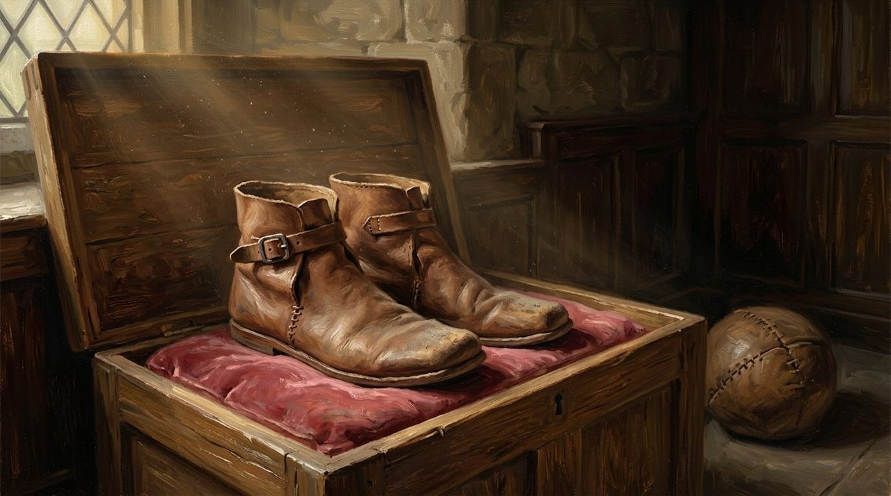
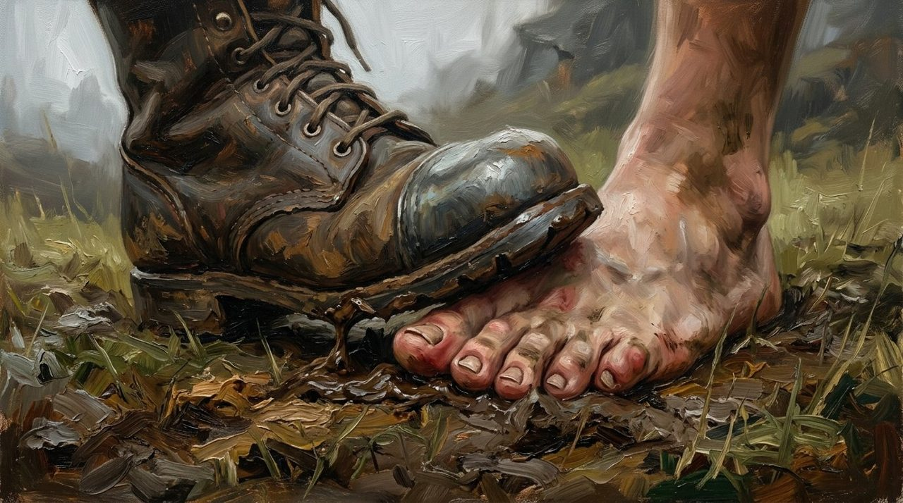
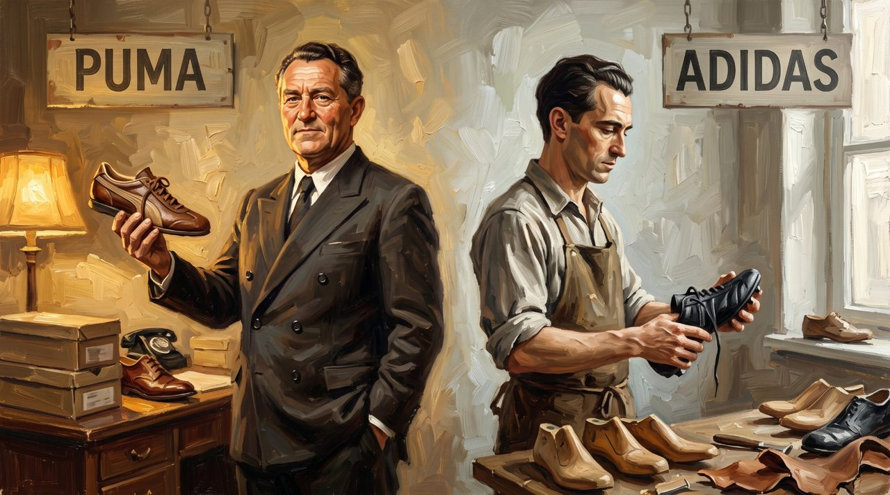
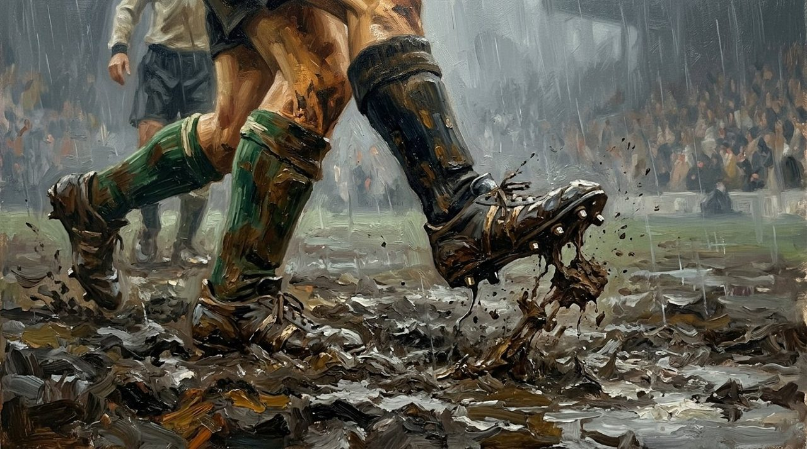
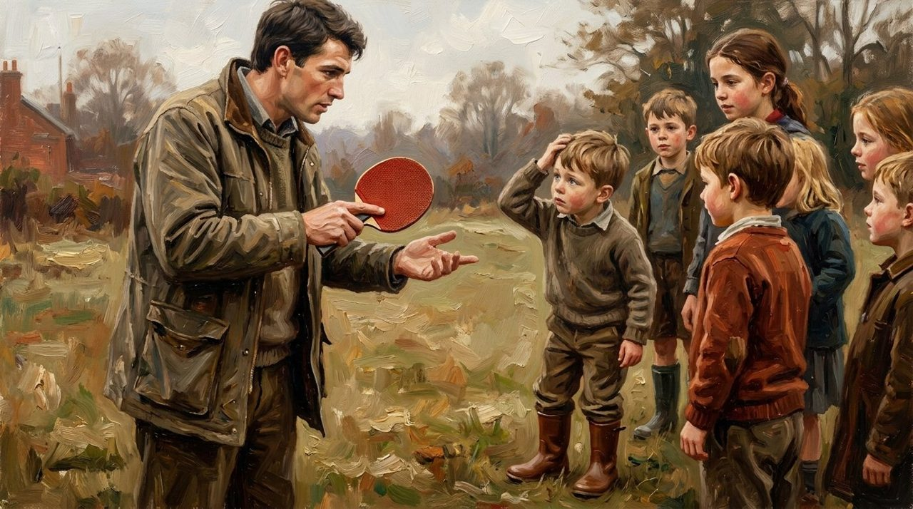
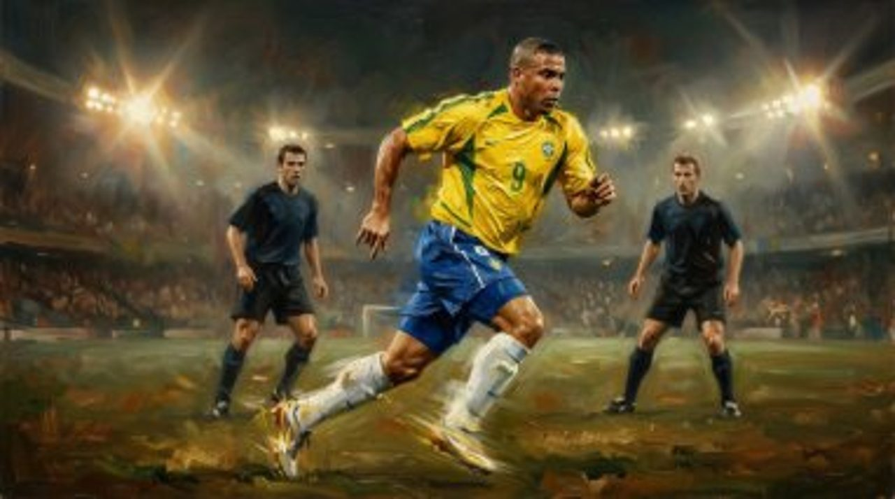
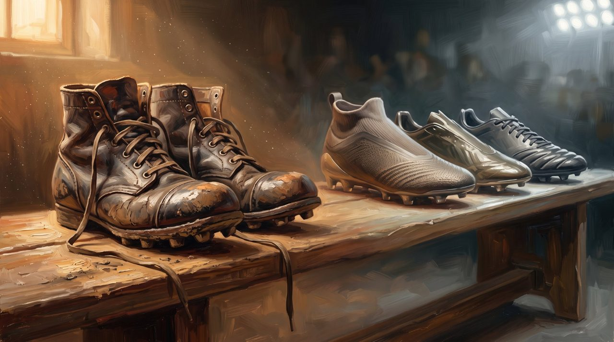

Can a pair of shoes win a World Cup?

In 1954, in Bern, Switzerland, West Germany faced Hungary in the World Cup final. Hungary was feared by everyone. Rain had turned the pitch to mud, and players slipped with every step. But the German boots carried a quiet invention: studs that could be unscrewed and changed for wet ground. Germany kept its footing - and won.

<figure><figcaption>Bern, 1954: rain, mud, and one quiet question - can a pair of shoes win a World Cup?</figcaption></figure>

To see how a simple shoe grew strong enough to change a final, we travel back 1,000 years - to a quiet garden in Japan.

## Duck Shoes in a Quiet Garden

Around the year 1000, players of kemari in Japan already knew a ball game needs special shoes. They wore leather shoes known as duck shoes.

<figure><figcaption>Japan, around the year 1000: no stadium, no crowd - just a garden, a ball, and shoes made only for the game.</figcaption></figure>

No stadiums, no crowds, no cameras yet. Just players in a garden, wearing shoes made only for the game. It was a small first step: the idea that the shoe is part of the sport.

## A Line on a King's Shopping List

The earliest record of football boots is no painting or trophy. It is one small line on a shopping list.

In 1526, King Henry VIII of England ordered a pair of football boots. The price written beside them was four shillings. That is all that survives: a king, a pair of boots, four shillings.

<figure><figcaption>All that survives of the king's boots is one line on a list. The boots themselves live only in imagination.</figcaption></figure>

Most players had no such luxury. For centuries they played in boots built for work, not play.

## Heavy Leather and Hard Rules

In the 1800s, footballers wore their heavy work boots onto the pitch, with iron nails in the soles to stop them slipping. When it rained, one boot, soaked with water and mud, could weigh more than one kilogram. Imagine running with a wet brick tied to each foot.

<figure><figcaption>Boots built for the working week, not the game: heavy leather, iron nails, and no mercy.</figcaption></figure>

The game was rough, too. In 1863, the Football Association was formed in England, wrote shared rules, and banned hacking. Slowly, boots became real football boots: made for the pitch, not the working week.

## Two Brothers Change the Boot

In a small German town, two brothers started the companies that changed the boot forever: [Adidas](/stories/history-of-adidas/) and [Puma](/stories/history-of-puma/). Their race to build the better boot pushed design forward faster than ever.

<figure><figcaption>Two brothers, two signs, one small town: the race that changed the boot forever.</figcaption></figure>

Adi Dassler looked at football's oldest problem: the ground changes. Dry grass one week, deep mud the next. His answer was simple and clever: studs that could be screwed in and out, changed for the weather. On that rainy day in Bern in 1954, West Germany changed its studs for the wet ground - and won the Miracle of Bern.

<figure><figcaption>The quiet invention at work: studs that could be changed for the weather, holding firm in the mud.</figcaption></figure>

A boot is not just clothing. On the right day, it is the difference between falling and standing.

## White Paint and a Table Tennis Bat

At the 1970 World Cup, Pelé made boots famous to everyone watching.

<figure><figcaption>1970: the most watched feet in the world. What a star wore now mattered to millions.</figcaption></figure> What a star wore now mattered to millions.

That year, England star Alan Ball appeared in bright white Hummel boots - or so everyone thought. In truth, they were his old Adidas boots, painted white. The boot had become part of a player's image.

The next great idea began with a child's question. In Australia, a little boy asked footballer Craig Johnston a question about the ball, and Johnston never forgot it. His answer was strange and brilliant: a table tennis bat. If rubber on a bat can grip a ball and make it spin, why not put rubber fins on a boot, to grip a football and make it curve? That idea became the Adidas Predator.

<figure><figcaption>It began with a child's question and a table tennis bat: if rubber grips a small ball, why not a football?</figcaption></figure>

## Down to 99 Grams

In 1998, Ronaldo of Brazil ran in a new kind of boot: the Nike Mercurial, built for one thing - speed.

<figure><figcaption>1998: Ronaldo in the Mercurial. The work boot was gone; the racing shoe had arrived.</figcaption></figure> The heavy work boot was gone; in its place, a light racing shoe with almost nothing between foot and ball.

Today, a modern football boot can weigh about 99 grams. A single wet boot of the 1800s weighed more than ten times that.

<figure><figcaption>More than a kilogram of wet leather then; about 99 grams now. A thousand years, on one scale.</figcaption></figure> From duck shoes to a king's four shillings, iron nails, screw-in studs, and a table tennis bat: every gram was removed, by many hands.

Behind every boot there are still hands: people who cut, stitch, and shape them. The perfect boot was never only about weight - it is about the ground, the game, and the care of the people who made it.

<figure><figcaption>One bench, one thousand years: from the work boot to the 99-gram racing shoe.</figcaption></figure>

## What This Story Teaches Us

- **Small tools can decide the biggest moments.** A World Cup final in the rain turned on a simple idea: studs you could change for wet ground.
- **Great inventions often begin with a question.** The Predator began with a little boy's question in Australia - and one man who refused to forget it.
- **Progress is slow, and it belongs to many hands.** No single person built the modern boot. A thousand years of small improvements did.

## Shoes for the Ground Beneath You

Every footballer in this story faced the same problem: the ground keeps changing. Rain. Mud. Hard earth. Soft grass. The players who stood tall were not always the strongest - they were the ones ready for the ground beneath them.

Life has weather, too: dry days when everything is easy, wet days when every step wants to slide. Its long history carries one quiet piece of advice: prepare for the ground you are actually on. Change your studs.

<figure><figcaption>Every story in this article ends here: a child, a pair of boots, and the ground waiting tomorrow.</figcaption></figure>

The perfect boot was never magic. It was the right boot, for that day, on that ground.
