A man sits on a bicycle in a laundry room in Germany, pedaling for hours. The bicycle never moves one metre. But its wheels power a machine, and slowly, under a quiet shoemaker's hands, the first shoes are born.

<figure>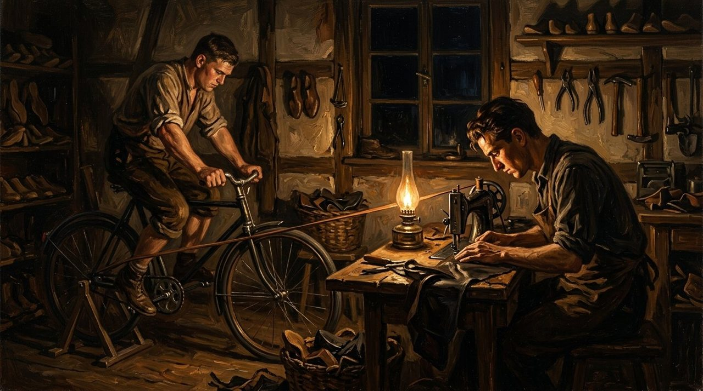<figcaption>The laundry room at night: one brother pedals, the machine turns, and the shoes are born.</figcaption></figure>

The shoemaker is Adi Dassler. He has no money, no machines - only his hands, old leather, and one idea: the right shoe can make an athlete better. He will lose almost everything, more than once. And each time, he will begin again. This is how Adidas started.

## Shoes from the Ruins

Adi Dassler was born on November 3, 1900, in Herzogenaurach, a small town in Bavaria. His mother ran a small laundry.

<figure>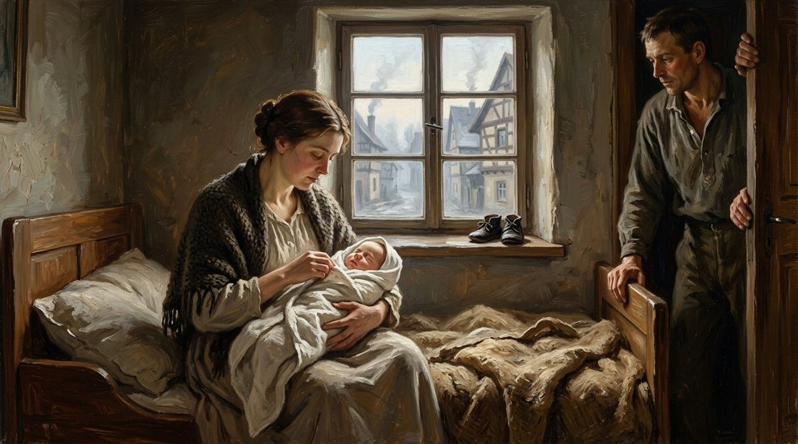<figcaption>Herzogenaurach, 1900: a laundry woman's son is born, and a small pair of shoes waits by the window.</figcaption></figure>

At 17, he went to war, and came home to a broken country: no leather, no loans. So Adi collected what soldiers had left behind: old helmets, bread bags, torn parachutes. He cut soles from the leather, slippers from the silk.

In 1924, the brothers registered their company: the Dassler Brothers Shoe Factory. Adi was the quiet one who built; Rudolf was loud and loved to sell.

<figure>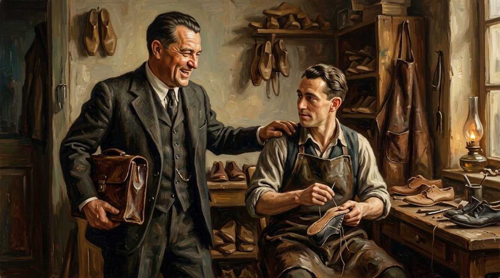<figcaption>The maker and the seller: Adi at the bench, Rudolf with the smile and the sales bag.</figcaption></figure> And Adi did one simple thing: he listened to athletes, then went back to his bench and made the shoe better.

<figure>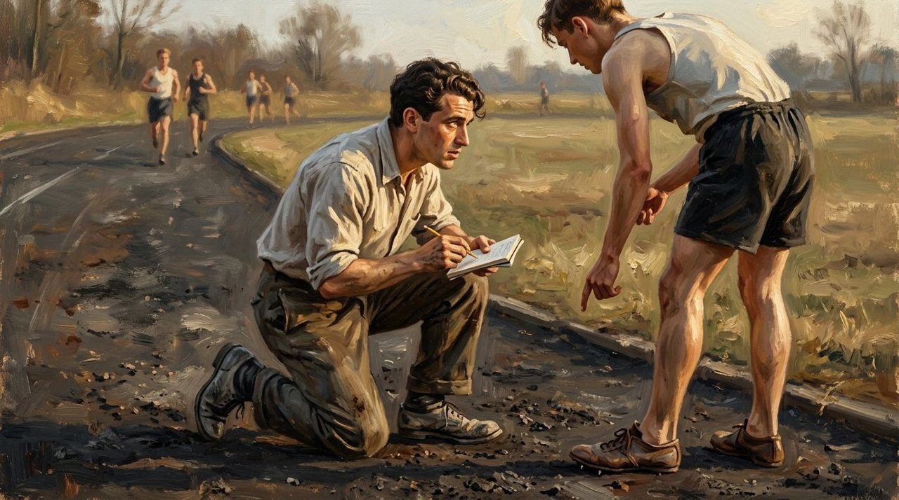<figcaption>His whole method, in one picture: kneel down, listen to the athlete, write it down, make the shoe better.</figcaption></figure>

## A Suitcase for Berlin

In 1928, Lina Radke won Olympic gold in Dassler shoes.

<figure>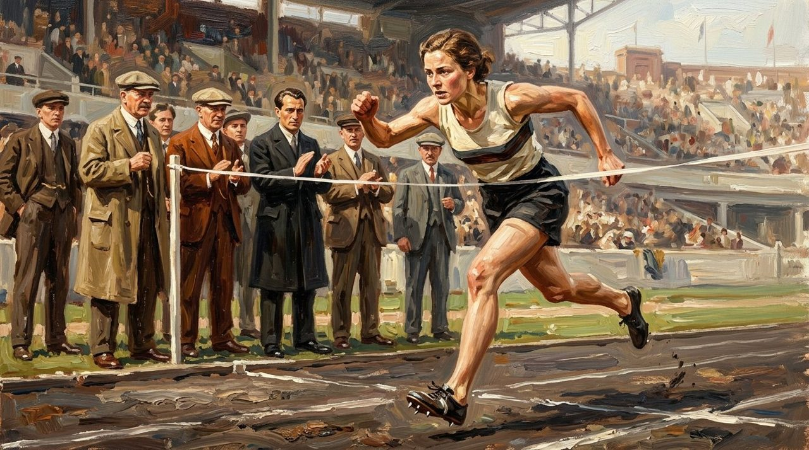<figcaption>Amsterdam, 1928: Lina Radke breaks the tape, and the Dassler name travels for the first time.</figcaption></figure>

Then came Berlin, 1936: Hitler's Olympic Games. Adi packed a suitcase of handmade spikes and went to find one man: Jesse Owens, a young Black sprinter from America, grandson of an enslaved man.

Was it courage, or business? People still disagree. Owens tried the spikes and wore them. In one week he won four gold medals - the 100 metres, the 200 metres, the long jump, and the relay. The world remembered Jesse Owens - and noticed his shoes.

<figure>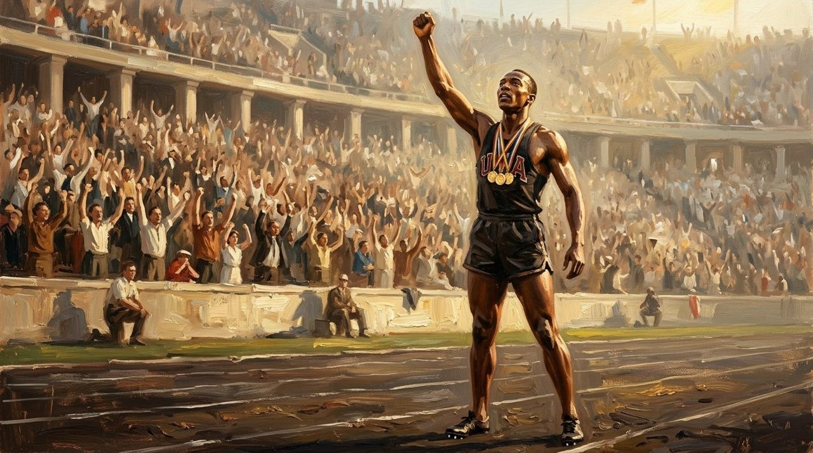<figcaption>Berlin, 1936: four gold medals in one week. The world remembered Owens, and noticed his shoes.</figcaption></figure>

## The Factory Goes to War

In 1933, both brothers joined Hitler's Nazi Party. When the Second World War came, the sewing machines stopped: the shoe factory became a weapons factory, making parts for an anti-tank weapon.

In April 1945, American soldiers reached the town, ready to destroy it. Adi's wife Käthe stepped forward and told them it was a sports shoe factory.

<figure>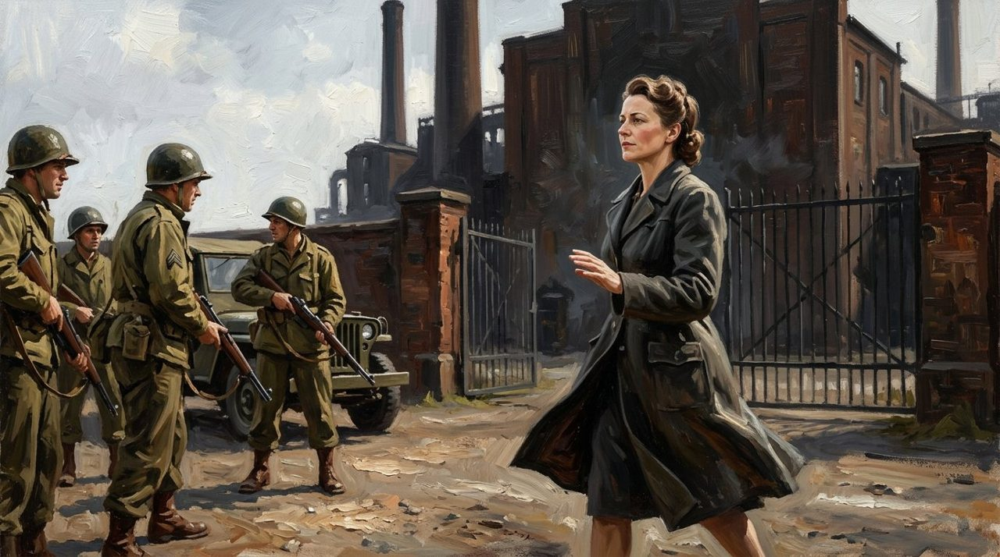<figcaption>April 1945: Käthe steps forward alone and tells the soldiers the truth. It is a shoe factory.</figcaption></figure> The soldiers also learned whose shoes had been made there: Jesse Owens's spikes. They let the factory stand.

With no leather left, Adi made shoes from the ruins once more: rubber from fuel tanks, canvas from tents.

## Two Brothers, One River

After the war, Rudolf spent a year in a prison camp, believing his own brother had betrayed him. Nobody knows if it was true - but Rudolf believed it. In 1948, the brothers divided everything - the machines, the money, even the workers, who had to choose a side.

A small river, the Aurach, runs through the town. Rudolf moved to the south side and started [Puma](/stories/history-of-puma/). Adi stayed on the north side. He chose a new name: Adidas - Adi from his name, Das from Dassler - registered in 1949 with 47 workers.

<figure>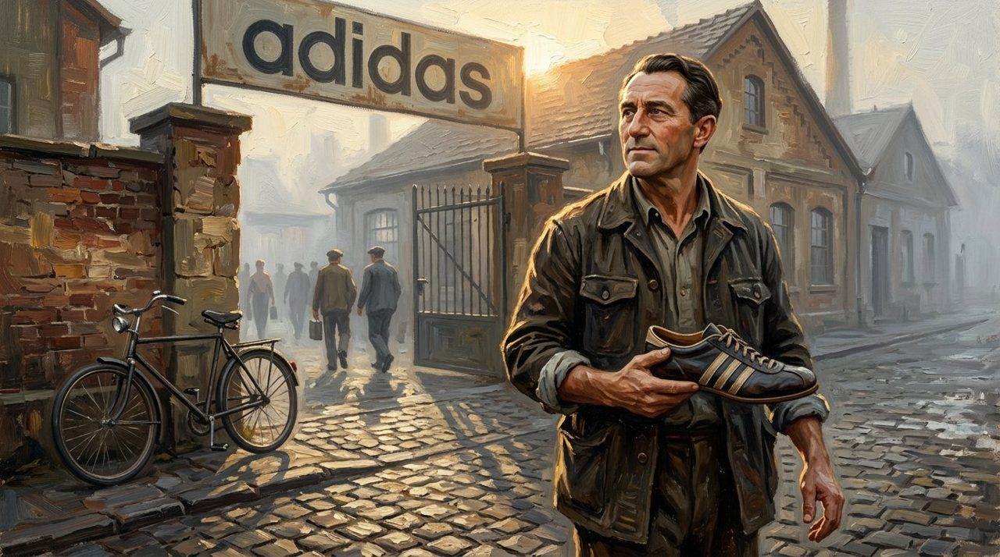<figcaption>1949: a new name over the gate, 47 workers, and a shoe with three stripes in his hands.</figcaption></figure>

Herzogenaurach became the town of bent necks, where people looked at your shoes before saying hello.

## Three Stripes and a Rainy Day

At first, the three stripes had a job: holding the foot steady. But they were not fully his. Finland's Karhu company had used them for years and owned the right to them. In 1952, Adi bought them: about 1,600 euros in today's money, plus two bottles of whiskey.

<figure>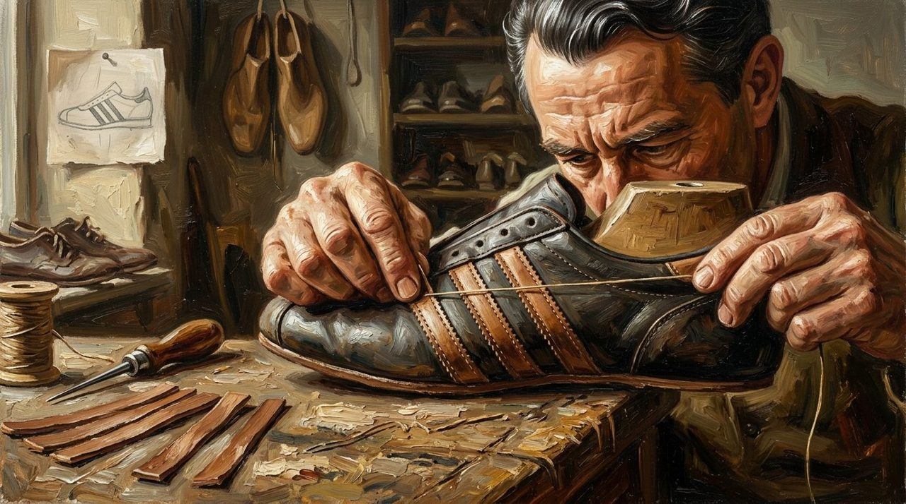<figcaption>Three leather strips, sewn one by one. First they held the foot. Then they held the world's attention.</figcaption></figure>

On July 4, 1954, in Bern, West Germany faced Hungary in the rainy World Cup final. Hungary had not lost in years; they had beaten Germany 8-3 in the same tournament. In thick mud, Hungary scored twice in eight minutes. But the German boots had a clever feature: their studs could be unscrewed and changed for longer ones. Germany held its balance and won 3-2: the Miracle of Bern.

Adi did not invent screw-in studs. His gift was knowing which ideas mattered - and where to put them: on the right feet, at the right moment, in front of the whole world.

## Falling and Rising Again

Adi died in 1978, at 77. His wife Käthe, then his son Horst, led the company. One night in New York, the rap group Run-DMC played Madison Square Garden wearing Adidas. During their song "My Adidas", thousands of fans held their shoes up into the lights. Adidas signed them for more than a million dollars. The three stripes had jumped from the stadium to the street.

<figure>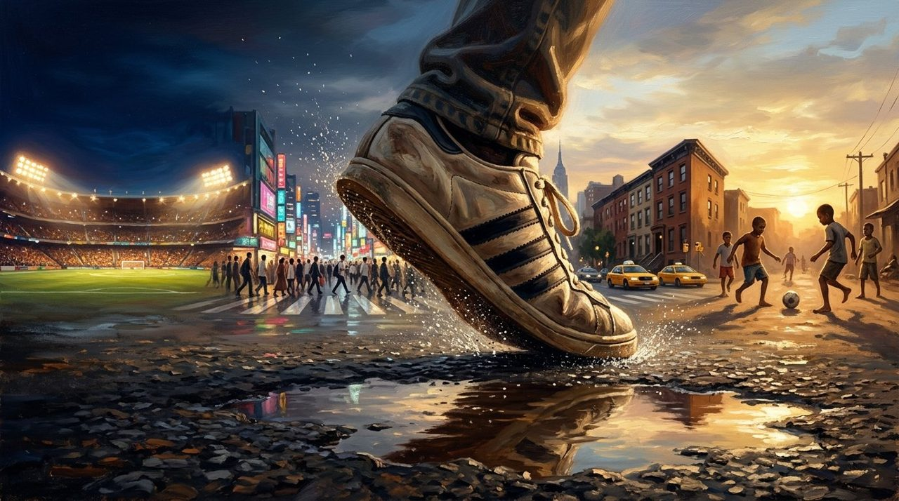<figcaption>From the stadium to the street: one shoe, worn by champions and by children on wet pavement.</figcaption></figure>

After Horst died of cancer in 1987, at 51, the family lost control. Sold and losing money, by 1992 it was close to losing everything. A new leader brought Adidas back to athletes, and within a year it was in profit again; in 2025 it reached record sales.

And in 2009, Adidas and Puma played a football match together, for peace. The founders never made peace. But that day, the town finally looked up from its shoes.

<figure>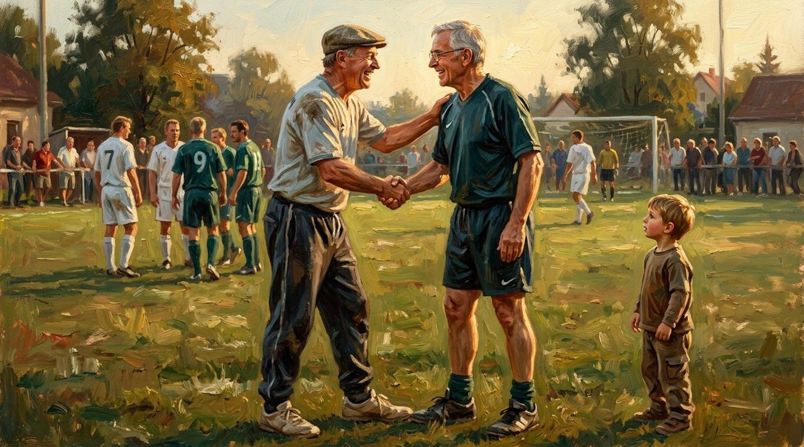<figcaption>2009: the peace match. The founders never shook hands again. Their town finally did.</figcaption></figure>

## What This Story Teaches Us

- **Begin with what you have.** Adi Dassler started with army leftovers, a laundry room, and a bicycle that went nowhere.
- **Listen more than you speak.** His best ideas came from listening to athletes - even the famous stripes came from another company. His gift was choosing well.
- **Falling is not the end.** Adi began again after two wars. Adidas rose again in the 1990s by returning to what it had forgotten: the athlete.

## The Bicycle That Went Nowhere

Maybe today your work feels like that bicycle: you pedal hard, and you do not seem to move at all. A small room. Simple tools. Nobody watching.

Adi Dassler pedaled in that laundry room for years, listening, fixing, improving one small shoe at a time. The bicycle never moved. But the shoes travelled the whole world.

<figure>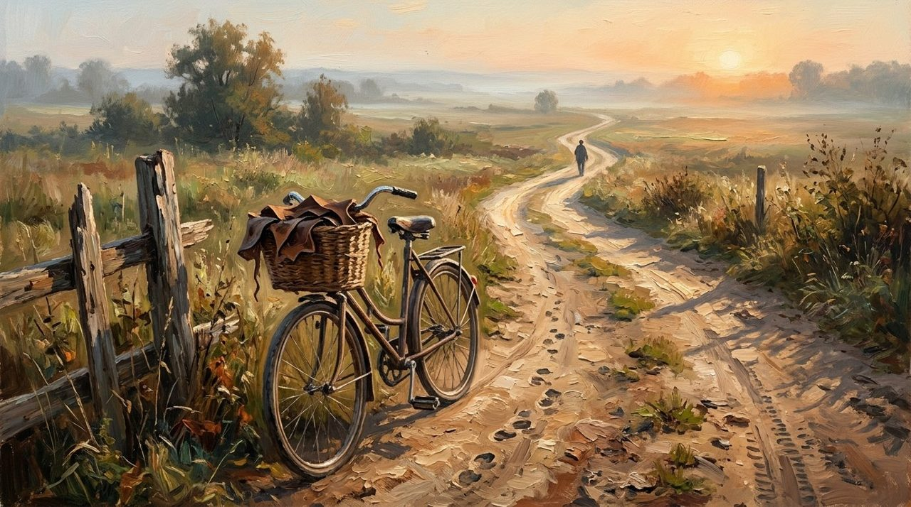<figcaption>The bicycle stayed in the laundry room. The road it opened went around the world.</figcaption></figure>

You do not need perfect conditions to start something meaningful. Begin with what you have. Do small work with care. Keep going.

One day, you may be surprised how far it went.
