In the 1930s, a Japanese engineer took apart an American Chevrolet, piece by piece, to learn how to build a car. His name was Kiichiro Toyoda. He did not yet know how to make an engine. He only knew how to learn.

<figure>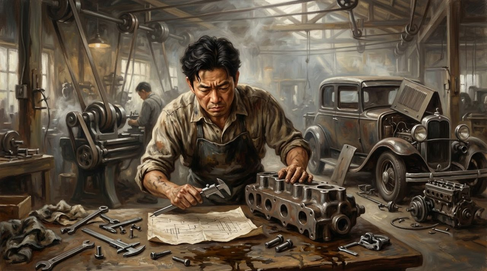<figcaption>He did not know how to make an engine. Not yet. So he measured, and learned.</figcaption></figure>

Decades later, the story turned around: General Motors, the giant behind Chevrolet, would study Toyota to learn to make better cars. This is how Toyota started: not with a car, but with a wooden loom.

## The Boy Who Watched His Mother Weave

The story begins in 1867, in a small Japanese village, where Sakichi Toyoda was born. His father worked as a carpenter. His mother made cloth, moving a wooden loom by hand for hours. The work was slow, and the boy watched - and asked a simple question: can this machine work better?

<figure>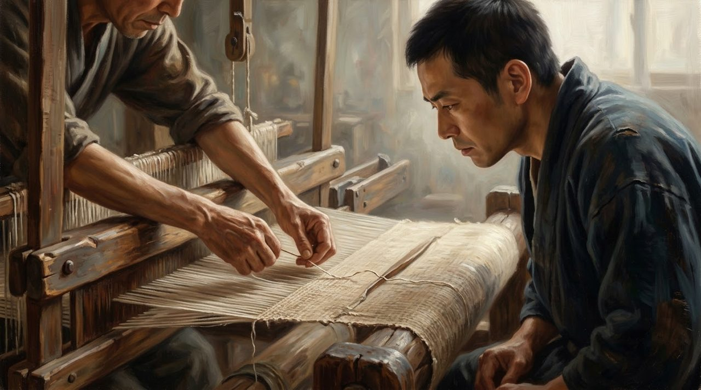<figcaption>A broken thread, a stopped loom, a watching boy: the whole Toyota idea begins here.</figcaption></figure>

In 1890, Sakichi finished a wooden hand loom of his own design; a patent followed in 1891. When a thread broke, an ordinary loom kept working and ruined the cloth. Sakichi's looms stopped by themselves the moment a thread broke - a small problem stopped before it became big. Years later, his whole company would live by that idea. By 1926, the family founded Toyoda Automatic Loom Works in Kariya.

<figure>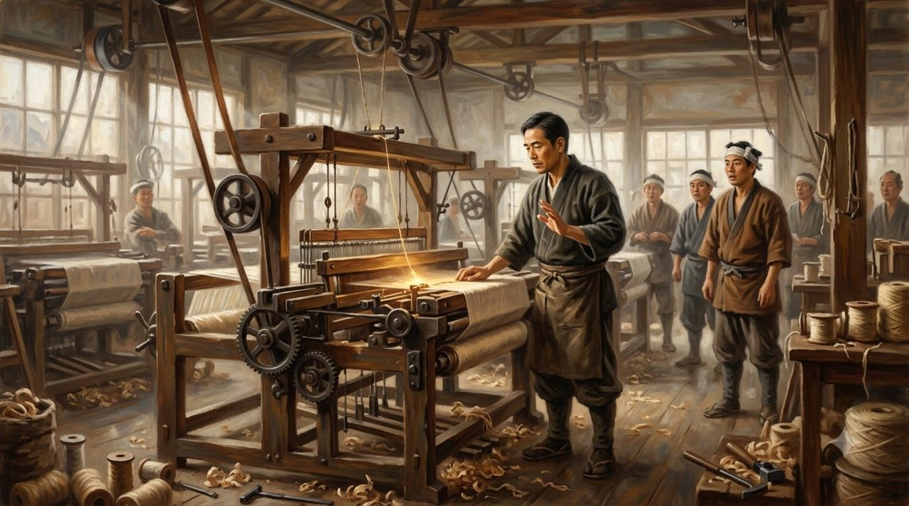<figcaption>The loom that stopped by itself: Sakichi's invention, and the seed of everything after.</figcaption></figure>

## Money From Cloth, Eyes on Cars

His son Kiichiro, born in 1894, studied engineering and joined the family business. In 1929, the English firm Platt Brothers paid for rights to his father's loom technology. Travelling for that deal, Kiichiro visited car factories abroad, and watched thousands of parts become one car. Money from cloth opened the door to a new dream.

His father died in 1930, never seeing a Toyota car. In 1933, Kiichiro opened an automobile division inside the loom company. He did not start with his own design. He started by learning.

<figure>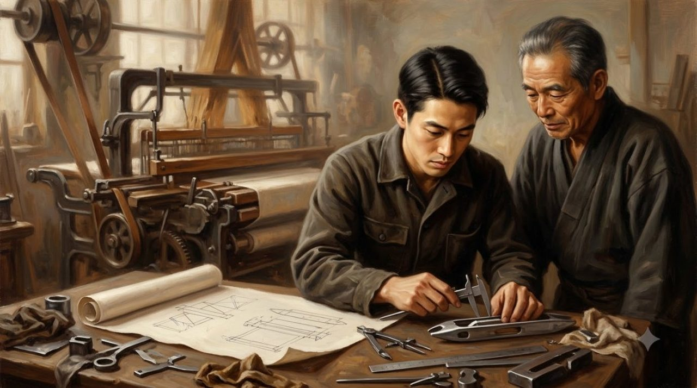<figcaption>Father and son at the bench: the loom maker's patience, passed to the car maker.</figcaption></figure>

## Taking Apart a Chevrolet

His team took apart an American Chevrolet, measured every part, and asked how it was made - dirty hands, heavy tools, endless questions.

<figure>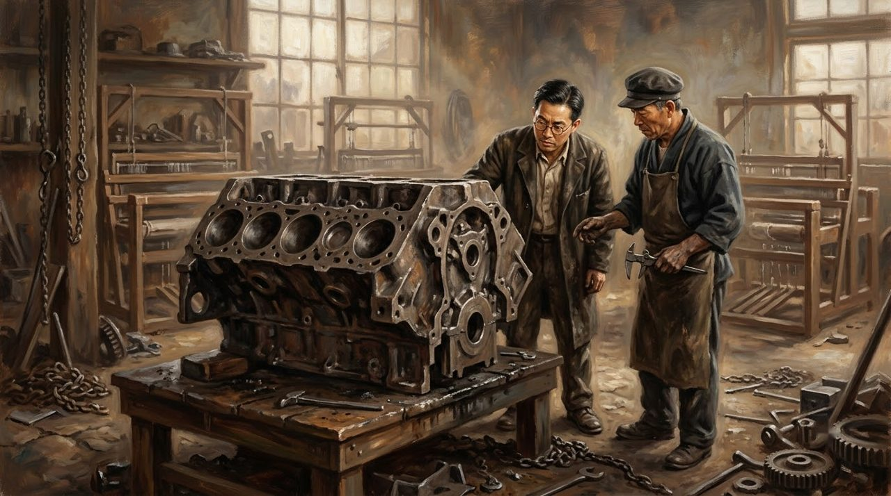<figcaption>Piece by piece, part by part: an American engine on a Japanese workbench, and a hundred questions.</figcaption></figure>

The hardest part was the engine block. Again and again, they poured hot metal into molds - and the blocks cooled the wrong way and came out broken. Their first tested engine, in 1934, was weaker than the Chevrolet engine they had studied. So they changed the design and tried again, until it reached about 65 horsepower - stronger than its teacher.

<figure>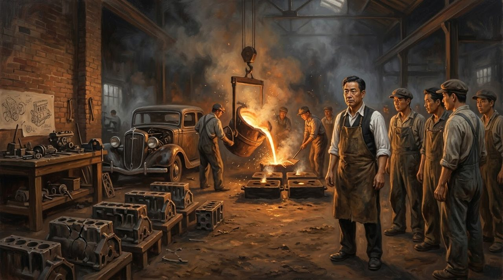<figcaption>The blocks kept cracking. They poured again. Failure by failure, the engine grew stronger than its teacher.</figcaption></figure>

In 1936, the first car people could buy, the Model AA, was ready. A public competition gave it a new name: Toyota - eight strokes in Japanese writing, and eight was a lucky number. In August 1937, Toyota Motor Company stood on its own.

<figure>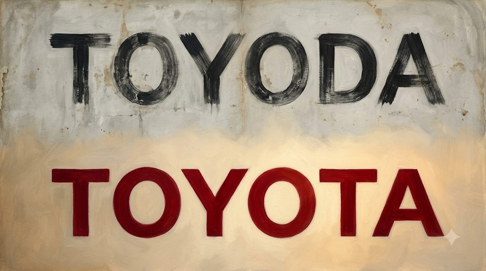<figcaption>One letter changed: Toyoda becomes Toyota, eight lucky strokes, a name the whole world could say.</figcaption></figure>

## The Man Who Had to Leave

War came, and Toyota built trucks for the army. After the war ended in 1945, Japan lay in ruins, and money was scarce. By 1950, the company was in deep trouble, and workers and managers fought over its future. Kiichiro took responsibility. In June 1950, he resigned from the company he had built from nothing.

He planned to return. He never did. On March 27, 1952, Kiichiro died, only 57 years old. Three years later came the Crown, a new car for Japan. The founder was gone; others would carry his dream forward.

<figure>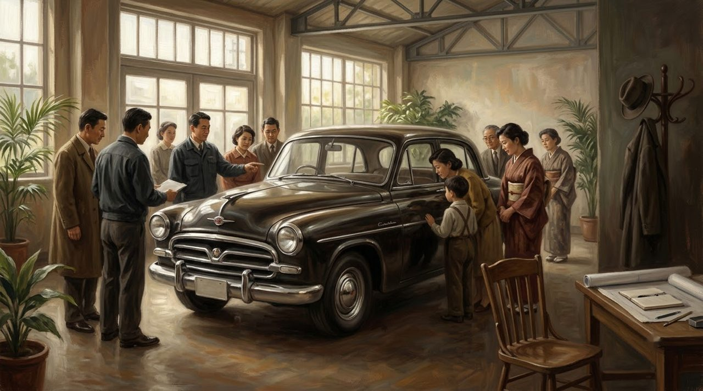<figcaption>1955: the Crown. Kiichiro never saw it. His dream had learned to walk without him.</figcaption></figure>

## The Supermarket Idea

Toyota had little money and a small home market. It could not copy the American way, with mountains of parts in store rooms. An engineer named Taiichi Ohno found an idea in an American supermarket: the store replaced only what customers took from the shelf. Nothing more.

<figure>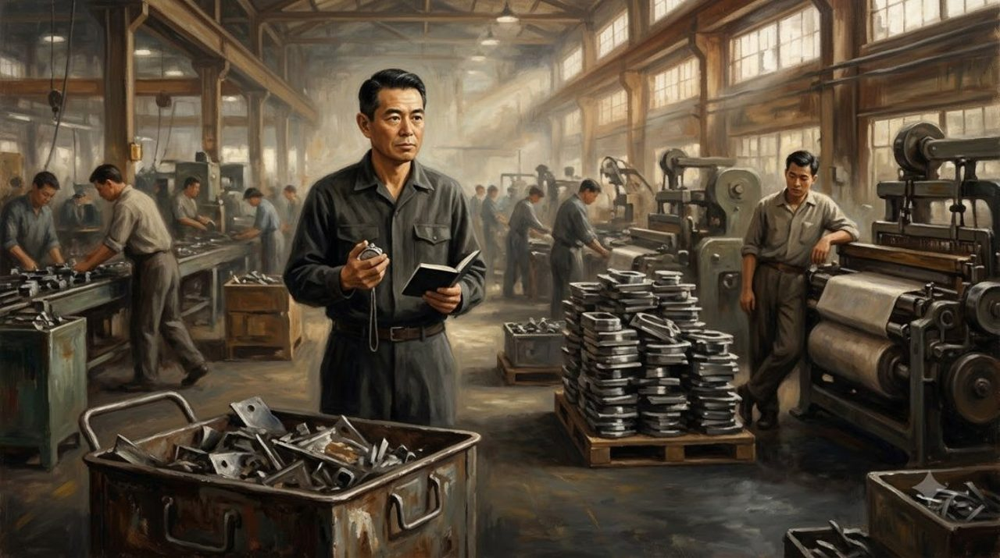<figcaption>Taiichi Ohno, stopwatch in hand, counting what the factory truly needed - and nothing more.</figcaption></figure>

Workers asked for parts only when they needed them, using small cards called kanban. Make only what is needed, when it is needed. And when a worker saw a serious problem, the line could stop - Sakichi's old idea, from the loom that stopped at a broken thread. Over the years, these habits became the Toyota Production System. In 1966 came the small, affordable Corolla. When oil prices rose in the 1970s, the world wanted cars using less fuel - and Toyota's were ready.

<figure>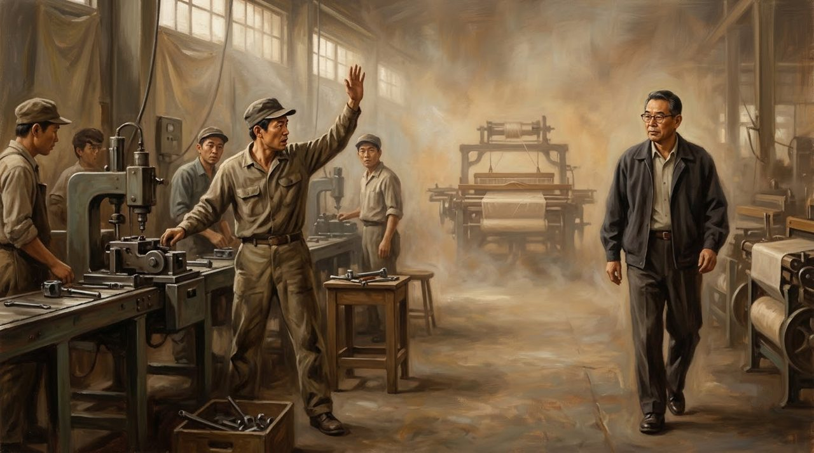<figcaption>Any worker could stop the whole line - the old loom's idea, alive on the factory floor.</figcaption></figure>

## The Student Becomes the Teacher

In 1982, General Motors closed a troubled factory in Fremont, California, and thousands lost their jobs. Then GM made a surprising choice: reopening the plant with Toyota, its rival, as a partner. From 1984, many of the same workers built cars the Toyota way - and the plant became famous for quality. The student of the Chevrolet had become the teacher.

<figure>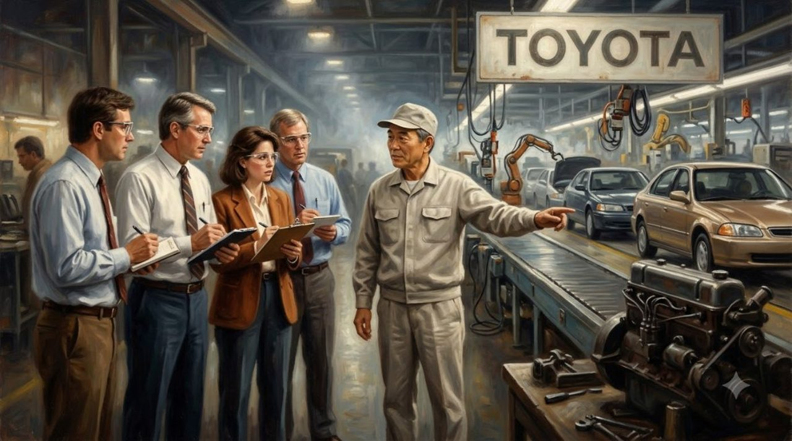<figcaption>Fremont, California: the student of the Chevrolet, now teaching General Motors' own workers.</figcaption></figure>

In December 1997 came the Prius, one of the first mass-produced hybrid cars. But success brought a hard test: in 2009 and 2010, Toyota recalled millions of cars over safety problems. In February 2010, Akio Toyoda - Kiichiro's grandson - stood before American lawmakers and said sorry. The company had spent decades earning people's trust. Now it had to earn it again.

## What This Story Teaches Us

- **A machine that stops can save the work.** Sakichi's loom stopped the moment a thread broke, so one small problem could not ruin a whole cloth.
- **Learning from a teacher is not shameful.** Kiichiro took apart a Chevrolet piece by piece, because he wanted to understand how a good car was made.
- **A weak first result can still be a beginning.** The team's first engine was weaker than the Chevrolet engine it copied. They changed the design, tried again, and made it stronger.

## Not Yet

Think of Kiichiro standing beside that Chevrolet, looking at an engine he did not know how to make. He did not know. Not yet. But he was willing to learn.

<figure>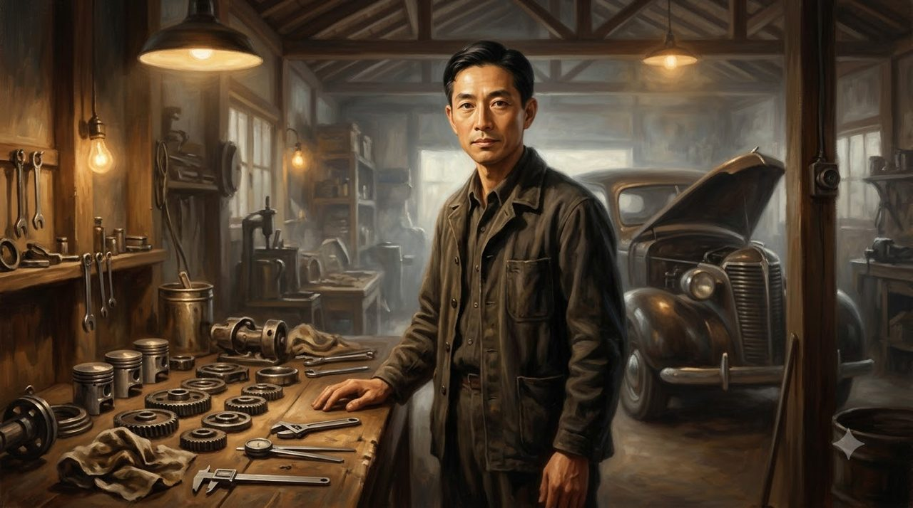<figcaption>Kiichiro in his shed, among the parts of a dream he would never see finished. He began anyway.</figcaption></figure>

My friend, maybe there is a dream in your life that still feels too big. Maybe you have tried, and things did not work out. Kiichiro's story offers one quiet answer: you do not have to know everything today. You only have to be willing to learn - piece by piece, failure by failure.

He never saw how far his dream would travel. He began anyway. Sometimes, that is where the greatest dreams begin.
