In 1994, Jeff Bezos had a life most people would dream of. A great job in New York. A good salary. A safe future. Then he walked away from all of it, to sell books on a strange new thing called the internet, when almost nobody had bought anything online.

<figure>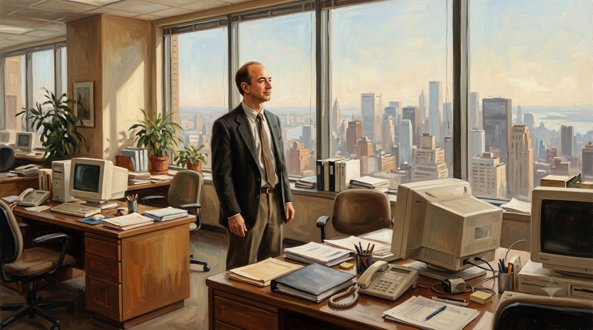<figcaption>New York, 1994: a safe office, a good salary, a whole city below. The life most people would dream of.</figcaption></figure>

Within a few years, the little bookshop was worth billions. Then the market crashed, and it nearly lost everything. This is how Amazon started.

## A Boy Who Watched People Start Again

Jeff Bezos was born on January 12, 1964, in Albuquerque, New Mexico. His mother, Jacklyn, was only 17 and still in school. When Jeff was four, she married Mike Bezos, who had arrived alone from Cuba as a teenager, almost empty-handed. Mike adopted the boy, gave him his name - and an example: a man can start again.

<figure>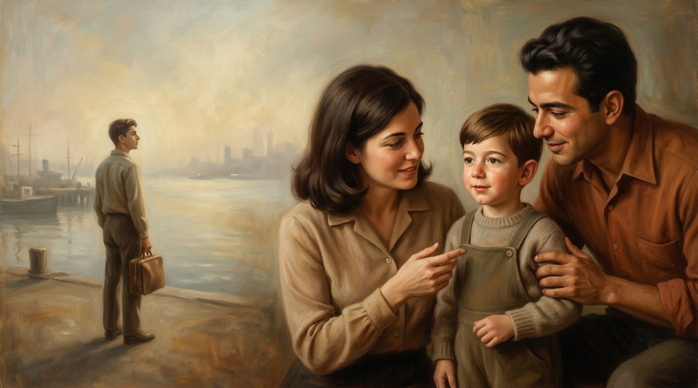<figcaption>The first lesson came from home: his stepfather had crossed the sea with almost nothing, and started again.</figcaption></figure>

Every summer, Jeff worked on his grandfather's Texas ranch, laying pipes and fixing windmills. His grandfather, Pop Gise, taught him: it is harder to be kind than to be clever.

<figure>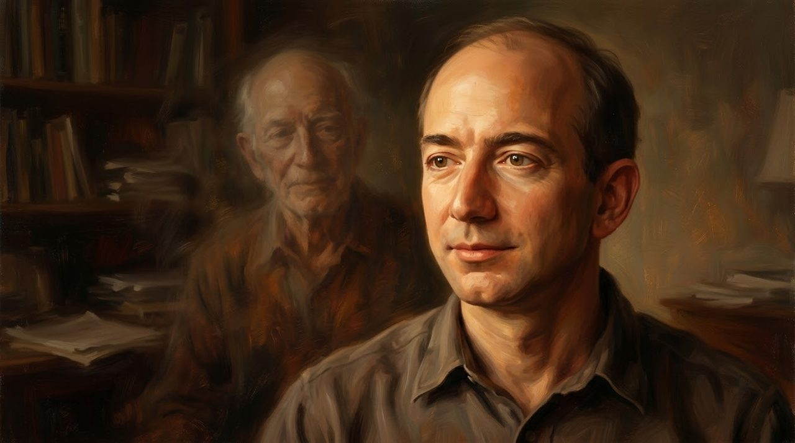<figcaption>Pop Gise of the Texas ranch, the quiet voice behind him: it is harder to be kind than to be clever.</figcaption></figure>

## The Old Man at Eighty

The boy became a star student, studied computers at Princeton, and climbed fast on Wall Street.

<figure>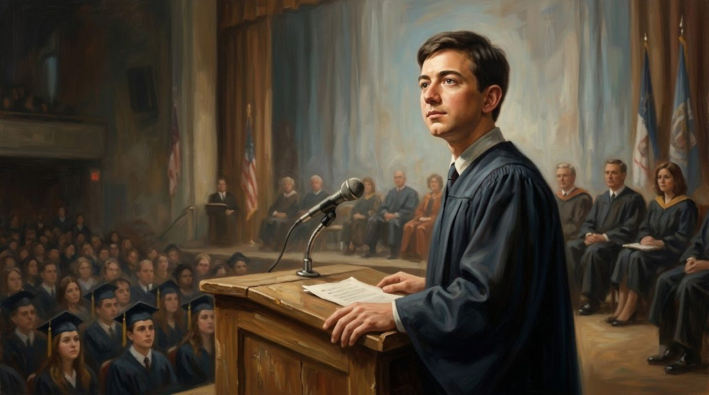<figcaption>First in his class, then Princeton, then Wall Street. The safe road was wide open.</figcaption></figure> At just 30, he was a senior vice president at D. E. Shaw, where he met his future wife, MacKenzie. Life was safe. Life was rich.

<figure>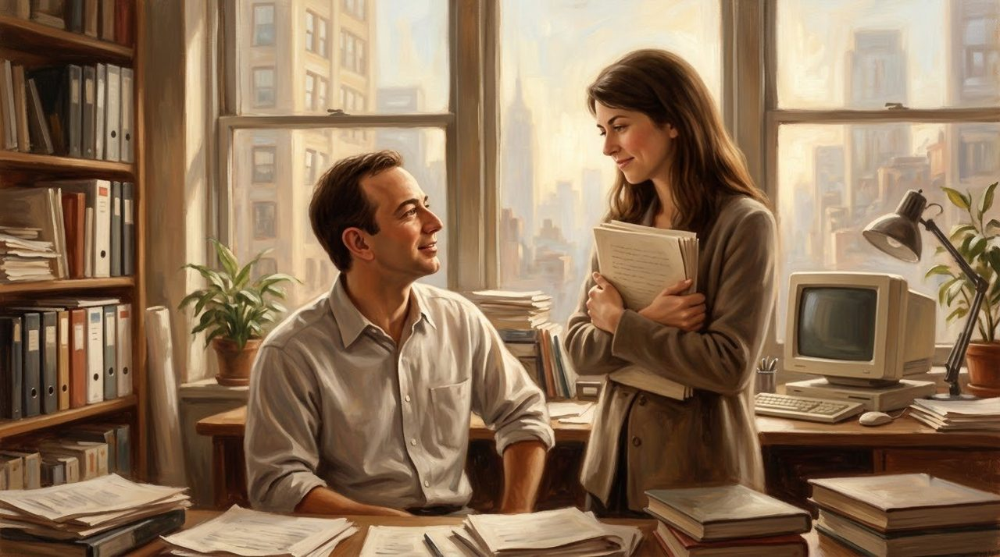<figcaption>At D. E. Shaw he met MacKenzie. When he told her the wild idea, she did not laugh. She listened.</figcaption></figure>

Then, in spring 1994, Jeff saw a number he could not forget: the web was growing at 2,300 percent a year. He listed 20 things to sell online and chose books: no bookshop could hold the world's millions of books, but a website could try.

Before deciding, Jeff tried a strange test. He imagined himself at 80, looking back. Would that old man be sorry he tried and failed - or sorry he never tried at all? He knew the answer at once. He left, giving up his big bonus and the safe road.

## Desks Made of Doors

In the summer of 1994, they drove west to Seattle, MacKenzie at the wheel, Jeff working on the business plan.

<figure>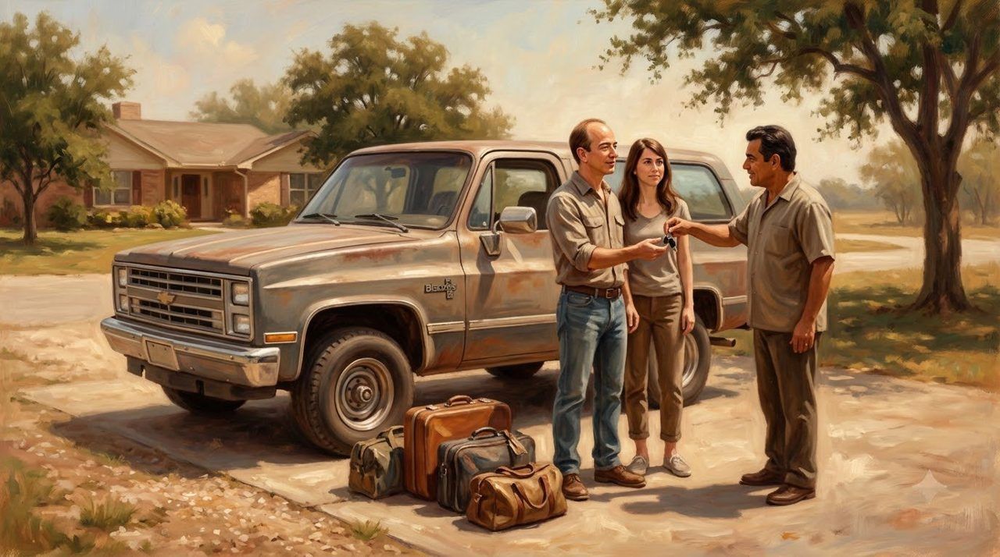<figcaption>A borrowed truck, a few bags, and a business plan written on the road west.</figcaption></figure> Seattle had smart young engineers, and stood near a giant warehouse of books in Oregon.

On July 5, 1994, Jeff started his company. Its first name was Cadabra, from the magic word Abracadabra. But on the phone, it sounded like Cadaver - a dead body. So Jeff opened a dictionary, searched the A words, and found the largest river in the world: Amazon.

The first office was a rented garage in Bellevue. Money was short, so the team made desks from cheap doors on four wooden legs. On July 16, 1995, Amazon opened to the world. In the first week, people bought 12,000 dollars of books. With every order, the computer beeped - until they turned the sound off. The orders never stopped. Within a month, it sold books in all 50 states and 45 countries, with no advertising at all.

<figure>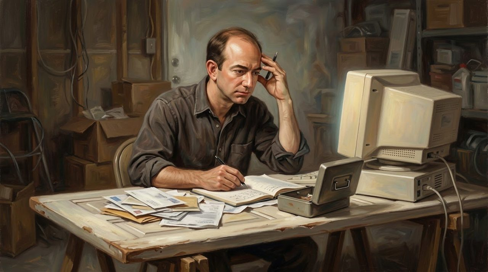<figcaption>The famous desk: a cheap door on four wooden legs, in a rented garage, with the bills never far away.</figcaption></figure>

## A Seventy Percent Chance

Growth ate money. Jeff went to the two people he trusted most: his mother and Mike. He told them the truth - a 70 percent chance they would lose everything. They listened in silence - and gave him 245,573 dollars, much of their savings. About 60 people were asked; most said no. Twenty-two said yes, giving about one million dollars.

On May 15, 1997, Amazon went public at 18 dollars a share. Yet its own papers warned buyers: Amazon may never make a profit. People bought anyway, because Jeff was building for the long term. His yearly letter carried two famous words: Day 1 - always move like a company just beginning.

<figure>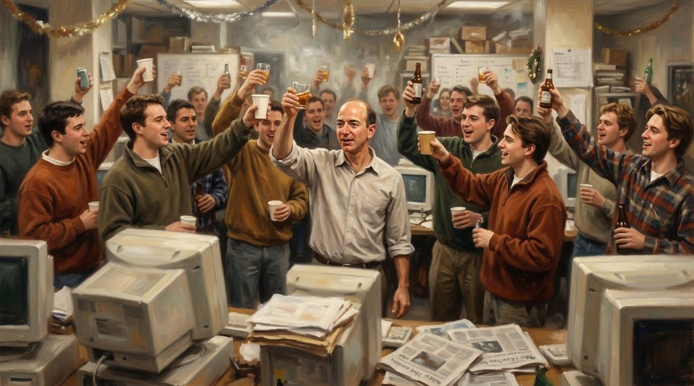<figcaption>May 1997: the little bookshop goes public, and the team raises a glass. The papers still warned it might never profit.</figcaption></figure>

## From $113 to Six Dollars

By December 1999, one Amazon share had climbed near 113 dollars. Then the internet bubble broke. Money Amazon had borrowed in February 2000 became its lifeboat. Still, in January 2001, it cut 1,300 jobs. By autumn 2001, the price had fallen to about six dollars, and many believed Amazon would not survive.

<figure>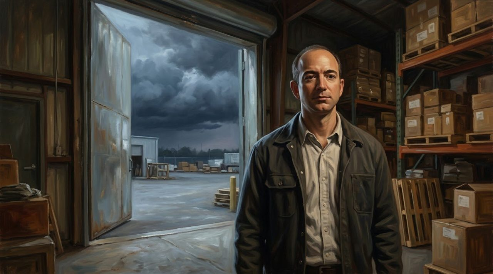<figcaption>From 113 dollars to about six: the storm years, when many believed the story was over.</figcaption></figure>

But at the end of 2001 came the first quarterly profit: five million dollars - one cent for every share. One cent, after years of struggle. It mattered. In 2003, Amazon finished a whole year in profit for the first time.

## More Than a Bookshop

Survival was only the beginning. In February 2005, Amazon launched Prime: for 79 dollars a year, many orders arrived free in two days. In 2006 came Amazon Web Services: renting computer power over the internet - an invisible business, built by a bookshop. And on November 19, 2007, the Kindle arrived: a small reading machine with a screen like paper. It cost 399 dollars and sold out in less than six hours.

<figure>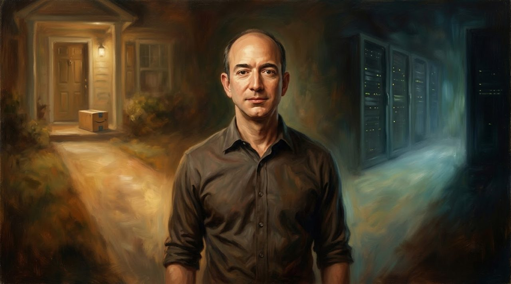<figcaption>More than a bookshop: a box on your doorstep, and an invisible cloud of computers behind it.</figcaption></figure>

On July 5, 2021, Jeff stepped down as CEO, exactly 27 years after starting the company. Fifteen days later, he flew to space with his rocket company, Blue Origin.

## What This Story Teaches Us

- **Ask your future self before you choose.** At 30, Jeff imagined being 80, and knew he could live with failing, but never with not trying.
- **Start small, and use what you have.** In a rented Bellevue garage, the first desks were cheap doors on wooden legs - and the team still opened its store.
- **Being kind is harder than being clever.** He learned it young, on his grandfather's Texas ranch, laying pipes and fixing windmills under the hot sun.

## The Empty Chair

In Amazon meetings, one old story tells of an empty chair, standing for the customer - not in the room, but the person who mattered most.

Jeff made his biggest choice for someone who was not in the room, too: the old man he would one day become. Before taking the safe road, he asked that man a question. Will you be sorry?

<figure>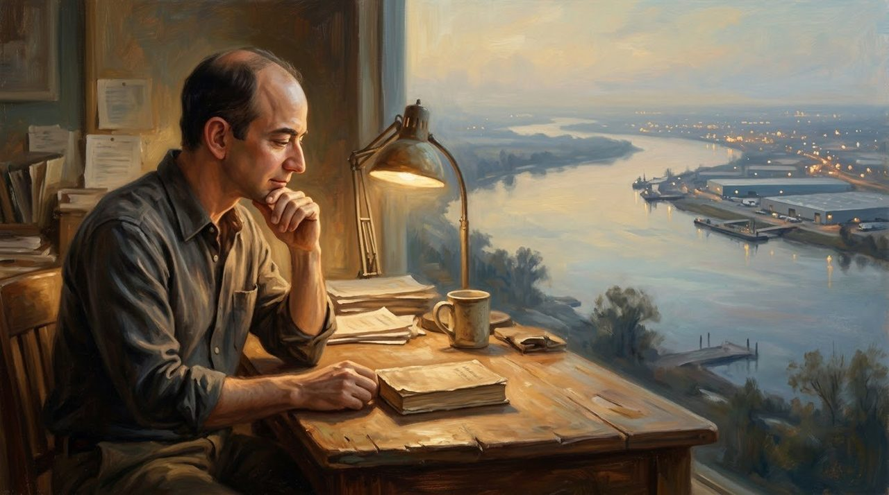<figcaption>The question he asked his 80-year-old self still waits at the desk every morning. Day 1.</figcaption></figure>

My friend, maybe we all need one empty chair. A chair for the people we serve. A chair for the people we love. And a chair for our future selves, waiting quietly at 80, hoping we were brave.

Tomorrow can still be Day 1.
