In 2008, Elon Musk stood between two failing dreams. His rocket company had launched three rockets, and all three had failed. His electric car company was running out of money, and so was he. One more failure, and everything could end.

How did a man who began by selling a small computer game come so close to losing it all - and what happened next? This is the story of Elon Musk.

<figure>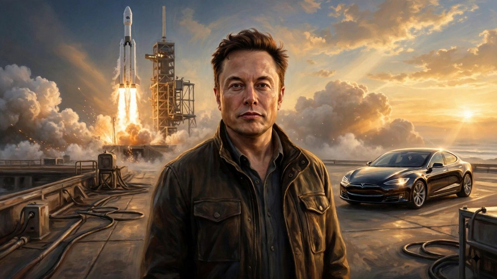<figcaption>Two dreams at once: the rocket rising behind him, the electric car beside him.</figcaption></figure>

## A Quiet Boy With a Computer

Elon Musk was born on June 28, 1971, in Pretoria, South Africa. He was a quiet child who loved books and computers. School was not easy for him. Other children bullied him, and he often spent time alone. Books gave him a way to travel far beyond the world around him.

<figure>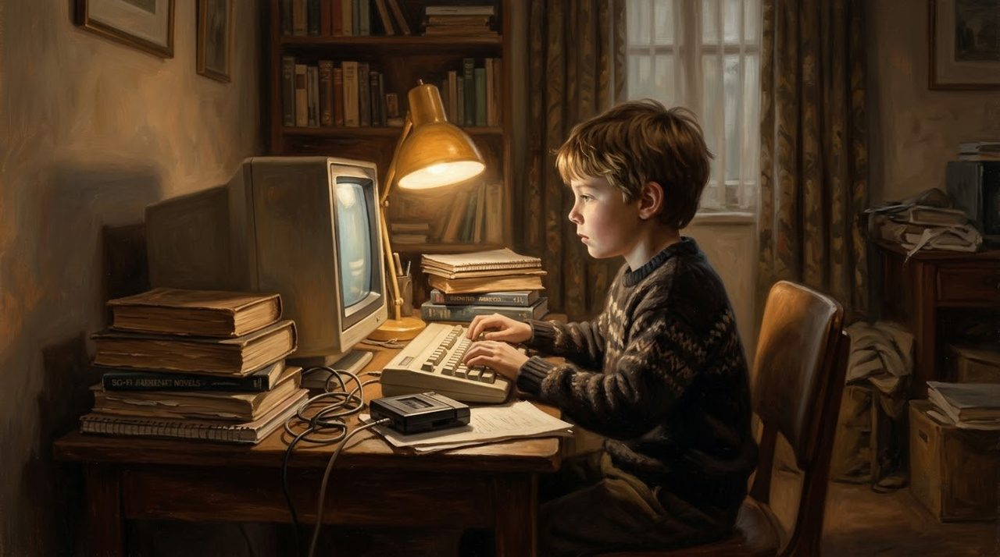<figcaption>Pretoria: a quiet boy, an old computer, and a tall stack of other worlds.</figcaption></figure>

Then he found programming. When Musk was about twelve, he created a simple video game called Blastar. He sold the code to a computer magazine for around 500 dollars. It was a small thing. But for the first time, an idea in his head had become something real - something a stranger would pay for.

<figure>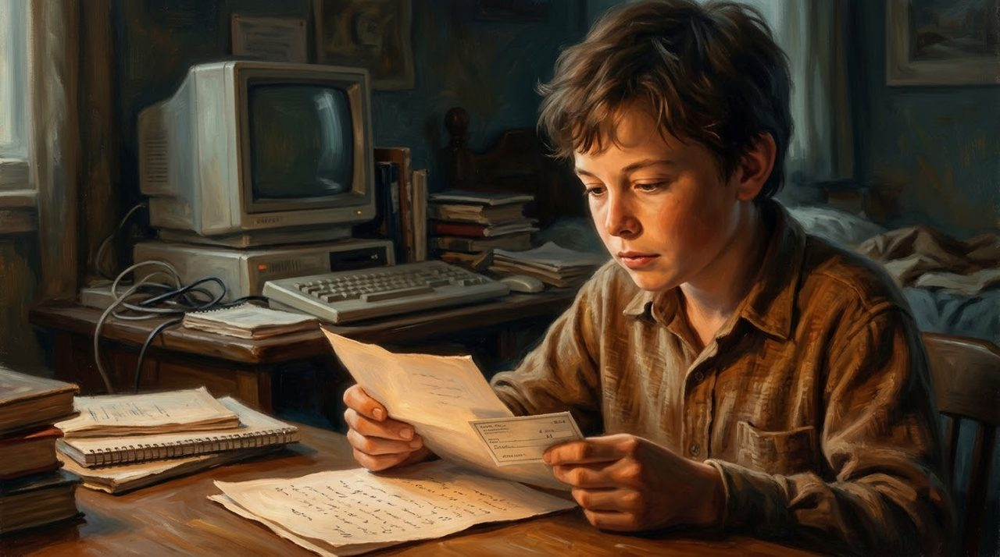<figcaption>Five hundred dollars for a simple game called Blastar: the first proof that an idea could become real.</figcaption></figure>

## The Safe Path, Left Behind

As a teenager, Musk left South Africa for Canada. He later studied at the University of Pennsylvania in the United States, learning physics and economics. Physics taught him the rules of the physical world. Economics taught him how money and markets move. Both would matter later, more than he could know.

<figure>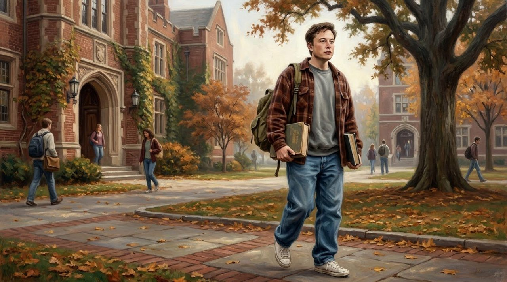<figcaption>Physics in one hand, economics in the other: the student years that quietly prepared everything.</figcaption></figure>

After university, he entered a graduate program at Stanford in California - and left after only a short time. The internet was growing fast, and he wanted to build. In 1995, he and his brother Kimbal started Zip2, which made online maps and business directories for newspapers. In 1999, Compaq bought Zip2, and Musk had his first major fortune.

<figure>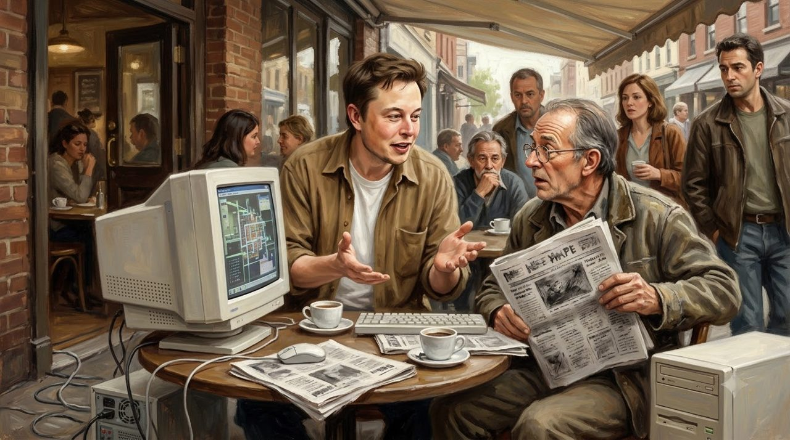<figcaption>Zip2: maps and directories for newspapers, sold cafe table by cafe table.</figcaption></figure> He could have stopped there. He did not.

## Losing the Company He Helped Build

His next idea was money itself. He helped start X.com, an online financial company. It later joined with the company whose payment service became PayPal. But the road was rough. The leaders did not always agree, and in 2000, Musk was replaced as CEO of the company he had helped create.

<figure>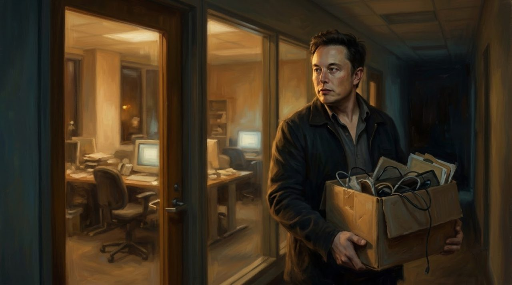<figcaption>The company he helped build, the box he carried out of it: losing control hurt more than losing money.</figcaption></figure>

He had lost control. All he could do was watch. Yet the service kept growing, and in 2002, eBay bought PayPal. Musk's share became a second fortune. Now he had the money to try something far harder: rockets, and electric cars.

## Two Bets That Nearly Broke Him

In 2002, Musk founded SpaceX. He wanted to make spaceflight cheaper, and one day help humans travel to Mars. Tesla had been founded in 2003 by Martin Eberhard and Marc Tarpenning, to build electric cars. In 2004, Musk invested in Tesla and became its chairman. He believed an electric car could be fast and exciting, not slow and dull.

<figure>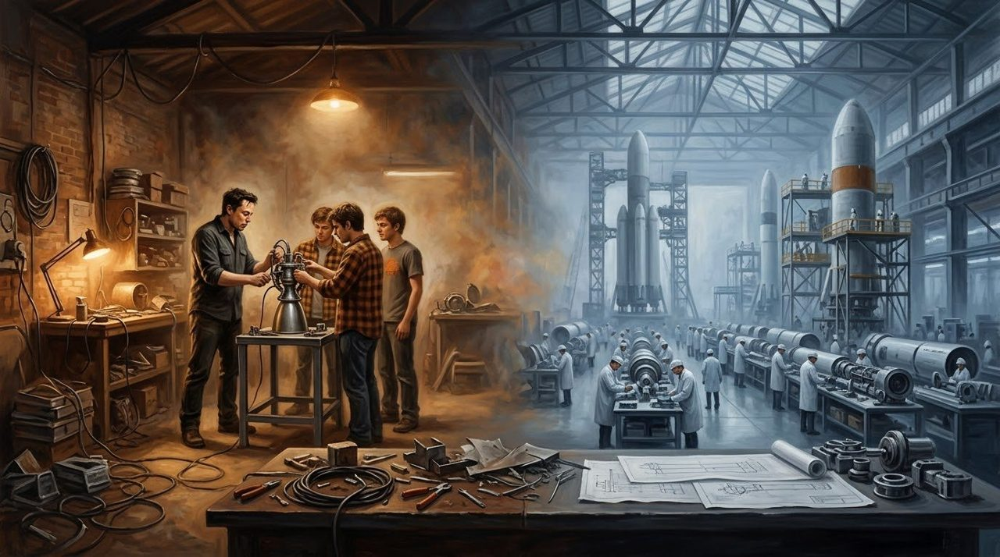<figcaption>It began in a small workshop with a rocket engine on a stand. It did not stay small.</figcaption></figure>

Rockets and cars burned money. SpaceX's first rocket, Falcon 1, failed on its first launch. It failed on its second. In August 2008, it failed a third time. At the same moment, Tesla was struggling to build its first car, the Roadster, while the financial crisis made money almost impossible to find. Musk had put much of his own wealth into both companies. There was no rich parent company waiting to save them.

<figure>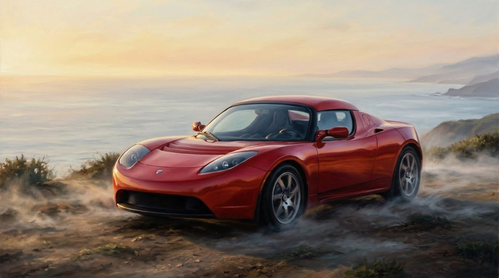<figcaption>The Roadster: fast, beautiful, and nearly impossible to build. Tesla's first dream on wheels.</figcaption></figure>

## The Fourth Rocket

In September 2008, SpaceX tried once more. The fourth Falcon 1 lifted off - and this time, it reached orbit. It was the first privately developed liquid-fuel rocket ever to do so. In December, NASA gave SpaceX a contract worth about 1.6 billion dollars to carry cargo to the International Space Station. Tesla, too, found new financing in the last days of 2008. Neither company was safe. But both were alive.

The years after brought sights few people forget. In December 2015, a Falcon 9 first stage fell back from space, fired its engines again, and landed standing upright - a rocket that could fly again instead of being thrown away.

<figure>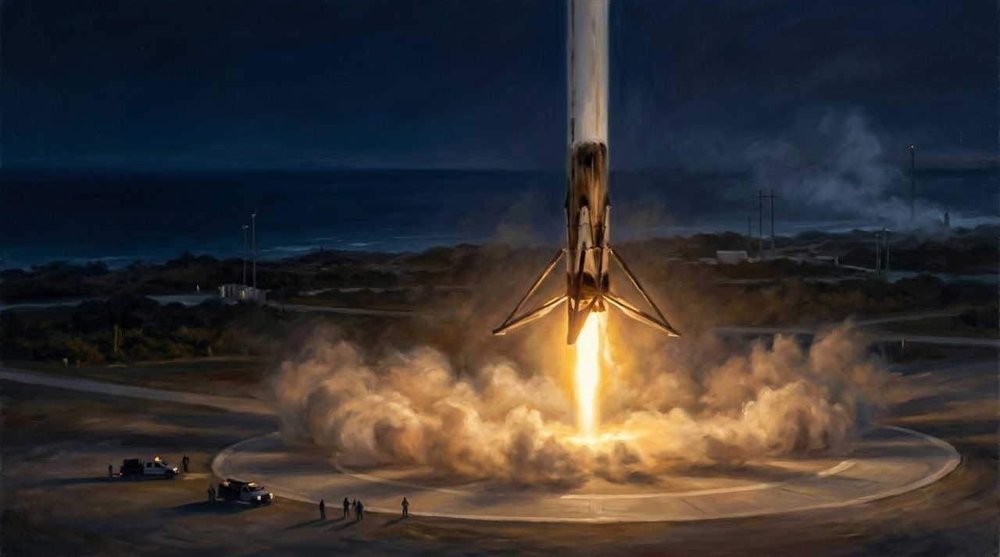<figcaption>December 2015: the rocket came back from space and landed standing up, like something from his childhood books.</figcaption></figure> In 2020, SpaceX carried NASA astronauts to the space station, the first private company ever to fly people into orbit. And above it all still hangs the biggest dream: Mars, and a giant new rocket called Starship, still being tested today.

<figure>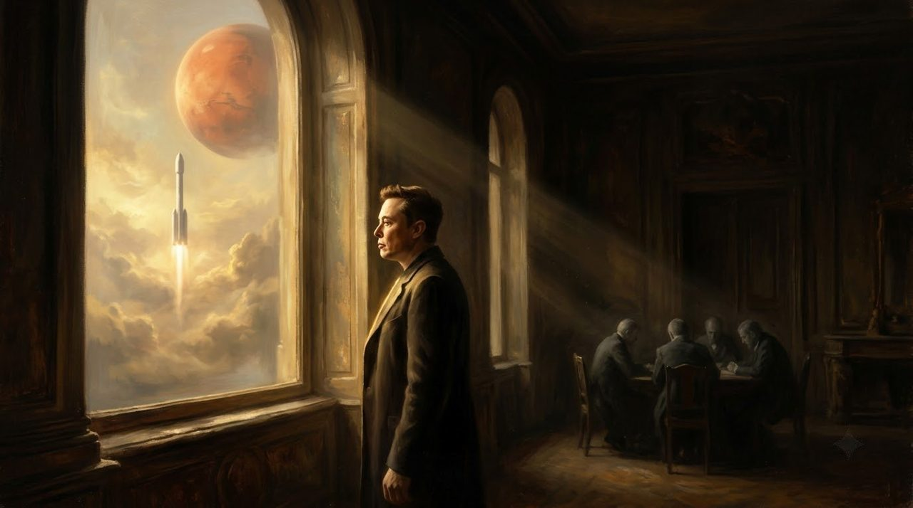<figcaption>Above every contract and every car, the dream that started it all still hangs in the sky: Mars.</figcaption></figure>

## What This Story Teaches Us

- **Start small, but start with something real.** At about twelve, Musk wrote a simple game called Blastar and sold the code for around 500 dollars. Big stories often begin with one small, finished thing.
- **Losing control does not have to end the story.** In 2000, Musk was removed as CEO of the company he helped create. Two years later, PayPal was sold to eBay, and that painful chapter gave him the money for everything that came next.
- **One more try can change everything.** Falcon 1 failed three times. The fourth launch reached orbit, won a contract with NASA, and kept SpaceX alive.

## An Idea Is Only the Beginning

Think of that twelve-year-old boy again, selling his little game for a few hundred dollars. He could not see rockets, or electric cars, or Mars. He only had an idea, and the wish to make it real.

Maybe your dream feels too big for the world around you. This story does not promise that big dreams come true. It shows something quieter: an idea, however bold, is only the beginning. Someone still has to build it, test it, watch it fail, and build it again.

The dream matters. But the work is what makes the dream true.

<figure>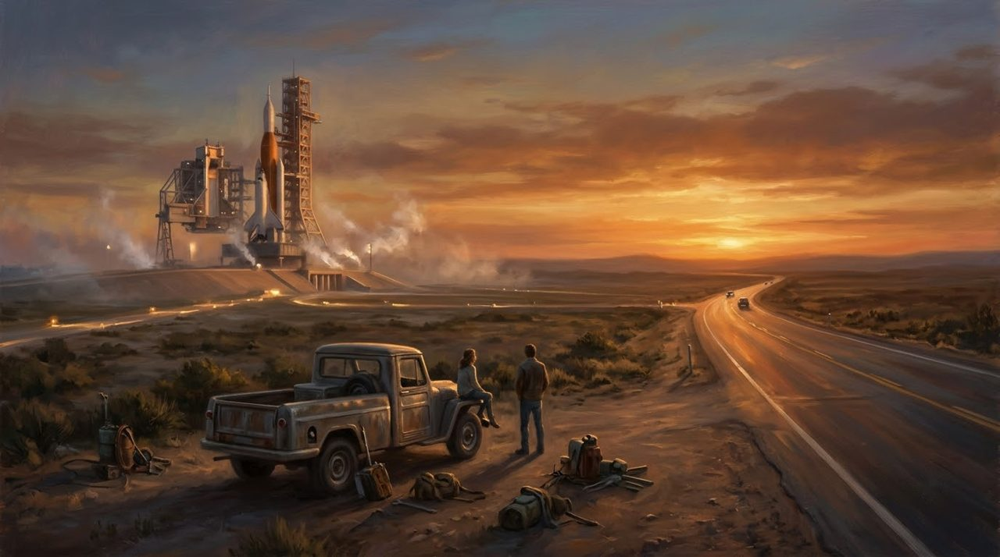<figcaption>Somewhere tonight, someone is standing by a road, watching a rocket, and dreaming. The work begins there.</figcaption></figure>
