Let me ask you something. Which do you like more, Pepsi or Coca-Cola? Today they are two of the most famous drinks in the world, standing side by side.

[Coca-Cola](/stories/history-of-coca-cola/) came first. Pepsi arrived years later, lost its creator, and went bankrupt twice. So how did a drink that nearly died find a way to stand beside the most famous drink on Earth? This is how Pepsi started.

<figure>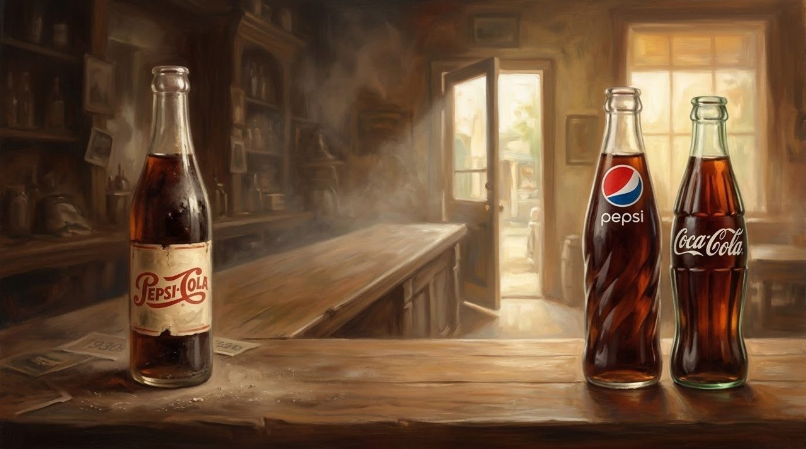<figcaption>One counter, two centuries: the old Pepsi-Cola bottle, and the two rivals standing side by side today.</figcaption></figure>

## Brad's Drink

In 1893, in the small town of New Bern, North Carolina, a young pharmacist named Caleb Bradham worked behind his drugstore counter. Seven years earlier, [Coca-Cola](/stories/history-of-coca-cola/) had been created in Atlanta.

He had once dreamed of becoming a doctor, but money trouble in his family changed his plans, and he studied pharmacy instead. In those days, people met friends at the pharmacy soda fountain for a cold drink. Bradham loved to experiment, and in 1893 he created a sweet, bubbling drink his customers called Brad's Drink.

<figure>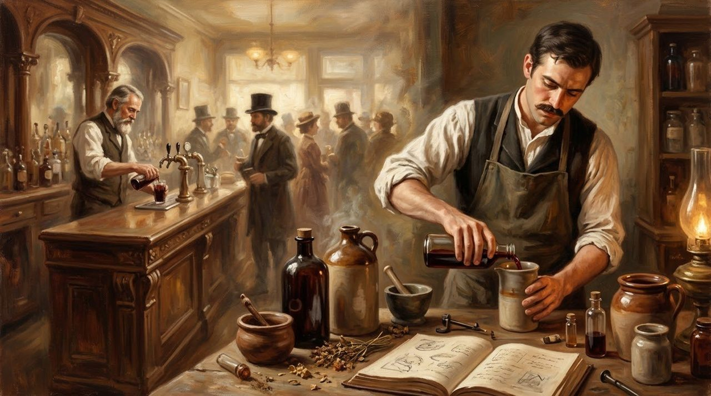<figcaption>New Bern, 1893: behind the counter of his own pharmacy, a young pharmacist mixes a drink his customers will name for him.</figcaption></figure>

In 1898, he gave it a new name: Pepsi-Cola. In 1902 he founded the Pepsi-Cola Company, and the next year the name became an officially registered trademark.

## Bottles Across America

Bradham's answer to distance was the bottle. Instead of serving Pepsi only in his shop, he sent syrup to local owners in other towns. They mixed it, filled glass bottles, and sold Pepsi under their own roofs.

By 1910, hundreds of bottlers in 24 states were selling it. A drink once served in one small shop could now reach families in towns Bradham would never see.

<figure>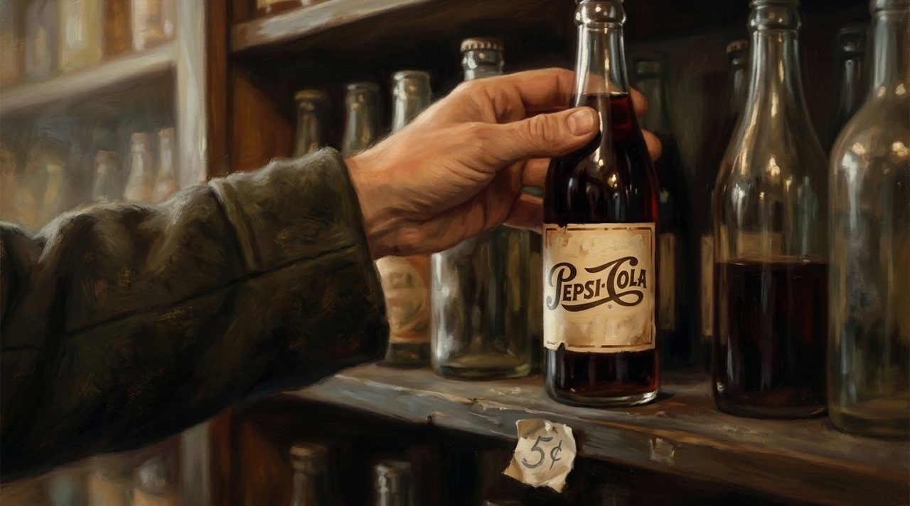<figcaption>Five cents a bottle, and the drink could travel: into shops and towns its maker would never see.</figcaption></figure>

## The Sugar Mistake

That ingredient was sugar. After the First World War, sugar prices rose sharply, and Bradham feared they would keep rising. To protect his company, he bought large supplies at high prices.

<figure>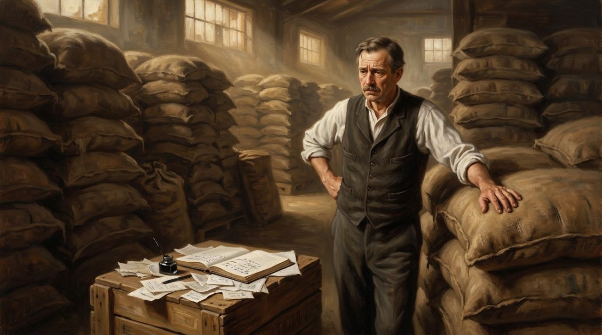<figcaption>The sugar gamble: warehouses full of sugar bought at high prices, and an account book that would not forgive.</figcaption></figure>

He was wrong. Sugar prices collapsed, and his sugar was worth much less, while his bills stayed the same. In 1923, the Pepsi-Cola Company went bankrupt. Bradham lost his business and returned to his pharmacy counter in New Bern.

Roy Megargel, a New York businessman, bought the Pepsi rights and tried again. Then, in 1929, the American economy crashed. In 1931, Pepsi went bankrupt a second time. Bradham died in 1934, at 66, before his drink's greatest years.

<figure>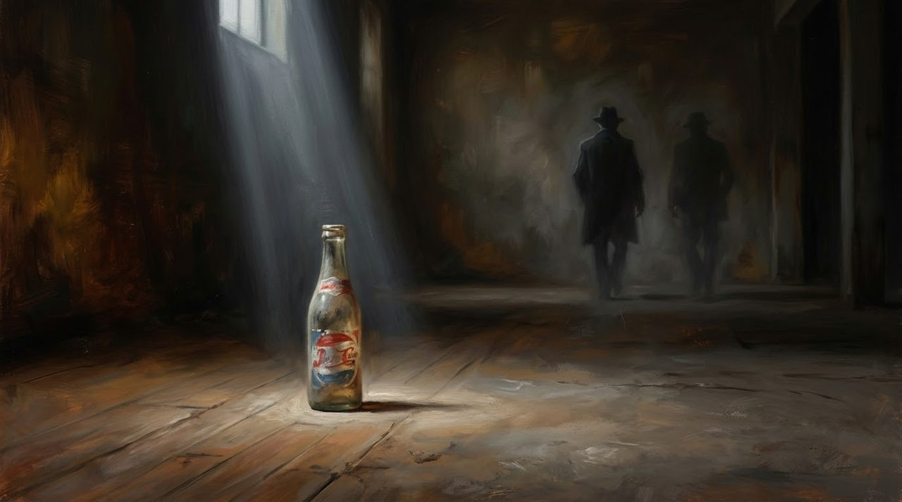<figcaption>Bankrupt twice, its creator gone. The bottle was left behind in the dark. It waited.</figcaption></figure>

## Twice the Drink for the Same Five Cents

The next chance came from a man who sold candy. Charles Guth ran the Loft candy shops, which bought large amounts of Coca-Cola syrup. He believed a big customer deserved a better price. Coca-Cola refused, so Guth helped bring Pepsi back instead.

In 1934, customers could buy 12 ounces of Pepsi for 5 cents, about twice a Coca-Cola bottle for the same price. For a family counting every coin in the Depression, the difference was easy to see.

<figure>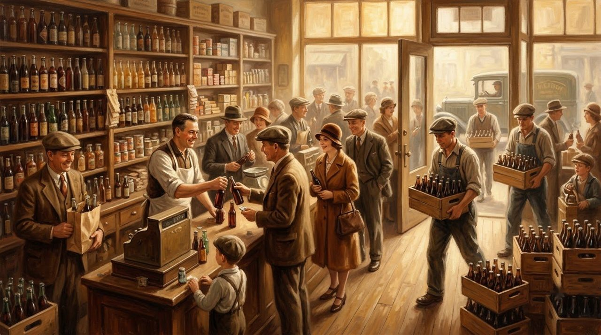<figcaption>Twice the drink for the same five cents: in the hard years, that was a promise a family could count.</figcaption></figure> Pepsi did not have to beat the famous name; it gave people a different reason to choose it.

Sales grew, and a radio song in 1939 carried the same promise into people's homes. That year, a court ruled the disputed Pepsi shares belonged to Loft, not Guth. The man who helped save Pepsi lost control of it, but his bigger bottle had changed Pepsi's future.

<figure>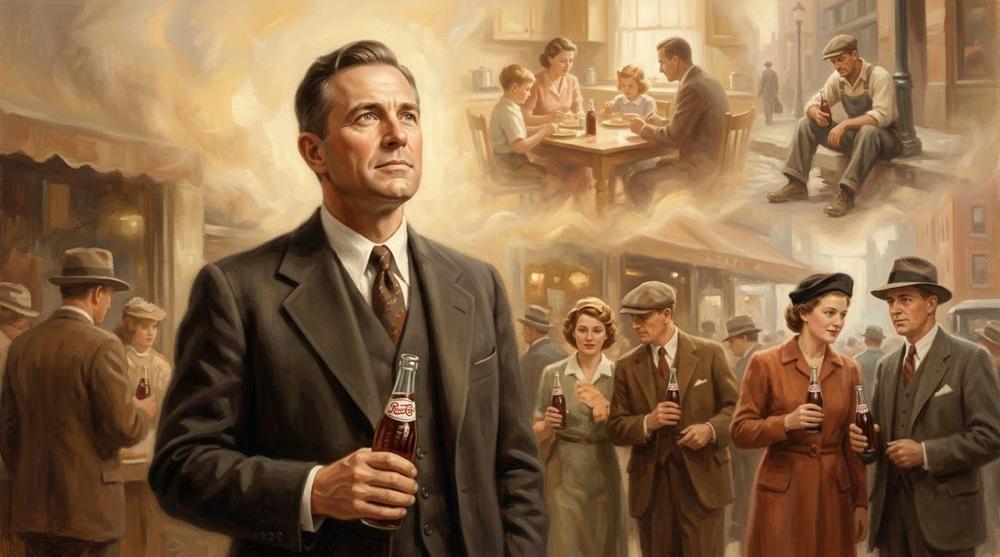<figcaption>New hands carried the bigger bottle into homes, lunch breaks, and family tables across America.</figcaption></figure>

## Respect, and a Cup in Moscow

Pepsi also learned to see customers that other companies ignored. In 1947, Edward Boyd joined Pepsi to lead a special sales team reaching Black communities. Their advertisements showed doctors, teachers, and families, with dignity, when few companies did. Yet the men who carried those advertisements still faced doors they could not enter, in a country where laws kept people apart.

In 1959, at an American exhibition in Moscow, Pepsi executive Donald Kendall arranged for Soviet leader Nikita Khrushchev to taste Pepsi while cameras watched. In the middle of the Cold War, the photograph surprised everyone. In 1972, Pepsi reached a trade agreement with the Soviet Union. Two years later, Pepsi was being bottled and sold there.

By 1963, Pepsi was calling itself the drink of a new generation.

<figure>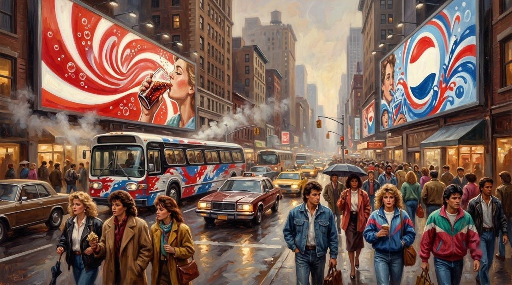<figcaption>The drink of a new generation: Pepsi learned to speak to the young, in their own blue.</figcaption></figure>

## Bigger Than Cola

In 1965, Pepsi-Cola joined with Frito-Lay, the snack company of Herman Lay, to create PepsiCo.

<figure>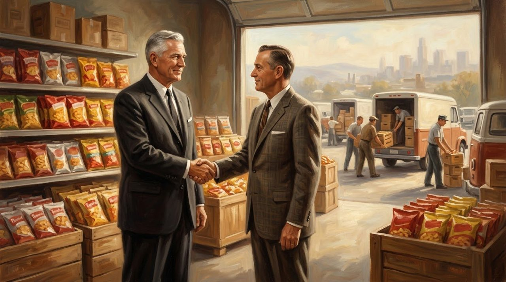<figcaption>1965: a cold drink shakes hands with a salty snack, and PepsiCo is born.</figcaption></figure> A cold drink and a salty snack belonged to the same moment, and now to the same company. Pepsi's future no longer depended on cola alone.

The old rivalry still burned. In 1975, the Pepsi Challenge invited people to taste two colas without seeing the names, and many chose Pepsi. In 1985, Coca-Cola changed its famous taste, called it New Coke, then brought the old taste back after angry customers spoke up. Pepsi had not won the cola war, but it had earned its place in the fight.

It bought Pizza Hut, Taco Bell, and KFC, then in 1997 separated the restaurants again to focus on drinks and snacks. Tropicana and Quaker Oats, with Gatorade, followed. In 2025, PepsiCo reported about 93.9 billion dollars in revenue, more than half from snacks and foods, not drinks.

<figure>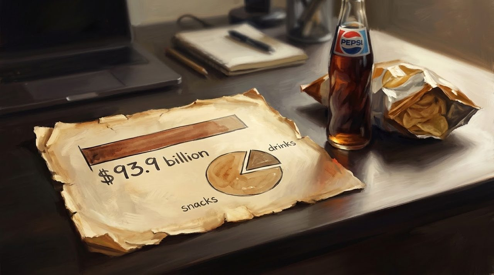<figcaption>Today the snack is bigger than the drink: more than half of PepsiCo's 93.9 billion dollars now comes from food.</figcaption></figure>

## What This Story Teaches Us

- **Being second is not the same as being beaten.** Pepsi arrived years after Coca-Cola and survived two bankruptcies, yet still earned a lasting place beside its older rival.
- **A clear, simple reason beats a famous name.** In 1934, Pepsi offered 12 ounces for 5 cents, twice the drink for the same money, and struggling families understood it at once.
- **Respect can open doors that money cannot.** Edward Boyd's team showed Black customers as doctors, teachers, and families in 1947, when most advertisements ignored them.

## You Do Not Have to Be First

Think back to Caleb Bradham's little pharmacy in New Bern. He watched customers take their first taste, never knowing how far that little drink would travel. He lost the company he created and never saw its greatest success. But his drink survived. Other people kept finding reasons to believe in it.

<figure>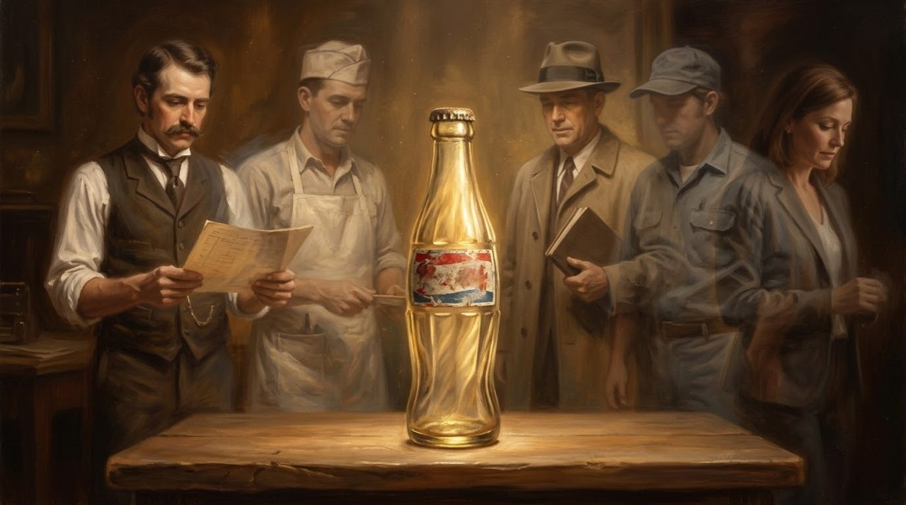<figcaption>The drink that refused to die: every era left someone beside the bottle, still believing in it.</figcaption></figure>

My friends, have you ever felt that someone else was already too far ahead of you? Remember those two bottles on the shelf. One came first. The other took a different road. You do not have to be first to find a place of your own.
