Have you ever turned a Heinz ketchup bottle upside down and waited for the sauce to come out? Nothing happens. So you tap the little number 57. And slowly, the ketchup begins to move.

It is one of the most familiar bottles in the world. But behind it stands Henry Heinz, a man who once lost almost everything: his business, his money, and the trust of his friends. He spent years rebuilding his life, and built one of the most trusted food brands on Earth. This is how Heinz started.

<figure>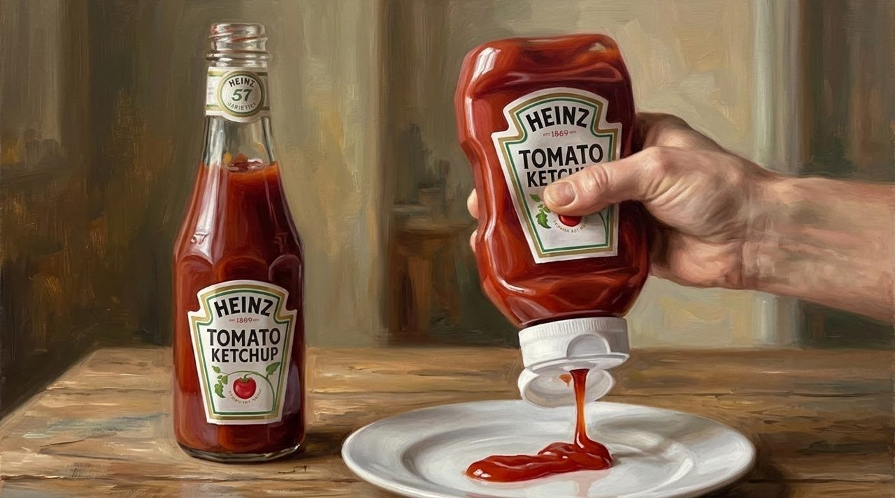<figcaption>The bottle the world knows: glass yesterday, squeeze plastic today. The sauce inside is still made the way Henry demanded.</figcaption></figure>

## A Boy in His Mother's Garden

Henry John Heinz was born in 1844 in Pittsburgh, the oldest child of German parents. When he was five, the family moved to Sharpsburg, a town along the river. His father made bricks. His mother, Anna, kept a garden, and the boy pulled vegetables from the soil to sell to grocers in town.

<figure>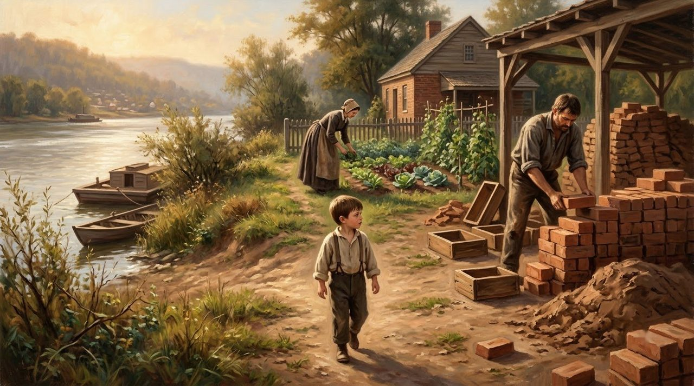<figcaption>Sharpsburg, by the river: bricks from his father, a garden from his mother. Henry grew up between the two.</figcaption></figure>

One plant burned his nose and made his eyes water: horseradish, a white root with a hot, sharp taste. Anna had her own recipe for it, and young Henry began selling her grated horseradish to grocers and hotel kitchens.

<figure>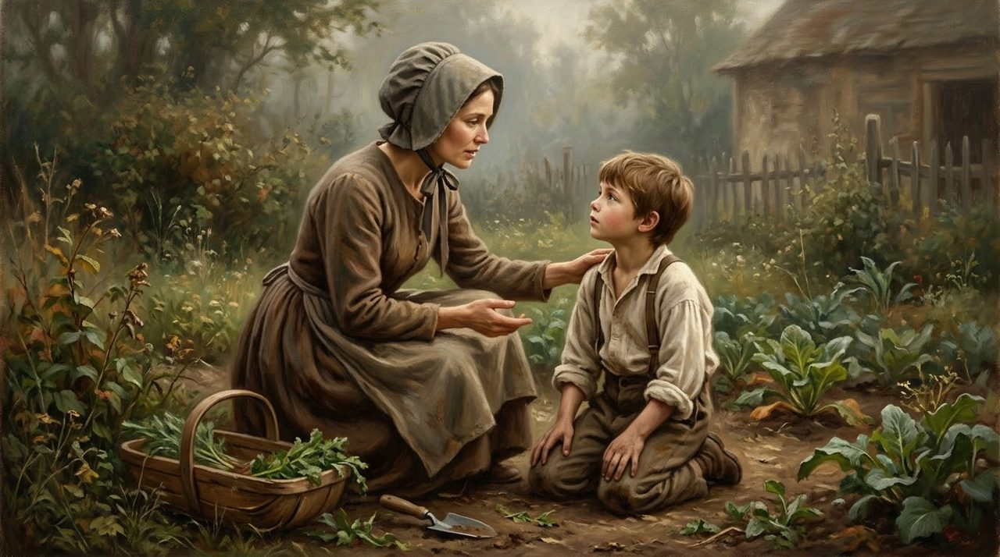<figcaption>Anna and her boy in the garden. Her horseradish recipe became his first product, and honesty his first lesson.</figcaption></figure>

## The Man Who Let You See Inside

In those days, most food jars were green or brown glass, and some sellers used the darkness to hide cheap fillings: turnips, leaves, even pieces of wood.

He chose clear glass, even though it cost more. Customers could see exactly what they were buying. No turnips. No leaves. Just fresh, white horseradish. His simple idea earned their trust: he let them look inside.

<figure>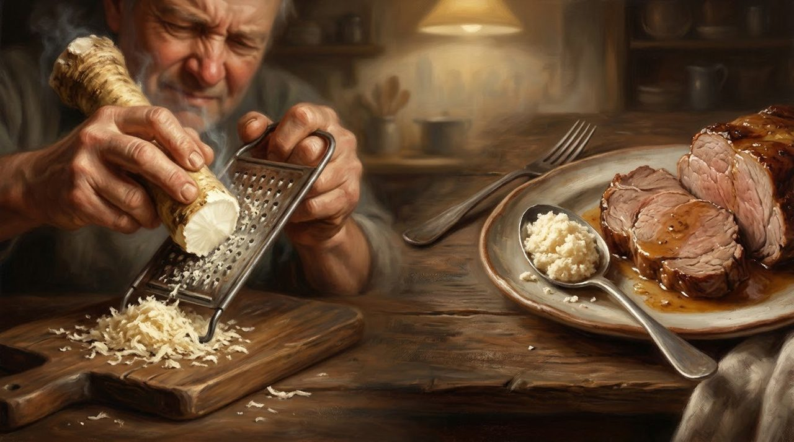<figcaption>Nothing to hide: fresh, white horseradish in clear glass, so every customer could judge it with their own eyes.</figcaption></figure>

In 1869, at 24 years old, he started a company with L. Clarence Noble in the basement of his parents' house. They named the brand Anchor, for hope.

## The Christmas He Lost Everything

By 1872 the young company had 100 workers, selling pickles, vinegar, and horseradish. But Henry had promised to buy a huge Illinois cucumber crop. Then a money panic hit America, and the harvest came in far bigger than expected. He still had to pay for every cucumber.

Just before Christmas in 1875, he went bankrupt. His company owed 160,000 dollars and had only 110,000 dollars in assets. His parents lost their savings. Three grocers he had known for years refused his family food on credit.

<figure>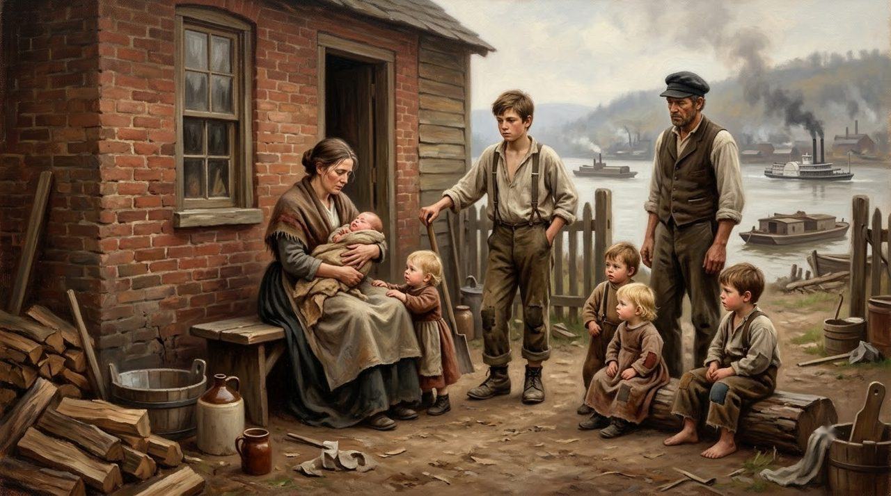<figcaption>The winter of 1875: the savings gone, and even old friends turning the family away.</figcaption></figure> On Christmas Day, he wrote in his diary that a man without money is nowhere.

## The Little Notebook

On February 14, 1876, his brother John and his cousin Frederick borrowed 3,000 dollars and started a new company, F and J Heinz. Henry owned nothing in it. He worked only as its manager, paid 125 dollars a month.

But in his pocket he carried a small notebook. On the cover were two letters: M and O, for Moral Obligations. Inside was the name of every person his old company owed. Slowly, one name at a time, he began to pay.

<figure>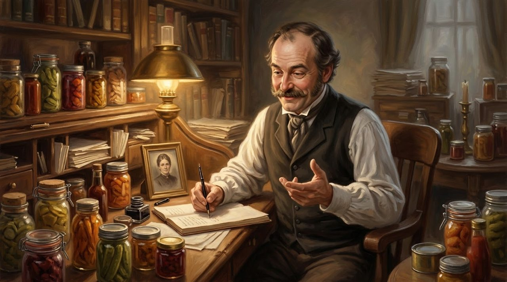<figcaption>Nine years of writing, working, and paying. One name at a time, the notebook grew shorter.</figcaption></figure>

It took nine long years. On February 3, 1885, Henry was free of his bankruptcy. That day, he wrote one line in his diary: "Thank God I am a free man." He was 40 years old.

## 57 Varieties

In 1886, Henry sailed to England with seven products. A buyer at Fortnum and Mason tasted them and took all seven.

<figure>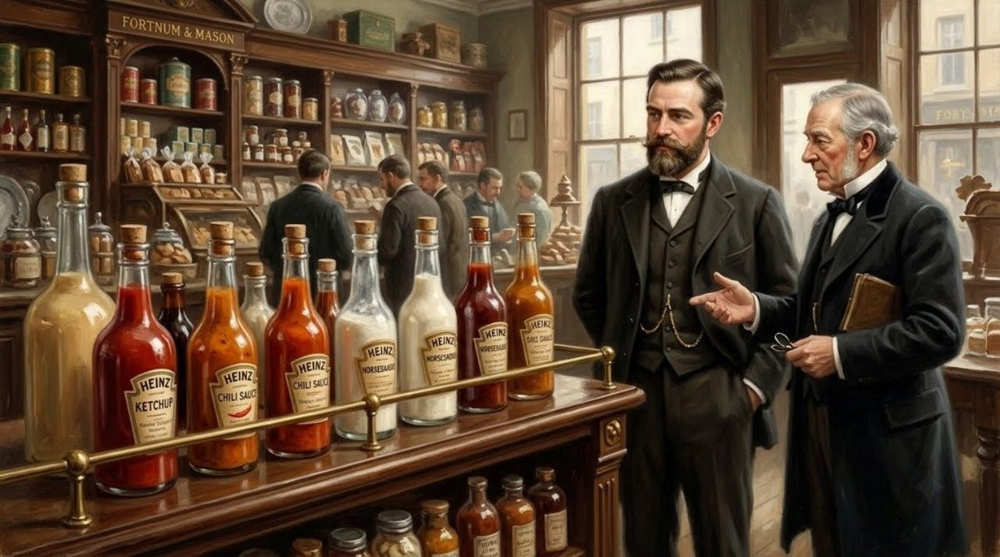<figcaption>London, 1886: seven products in a suitcase, and Fortnum and Mason took every one.</figcaption></figure> In 1888, Henry bought the business back and gave it his own name: the H. J. Heinz Company.

At the World's Fair in Chicago in 1893, his upstairs booth stood almost empty, until he offered a free gift: a tiny green pickle pin. By the end of the fair, he had given away more than a million of them.

Riding a train above New York three years later, Henry saw a shoe advertisement: "21 styles." His company made more than 60 products, but he chose the number 57: five was his lucky number, and seven was his wife's. Heinz never had exactly 57 varieties. But nobody ever forgot the number.

<figure>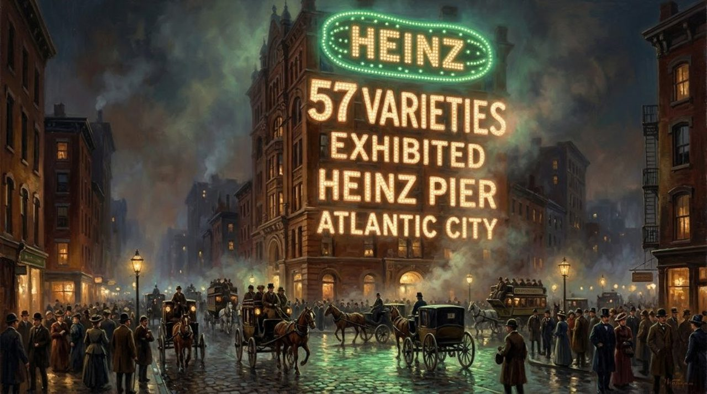<figcaption>57 Varieties, in lights above Atlantic City. The number was never a count. It was a promise people remembered.</figcaption></figure>

## What Clear Glass Could Not Show

For years, ketchup makers used a chemical, benzoate of soda, to keep sauce from spoiling. Government chemist Harvey Wiley believed it was dangerous and wanted it out of food. Around 1900, Henry gave his team a hard challenge: make ketchup that stays fresh without it.

The first attempts failed. Others built up so much pressure that their corks popped out. But the team kept trying, with ripe tomatoes, more vinegar and sugar, and everything kept very clean. By 1906, Heinz was making five million bottles a year with no benzoate, and that June the Pure Food and Drug Act became law.

<figure>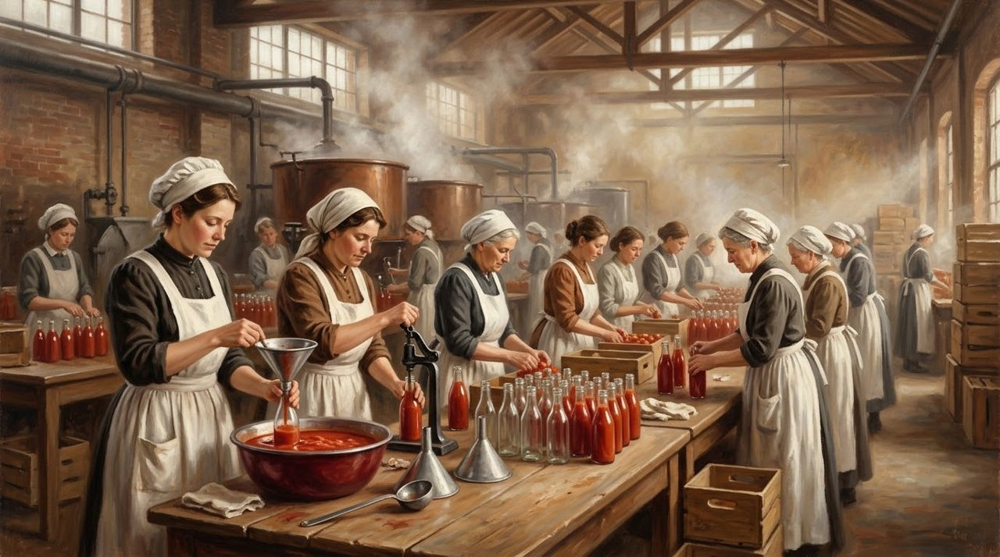<figcaption>Clean hands, clean uniforms, clean food: the factory floor where ketchup learned to keep without chemicals.</figcaption></figure>

His workers had clean uniforms, showers, a free doctor, and a garden on the factory roof. Henry Heinz died on May 14, 1919, at 74. Today, about 650 million bottles of Heinz ketchup are sold each year, in more than 140 countries.

<figure>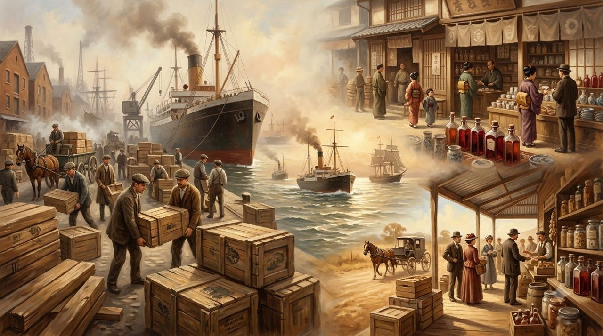<figcaption>From a Sharpsburg basement to more than 140 countries: the crates kept sailing.</figcaption></figure>

## What This Story Teaches Us

- **Let people see what you are selling.** While rivals hid turnips and leaves in dark bottles, Henry chose clear glass, though it cost more. Customers learned to trust his name, because they could look inside.
- **A debt you write down is a debt you can repay.** Bankrupt and owning nothing, Henry carried a Moral Obligations notebook with every name he owed, and paid them all back in nine years.
- **Good work still has to be discovered.** At the Chicago World's Fair in 1893, his upstairs booth stood empty until a free pickle pin pulled a million visitors up the stairs.

## The Promises He Never Forgot

Henry carried that small notebook in his pocket for years. It was full of names, and he paid them back one by one.

<figure>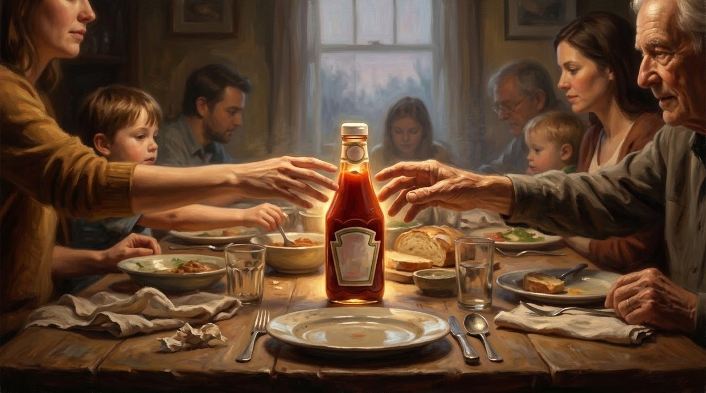<figcaption>And at the family table, the bottle is still passed from hand to hand, the way trust always is.</figcaption></figure>

My friend, we may never build a company like Heinz. But perhaps there is a promise in our own lives, still waiting. Henry could not change the day he lost everything. What he could choose was what to do next. And little by little, one name at a time, he made things right.

The next time you tap that little 57, remember Henry Heinz, and the promises he never forgot.
