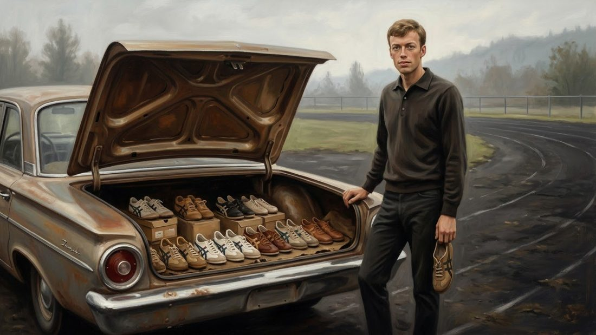
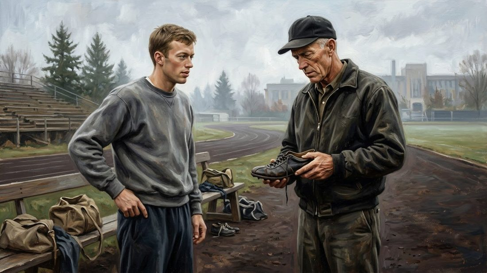
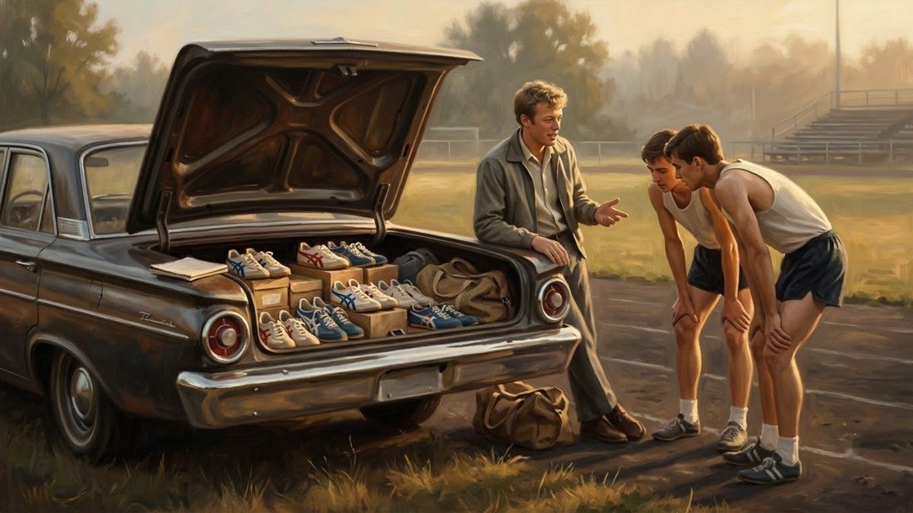
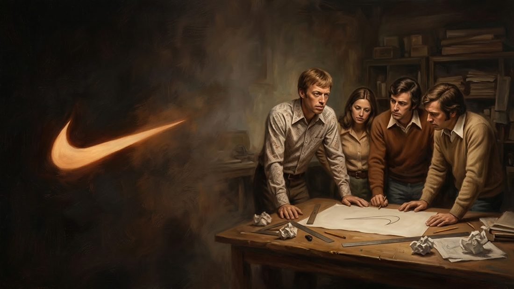
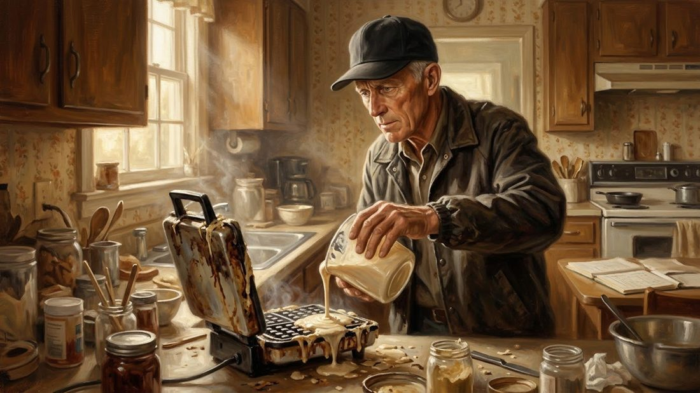
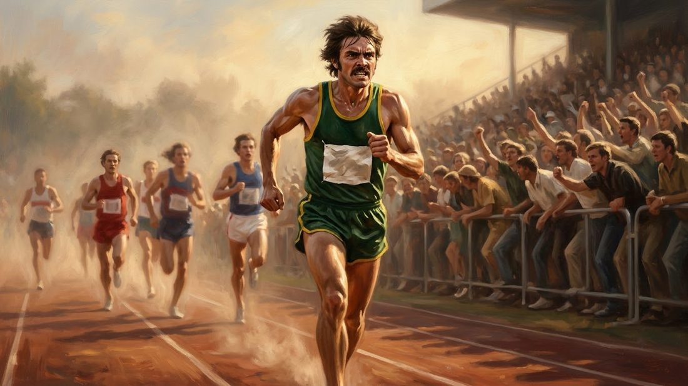
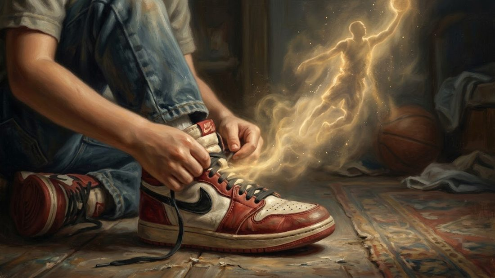
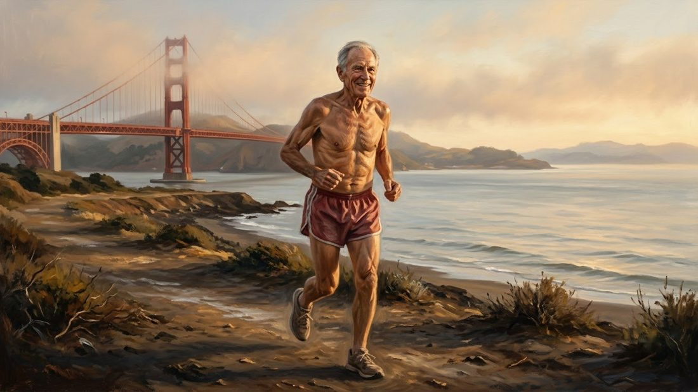

Have you ever dreamed of owning a pair of Nike shoes? But that famous curved mark did not begin in a giant factory. It began with a young man selling shoes from the back of his car.

He had no factory. He did not even make his own shoes. All he had was a dream: runners deserved something better. This is how Nike started.

<figure><figcaption>Phil Knight beside his car, the trunk full of shoes. Nike began with a runner selling to runners.</figcaption></figure>

## The Runner and the Coach

Philip Hampson Knight was born on February 24, 1938, in Portland, Oregon. As a boy, he was not great at sports, until his mother encouraged him to try running.

At the University of Oregon, he met coach Bill Bowerman, who could never leave a shoe alone. Bowerman cut shoes apart, changed them, and gave them to runners to test. A heavy shoe made every step harder. A rough edge could cut a foot.

<figure><figcaption>Coach Bill Bowerman could never leave a shoe alone - and young Knight watched, and learned.</figcaption></figure>

At Stanford, in 1962, he wrote a paper with one bold idea: cheap, well made Japanese shoes could beat the expensive German shoes ruling America. He flew to Japan and met the leaders of Onitsuka, maker of Tiger shoes. Asked which company he represented, he invented one on the spot: Blue Ribbon Sports.

## A Handshake and 1,000 Dollars

On January 25, 1964, Knight met Bowerman for lunch in cold, rainy Portland. Each man put in 500 dollars. With 1,000 dollars in total, they could not build a factory. They could only order shoes and sell them in person.

Knight drove to track meets, opened the trunk of his car, and laid out rows of shoes. He had run the same races and felt the same pain in his legs, so runners trusted him.

<figure><figcaption>Knight opened his trunk at track meets and sold shoes face to face, to runners whose pain he knew himself.</figcaption></figure>

Jeff Johnson, the first full time employee, wrote each customer's name and shoe size on a card, then wrote them personal letters about their races. He was not building a list. He was building trust. In 1966, he opened the company's first store in Santa Monica.

## The Day Nike Was Born

For years, all the shoes came from Onitsuka in Japan. By the early 1970s, they could no longer agree, and the fight reached the courts.

So Knight made the hardest decision of his life: he would sell shoes under a name of his own. Jeff Johnson suggested one: Nike, after the Greek goddess of victory.

<figure><figcaption>Nike - the winged goddess of victory, whose name came to a small, struggling company just in time.</figcaption></figure>

In 1971, a young design student named Carolyn Davidson drew a simple curved mark for the new shoes, and Knight paid her just 35 dollars. Today it is the Swoosh.

<figure><figcaption>A small team leans over a drawing of one simple curved mark - the Swoosh, drawn for 35 dollars.</figcaption></figure>

## The Waffle Iron

In 1971, Bowerman's team had a new track at Oregon, but the hard, slippery surface defeated spikes and soft soles alike. His runners kept losing their grip.

At home, he looked at his kitchen waffle iron, with its grid of little squares. What if the bottom of a shoe had a pattern like that? He poured a rubber like material straight into the hot iron. The iron sealed shut and was ruined, but the idea would not die.

<figure><figcaption>Bowerman pours rubber into his wife's waffle iron. The iron was ruined. The idea was born.</figcaption></figure>

Some soles fell apart. Others were too stiff to wear. In 1972, the first waffle soled shoes appeared at the U.S. Olympic trials in Eugene, and people called them the Moon Shoes. In 1973 came the Oregon Waffle, and then the Waffle Trainer, Nike's first real hit.

## The Runner Who Never Held Back

A shoe needs more than a good sole. It needs someone to believe in it. Nike found Steve Prefontaine, called Pre, who had run for Bowerman at Oregon. He raced from the front and pushed himself harder than almost anyone. People did not just watch Pre race; they felt every step.

<figure><figcaption>Steve Prefontaine raced from the front - and people did not just watch him, they felt every step.</figcaption></figure>

In 1973, Nike began backing him, and Pre mailed its shoes, with handwritten notes, to runners around the country.

Then, in May 1975, Pre died in a car accident, at only 24. He never saw the Swoosh on billboards or on the feet of millions. But he had given those unknown shoes something money could not buy: a human face, and a heartbeat. In 1978, Blue Ribbon Sports officially became Nike.

## A Shoe That Became a Dream

Basketball, though, belonged to Adidas and Converse. In 1984, a young player named Michael Jordan began his professional career with the Chicago Bulls. Nike offered him a major deal and his own line of shoes. Jordan preferred Adidas, and only his mother's advice brought him to the meeting.

In 1985, the first Air Jordan arrived. Fans watched Jordan seem to fly toward the basket, then looked down at his feet. For millions, the shoe became a small piece of their hero's dream.

<figure><figcaption>A boy ties his Air Jordans - and for a moment, he is wearing a small piece of his hero's dream.</figcaption></figure>

In 1988, the words "Just Do It" appeared, and one early face of the campaign was Walt Stack, 80 years old, who ran every morning in San Francisco. You did not need to be a champion, or even young. You only needed the courage to take the first step.

<figure><figcaption>One early face of "Just Do It" was 80 years old - and still running every morning.</figcaption></figure>

## What This Story Teaches Us

- **Go to the people you want to serve.** Knight drove to track meets and sold shoes from his trunk, to runners whose pain was once his pain.
- **Fix the small problem in front of you.** Bowerman's runners were slipping, so he tested square grips in a waffle iron until Nike had its first real hit.
- **You do not have to be the best to begin.** Knight was never the fastest on his team, and the Swoosh cost 35 dollars. He simply started with what he had.

## The Race Never Ends

Nike grew into a giant, and giants can lose their way. Years later, it pulled away from the sports stores where runners shop, and rivals took its place on the shelves. So in 2024, Nike asked a man who had spent more than 30 years inside the company to lead it home.

The ruined waffle iron was saved, like a small reminder. Phil Knight had no factory and no shoe of his own. He only had a dream, and the courage to take the first step. Every great journey begins the same way. So take yours.

<figure><figcaption>The race never ends. Every great journey begins with a first step.</figcaption></figure>
