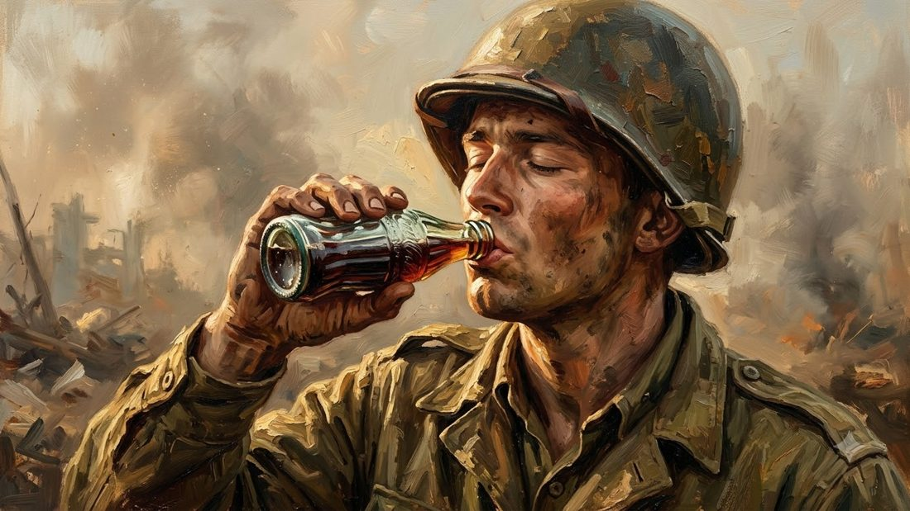
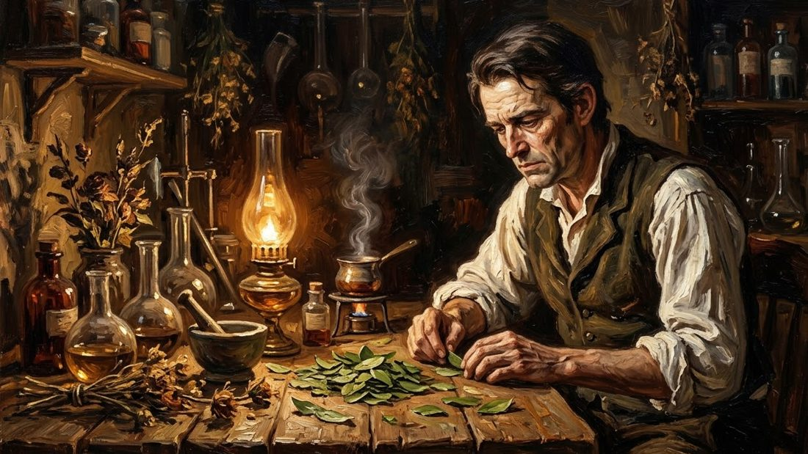
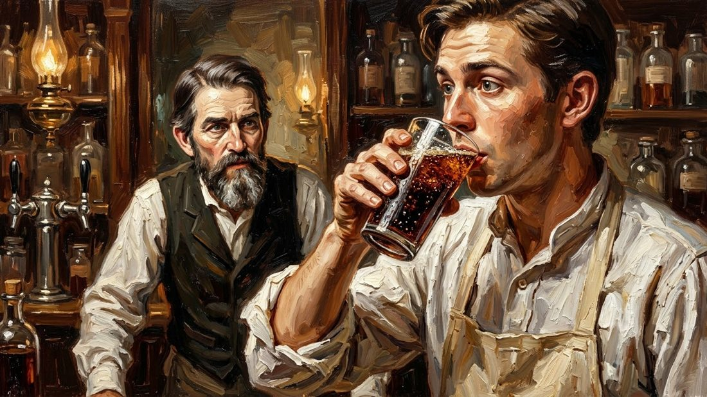
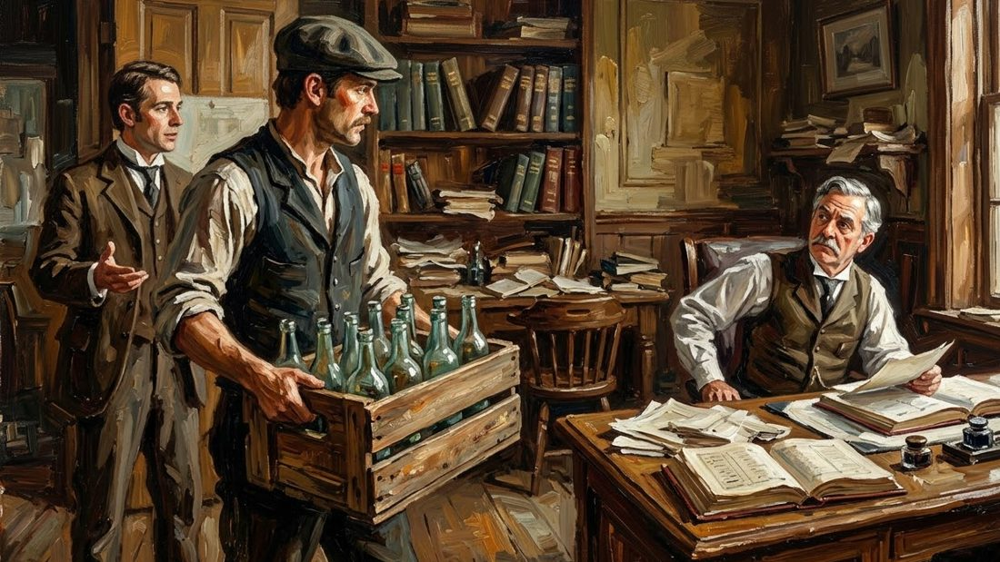
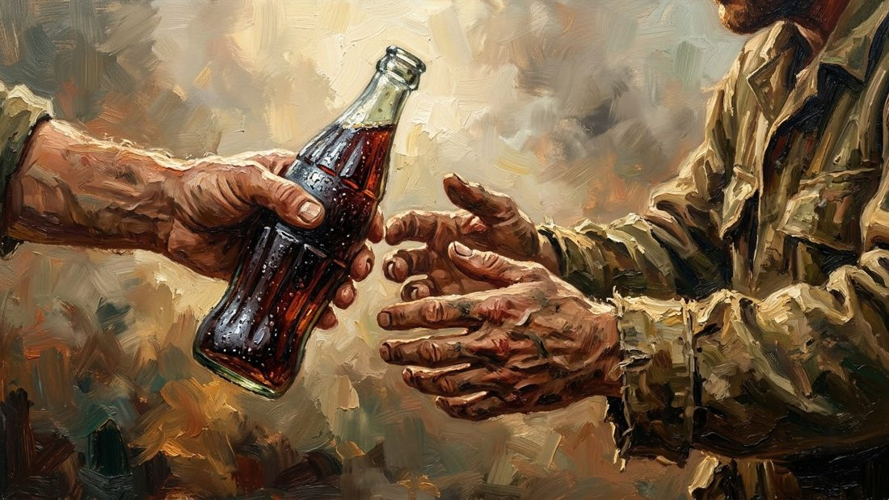

Imagine a hot day in the middle of a war. A young soldier stands far from home, in noise and fear. Someone hands him a cold bottle. Five cents. He drinks, and for one quiet moment, the war feels far away. He is home again.

That bottle travelled across an ocean to reach him. But the man who invented the drink never saw any of it. He died poor, only two years after he created it. This is how Coca-Cola started.

<figure><figcaption>A young soldier, far from home, drinks a cold Coca-Cola. For one quiet moment, the war feels far away.</figcaption></figure>

## A Wounded Man in a Backyard

His name was John Pemberton. He was a pharmacist in Atlanta, Georgia. In 1865, near the end of the American Civil War, a sword cut across his chest. The wound closed on the outside, but the pain stayed. Doctors gave him morphine, and soon he could not live without it.

More than money, more than fame, Pemberton wanted one thing: to be free of the pain - and of the medicine that held him.

So in the spring of 1886, in his backyard, he stood over an old brass kettle, stirring a dark syrup. He was not trying to build an empire. He was trying to cure himself.

<figure><figcaption>John Pemberton in his small pharmacy, searching among leaves and bottles for a cure for his own pain.</figcaption></figure>

## Five Cents a Glass

On May 8, 1886, Pemberton carried his syrup to Jacobs' Pharmacy in Atlanta. There, it was mixed with cold soda water and sold as a health drink. The price was five cents a glass.

On the first day, he sold about nine glasses. Nine. In the first year, the drink earned about 50 dollars - and Pemberton spent more than 70 dollars telling people about it.

<figure><figcaption>The first taste: a customer tries the new drink at Jacobs' Pharmacy, while Pemberton watches and hopes.</figcaption></figure>

His bookkeeper, Frank Robinson, gave the drink its name: Coca-Cola. Robinson had beautiful handwriting, and he wrote the name in soft, flowing letters. Look at a bottle today. You can still see his handwriting.

## The Dream for Sale

Pemberton was still a sick man, and he needed money. In 1887 and 1888, piece by piece, he sold his drink to other businessmen. In total, he received about 2,300 dollars.

On August 16, 1888, John Pemberton died - two years after he created the most famous drink on Earth, and long before it made anyone rich.

The man who took the drink was Asa Candler, another Atlanta pharmacist. Candler printed free coupons and gave them away all over the city, so everyone could taste one glass for free. Soon, all of Atlanta knew the taste. Then, America wanted more than a glass. America wanted to take the drink home.

## The One-Dollar Handshake

Putting Coca-Cola in bottles was not a new idea. In 1894, a candy shop owner in Mississippi, Joseph Biedenharn, had already bottled it for his customers. He even sent Candler a case as a gift. Candler thanked him - and did nothing.

<figure><figcaption>A case of bottled Coca-Cola arrives at Asa Candler's office - the idea he thanked, and almost ignored.</figcaption></figure>

Five years later, on July 21, 1899, two young lawyers from Chattanooga walked into Candler's office. They asked for the right to bottle Coca-Cola across most of America. Candler did not believe in bottles. So he named a price he thought was small.

One dollar.

They shook hands. And here is the strangest part: Candler never collected the dollar. Not ever. The most important handshake in the company's history cost one dollar that nobody ever paid. By 1920, there were about 1,000 bottling factories across America.

## The Bottle You Know by Touch

Success brought copycats - drinks with names like Koka-Nola and Toka-Cola. So in 1915, the company asked for a bottle so special that you could know it by touch alone. In the dark. Even broken on the ground.

The Root Glass Company answered with a green bottle of soft curves and ribs. And here is a small secret: the designers copied its shape from a picture of a cocoa pod - a fruit that was never in the drink, not then, not now. From 1916, you could hold a bottle in the dark and know: this is Coca-Cola.

## A Taste of Home

In 1923, a new leader, Robert Woodruff, took over. He wanted Coca-Cola "within arm's reach of desire" - everywhere, for everyone. When the Second World War came, he made a promise: every man in uniform would be able to buy a Coke for five cents, wherever he was in the world.

The company kept that promise. Bottling plants followed the soldiers. And for a young man far from home, one cold bottle tasted like home - which is why this story began with one.

<figure><figcaption>"Someone hands him a cold bottle." The small promise that followed the soldiers across the world.</figcaption></figure>

The story did not stop there. In Germany, cut off from the syrup during the war, the local team created a new drink from what they had: Fanta. In 1985, the company changed its famous taste and called it New Coke - and after just 79 days of public anger, the old taste came back. And in 1988, investor Warren Buffett looked at the company and quietly bought more than a billion dollars of its shares. The whole world saw a drink. He saw something that would never be forgotten.

And Coca-Cola did not stand alone for long. Seven years after Pemberton's first glass, another pharmacist, in a small North Carolina town, mixed a rival drink of his own. That is [the story of Pepsi](/stories/history-of-pepsi/).

## What This Story Teaches Us

- **Small beginnings can hide a very long story.** Nine glasses on the first day. Fifty dollars in the first year. Today, the drink is sold in almost every country on Earth.
- **Pain can push a person to create something new.** Pemberton was only looking for a cure. His search gave the world a drink it never forgot.
- **A man can plant something he will never see grow.** Pemberton died in 1888. The shade of his tree now covers the whole world.

## Plant It Anyway

Most of us will never see how far our work travels. A teacher never sees the adult her student becomes. You may work quietly for years, and no one may ever thank you.

John Pemberton stirred his kettle in a backyard, trying to stop his own pain. He did not know he was planting something.

You may plant something today, too. A kind word. One brave choice. Hours of quiet work that nobody sees. You may never sit in its shade.

Plant it anyway.
