Hello, my friend. You can buy coffee almost anywhere. So why do millions of people walk into a Starbucks, and stay a little longer?

Maybe it is not only the coffee. Maybe it is the warm light, the familiar table, and a friendly voice that knows your name.

But the first Starbucks was not like that at all. In 1971, it was one small Seattle shop that only sold coffee beans. No lattes. No soft chairs. Not even a place to sit.

So how did a little bean shop become a place loved around the world? This is the story of Starbucks, from the very beginning.

<figure>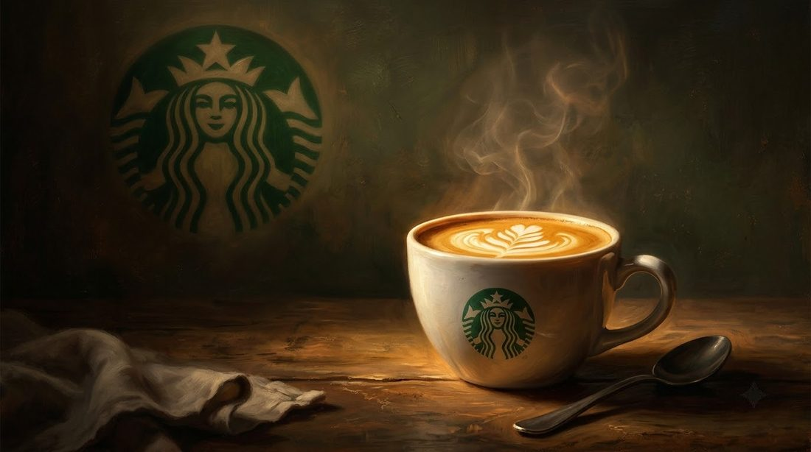<figcaption>A warm cup, a familiar green logo. But Starbucks did not begin with lattes at all.</figcaption></figure>

## A Boy from Brooklyn

Howard D. Schultz was born on July 19, 1953, in Brooklyn, New York, and grew up in a public housing building. His father, Fred, worked different jobs, and money was often tight.

When Howard was seven, his father was injured while working as a delivery driver. The boy found him at home, hurt and unable to work, while the bills kept arriving. There was no help and no protection. Howard was too young to help, but he never forgot those days.

<figure>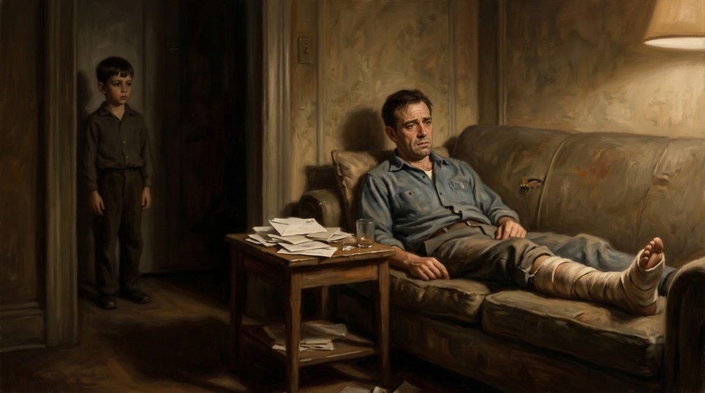<figcaption>His father came home hurt, his leg in a cast, the bills piling up on the table. Howard was seven, and there was nothing he could do.</figcaption></figure>

He loved sports, worked hard, and went to Northern Michigan University, the first in his family to graduate from college. Then, as a young salesman of kitchen equipment and coffee makers, he noticed something strange: one small Seattle customer kept ordering an unusual number of coffee makers. The company was called Starbucks.

<figure>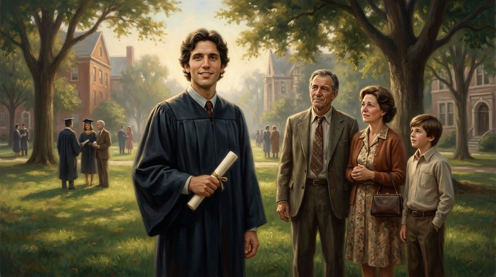<figcaption>The first in his family to graduate from college. A boy from Brooklyn was on his way.</figcaption></figure>

<figure>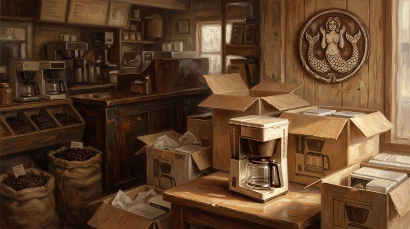<figcaption>One small Seattle customer kept ordering coffee makers, far more than a tiny bean shop should need. Howard had to know why.</figcaption></figure>

## Three Friends in Seattle

Seattle, the city that would later give the world [Amazon](/stories/history-of-amazon/), was home to three friends who shared a simple love in 1971: good coffee.

Gerald Baldwin, Gordon Bowker, and Zev Siegl loved coffee from dark-roasted beans, but it was hard to find. Each put in 1,350 dollars, and together they borrowed another 5,000 dollars. In March 1971, they opened the first Starbucks near Pike Place Market.

<figure>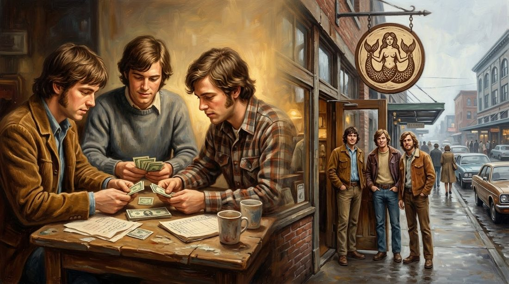<figcaption>Three friends, 1,350 dollars each and 5,000 more borrowed. Baldwin, Bowker and Siegl open their little bean shop in 1971.</figcaption></figure>

The friends had learned from Alfred Peet, who believed Americans deserved better coffee. They named the shop Starbucks, inspired by the novel *Moby-Dick*.

It was also the year a small Oregon shoe company became [Nike](/stories/history-of-nike/). In Seattle, the three friends were happy with their quiet bean shop. Then a young salesman from New York walked in, asking questions.

## The Dream He Saw in Milan

Howard first visited Starbucks in 1981. The coffee, and the founders' passion, stayed with him. In 1982, he left his secure job and joined the small company.

<figure>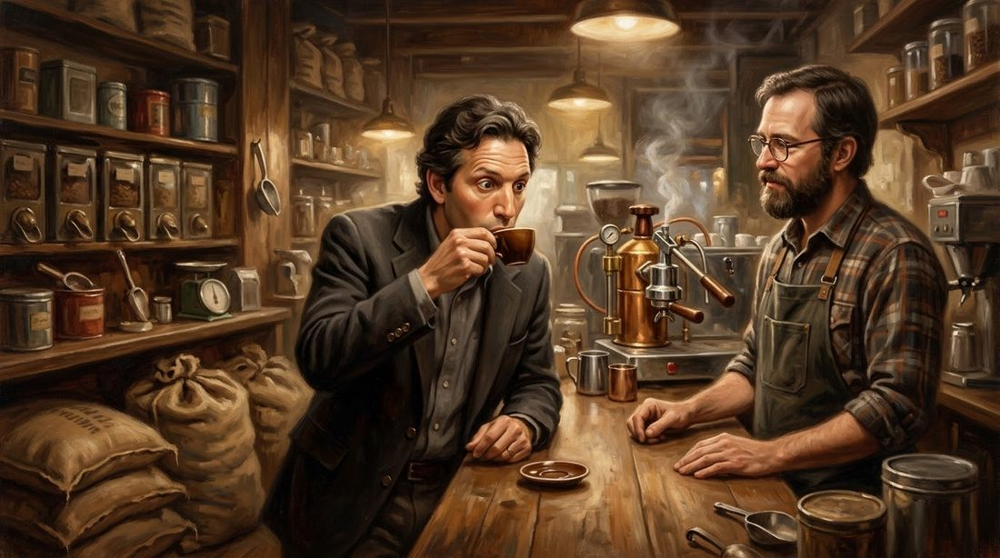<figcaption>In 1981, Howard tasted the coffee and listened to the men who cared so deeply about it. He wanted to be part of it.</figcaption></figure>

In 1983, Starbucks sent him to Italy. In a Milan coffee bar, he watched a barista greet regular customers by name. People stopped, talked, and enjoyed a few quiet minutes. In Seattle, Starbucks sold beans. In Milan, people gathered around coffee.

<figure>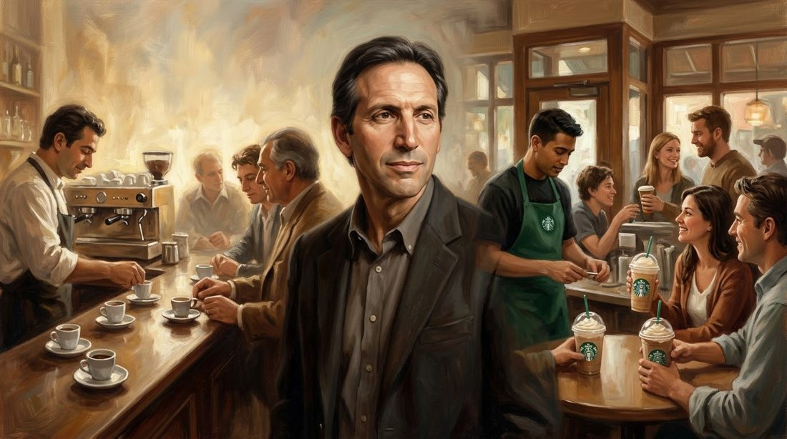<figcaption>In Milan, coffee gathered people together. Howard began to dream of a warm third place between home and work.</figcaption></figure>

Howard began to dream of a warm place between home and work, a "third place" where people could meet, or simply sit in peace. The founders were not convinced. In 1984, he tested espresso drinks in one store, and customers liked them. But the founders would not change. So in 1985, he left to build his own coffeehouse.

## 217 People Said No

His new company was called Il Giornale. By his own account, Howard approached 242 investors, and 217 said no. He kept going, and in 1986 opened his first Seattle coffeehouse. Soon Il Giornale had three locations.

Then, in 1987, the founders decided to focus on Peet's Coffee, which they had bought, and sell Starbucks: the name, the roasting business, and six stores. Howard needed 3.8 million dollars he did not have. Another investor threatened to take the deal, so he asked Bill Gates Sr., a respected Seattle lawyer, for help. Gates Sr. helped him protect it, and in August 1987 Howard bought Starbucks.

<figure>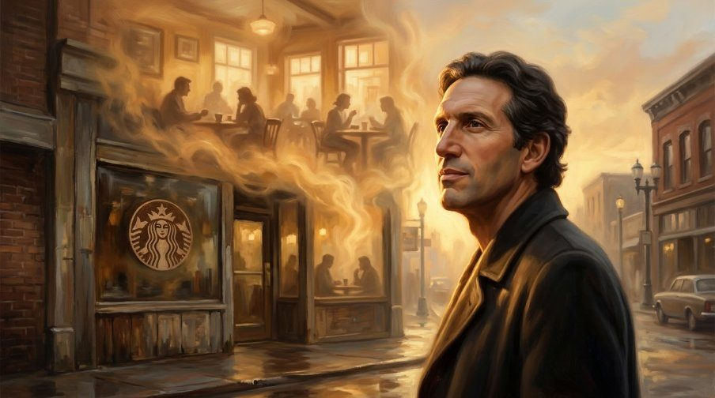<figcaption>He could already see the coffeehouse he wanted to build. He just had to survive 217 no's to build it.</figcaption></figure>

## The Promise Behind the Green Apron

Howard wanted his workers to have the support his father never had. In 1988, Starbucks offered health insurance to full-time workers and eligible part-time workers. In 1991, Bean Stock gave eligible employees a chance to own shares. The people who built Starbucks, he believed, should share in its success.

<figure>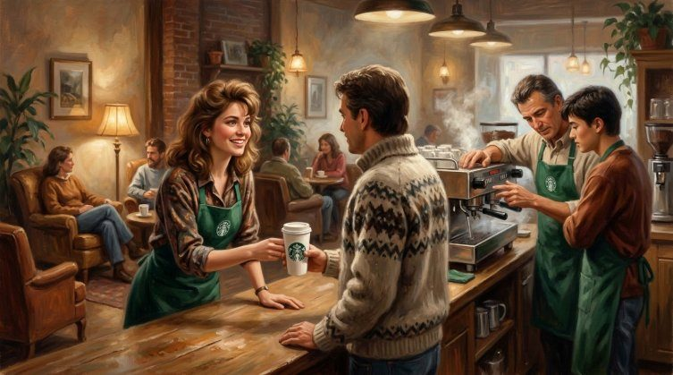<figcaption>Green aprons, trained baristas, and a quiet promise: the people building Starbucks would share in its success.</figcaption></figure>

In 1992, Starbucks sold shares to the public, with 165 stores.

## A Drink Nobody Planned

In Southern California, customers asked for cold, blended coffee drinks. Employees experimented with ice, milk, and coffee, and the company developed the Frappuccino. Howard was not excited. The sweet, icy drink was far from his beloved espresso. But customers wanted it, and in 1995 it became a hit across the United States.

<figure>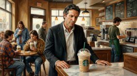<figcaption>Howard was not sure about the cold, sweet drink. The customers were. The Frappuccino became a hit.</figcaption></figure>

Starbucks was also learning to travel: Japan in 1996, its first store outside North America, then the United Kingdom in 1998 and China in 1999. In 2000, Howard stepped away as CEO, staying on as chairman.

<figure>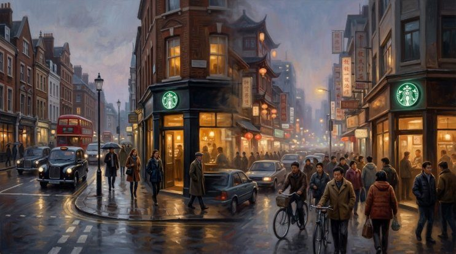<figcaption>Japan in 1996, the United Kingdom in 1998, China in 1999. The little Seattle coffeehouse had learned to travel the world.</figcaption></figure>

## The Afternoon Starbucks Closed

Success, though, can grow too fast. By 2007, Starbucks had more than 15,000 stores, and the warm, personal feeling was disappearing. Then the economy fell into crisis, and customers spent less.

<figure>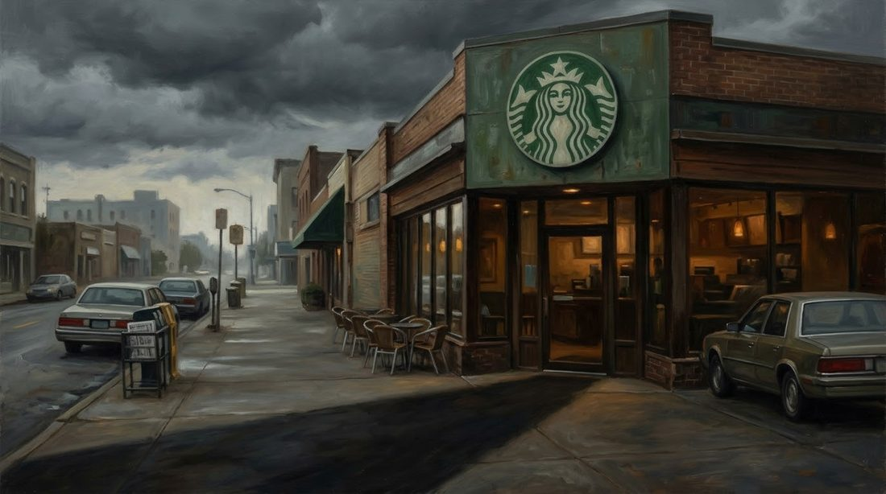<figcaption>More than 15,000 stores, but the warm, personal feeling was disappearing. Then the storm came.</figcaption></figure>

In January 2008, Howard returned as CEO. On February 26, 2008, at 5:30 in the afternoon, nearly 7,100 stores across America closed their doors. Inside, baristas were practicing how to make better espresso.

<figure>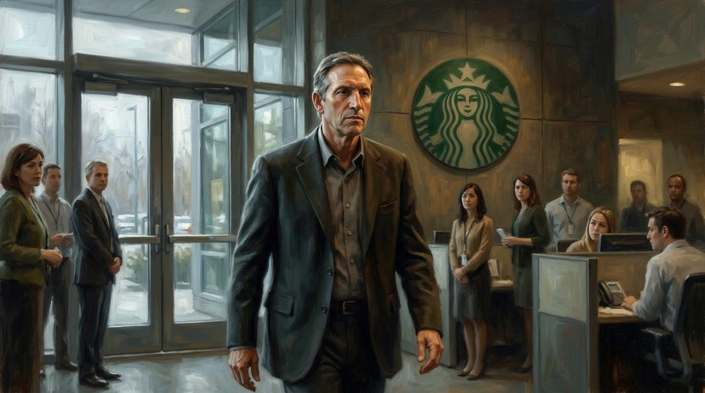<figcaption>In January 2008, Howard returned as CEO, ready to lose an afternoon of sales to bring back the coffee quality.</figcaption></figure>

Howard was willing to lose an afternoon of sales to bring back quality. But hundreds of struggling stores also closed, and many employees lost their jobs, painful decisions for a man who had promised to care for his workers. Slowly, Starbucks recovered.

## A Company Beyond Its Founder

In 2012, Starbucks began writing customers' names on their cups. Hearing your own name still felt personal, even when the spelling was wrong. Mobile ordering changed things again: some still came to sit and talk, others paid on their phones and hurried on.

<figure>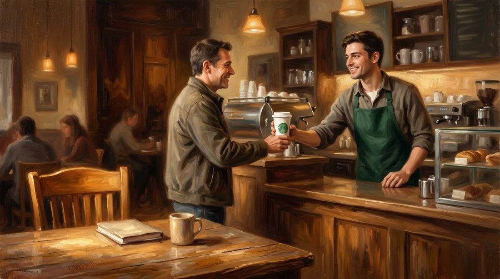<figcaption>Your name on the cup, a face that knows you. Even inside a giant company, the small personal moment still mattered.</figcaption></figure>

In 2017, Kevin Johnson became CEO, and a year later Howard left as chairman.

<figure>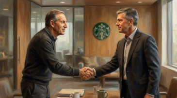<figcaption>In 2017, Howard handed Starbucks to a new leader. The company had to learn to walk without him.</figcaption></figure> In 2020, COVID-19 emptied the tables where friends once gathered. In 2021, workers at a Buffalo store voted to form a union, asking what Howard's old promise to care for workers really meant.

Howard returned in 2022. Laxman Narasimhan followed in 2023, and Brian Niccol in 2024. His plan, "Back to Starbucks," promises better coffee, more personal service, and a reason to stay. By 2026, Starbucks had 41,607 stores.

<figure>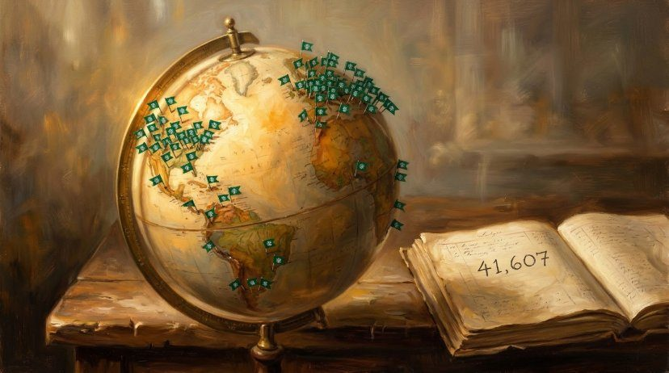<figcaption>41,607 stores around the world. All of it began with one small bean shop in Seattle.</figcaption></figure>

## What This Story Teaches Us

- **See more than the product you sell.** In Milan, Schultz did not only see espresso. He saw people gathering and resting, and he built a place for that feeling.
- **A dream can survive 217 no's.** Of 242 investors approached for Il Giornale, 217 refused Schultz. He kept asking, and in 1987 he bought Starbucks itself.
- **Give people the care you once needed.** His injured father had no protection. In 1988, Starbucks offered health insurance even to eligible part-time workers.

## The Dream That Lives On

To understand what Starbucks really meant to Howard, we go back to that winter day in Brooklyn. A seven-year-old boy. A father hurt and unable to work. No help. No health care. Nothing to protect the family.

Years later, Howard made a quiet promise: his workers would get the care his father never had. It was not always easy to keep, and the dream was never truly finished. Maybe it never will be.

But the idea was simple from the start. We can buy coffee almost anywhere. Yet we return to the places that make us feel welcome. A friendly face. A familiar table. Someone who knows our name.

<figure>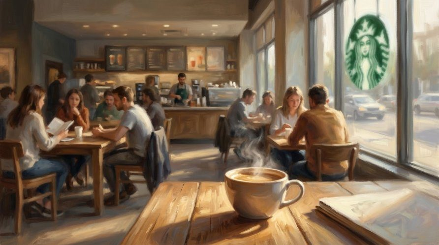<figcaption>A warm light, a familiar table, and people who stay a little longer. That was the dream from the very beginning.</figcaption></figure>

And now, my friend, tell me: what makes you return to your favorite coffee shop? Is it the coffee, or the way the place makes you feel?
