Hello, my friend. You have been working all day. You are tired, but your work is not finished yet. So you stop at a convenience store and pick up a cold, slim can.

<figure>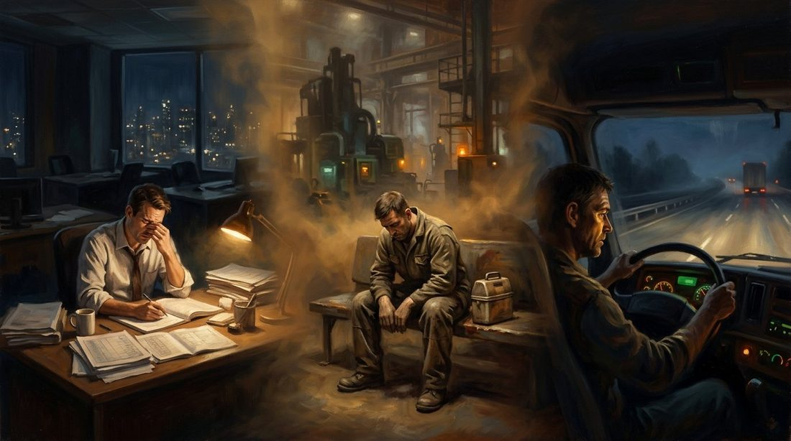<figcaption>Working all day, and the work is not finished yet. This story begins with tired people.</figcaption></figure>

Many years ago, in Thailand, a man noticed that people needed the same thing. Truck drivers on long roads. Workers on long days. So he created a drink for them, in a small glass bottle. That drink would one day become Red Bull.

But how did two men, from two different worlds, turn a little bottle from Thailand into a name known everywhere? This is the story of Red Bull, from the very beginning.

<figure>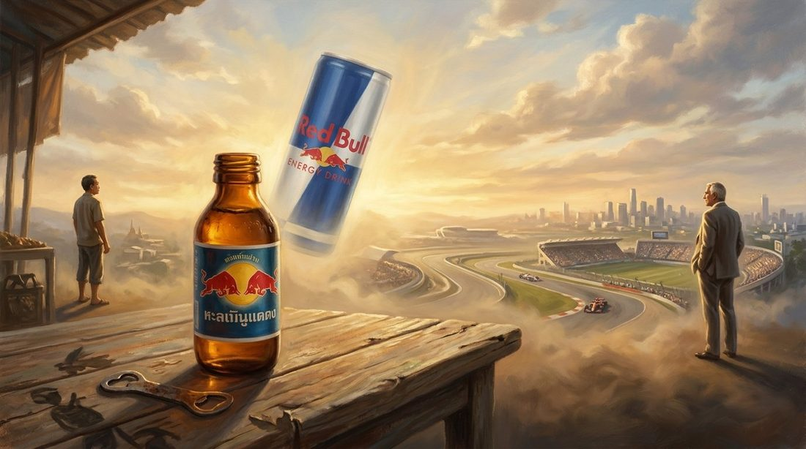<figcaption>A little bottle from Thailand, and the world it would one day reach.</figcaption></figure>

## The Boy Who Grew Up Poor

The man's name was Chaleo Yoovidhya. He grew up in a poor family in Thailand. His father was Chinese, and his mother was Thai. The family raised ducks and sold fruit to earn a living.

<figure>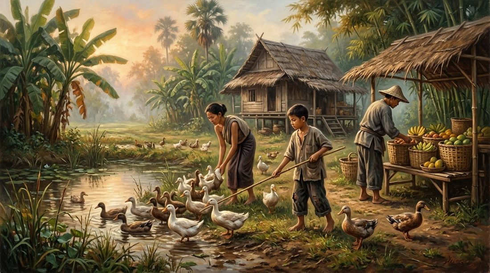<figcaption>Chaleo grew up poor. His family raised ducks and sold fruit to earn a living.</figcaption></figure>

Chaleo knew what it meant to work hard for very little money. As a young man, he began selling medicine. He had no business of his own, but he was learning something important: how to find customers, and how to earn their trust.

<figure>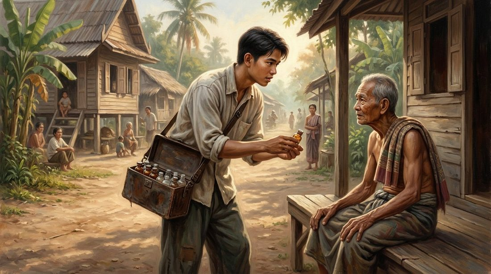<figcaption>As a young man, Chaleo sold medicine, and learned how to earn people’s trust.</figcaption></figure>

In 1956, he started his own company in Bangkok, T.C. Pharmaceutical, in a small rented office with very little money. He promoted his medicines through radio, cinemas, and even advertisements on taxis, and slowly the business grew. And in the 1970s, Chaleo began looking at a different kind of customer. Not someone who was sick, but someone who was simply tired.

<figure>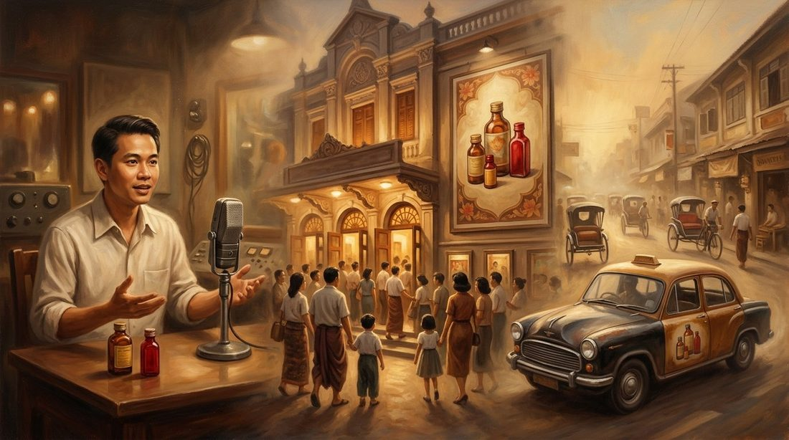<figcaption>He promoted his medicines through radio, cinemas, and even taxis. His small business slowly grew.</figcaption></figure>

<figure>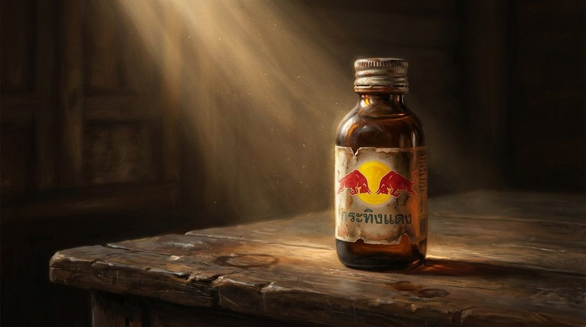<figcaption>One small bottle, in a quiet beam of light. Everything in this story grows from it.</figcaption></figure>

## A Drink for Tired Workers

First came an energy syrup called Theoplex-D, in a small bottle with two red animals facing each other in front of a yellow sun. The picture was easier to remember than the name. People began calling it Red Bull.

<figure>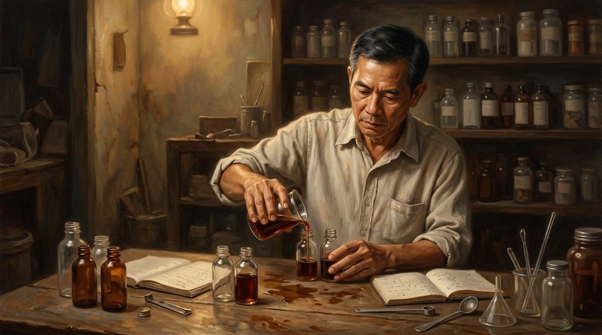<figcaption>Beyond medicine: Chaleo develops a new energy syrup in his small Bangkok workshop.</figcaption></figure>

<figure>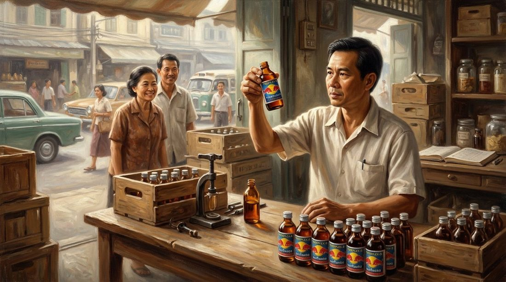<figcaption>Theoplex-D. The picture on the bottle was easier to remember than the name.</figcaption></figure>

In the middle of the 1970s, Chaleo brought out Krating Daeng. In Thai, the name means Red Bull, from a powerful wild animal found in Asia. It came in a small glass bottle, not a can, and it had no bubbles. Imagine a truck driver stopping for a short break. He picks up the small bottle, drinks, and continues his journey. It was a simple drink for people with long working days, and Chaleo promoted it through Muay Thai, the Thai boxing his customers loved.

<figure>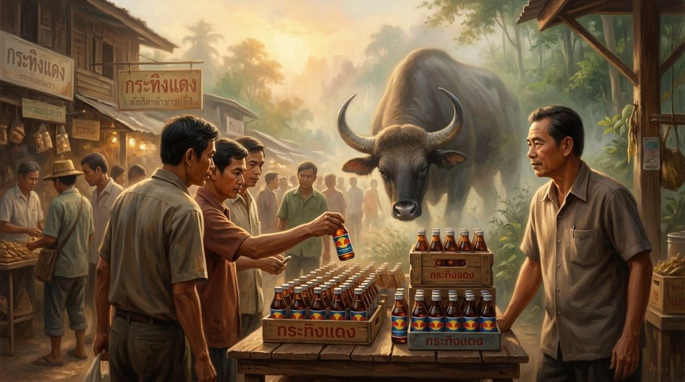<figcaption>Krating Daeng means Red Bull, named for the powerful wild gaur of Asia.</figcaption></figure>

<figure>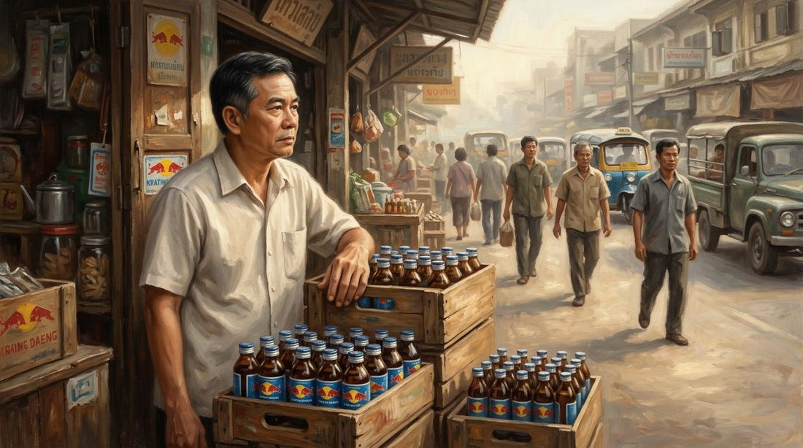<figcaption>Making the drink was only half the job. People still had to discover it.</figcaption></figure>

Slowly, drivers and workers began to recognize the two red animals. But in Europe, most people had never heard of drinks like this. One Austrian businessman would soon see a chance to change that.

<figure>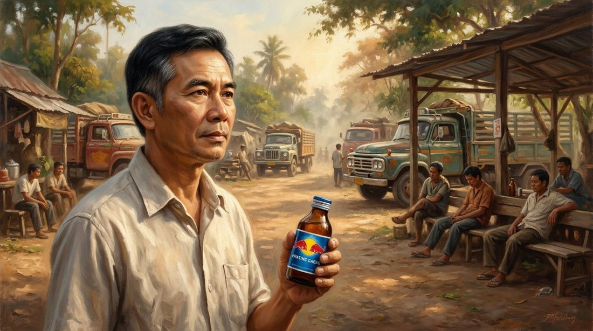<figcaption>Drivers and workers began to recognize the two red animals on the bottle.</figcaption></figure>

<figure>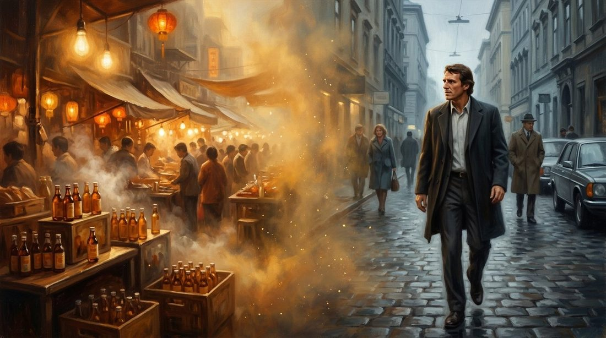<figcaption>In Asia, drinks like this were familiar. In Europe, almost nobody had heard of them.</figcaption></figure>

## The Austrian Who Tasted It

Dietrich Mateschitz grew up in Austria, studied business, and worked in marketing. By the early 1980s, he was working for Blendax, a company known for toothpaste, and his job took him on business trips to different countries. Chaleo knew how to create a product. Dietrich knew how to bring one to customers. But he had never built a worldwide company of his own.

<figure>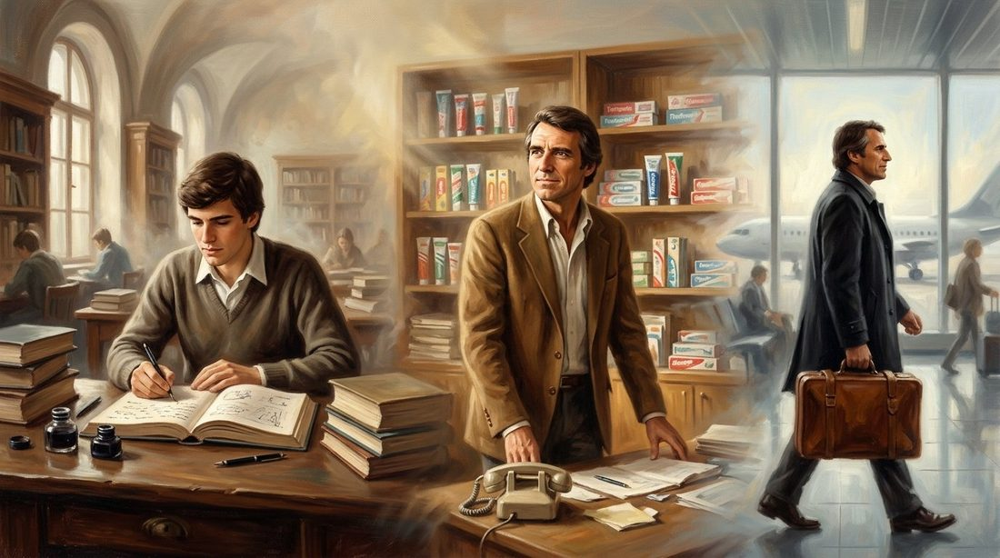<figcaption>Dietrich studied business and worked in marketing. His job took him around the world.</figcaption></figure>

During his travels in Asia, Dietrich came across the region's energy drinks. He later described drinking one in Thailand when he was tired from a long flight, and he wondered: might people in Europe buy something similar? There was another connection, too. Chaleo was already a business partner of Blendax in Thailand, the same company Dietrich worked for.

In 1984, the two men created Red Bull GmbH in Austria. Each invested five hundred thousand dollars. They each owned forty-nine percent of the company, and Chaleo's son received the final two percent. Dietrich left his old job, put his savings behind the project, and spent the next three years creating a different version of the drink. The old glass bottle would give way to a narrow can. The familiar red animals would stay. But almost everything around them would change.

<figure>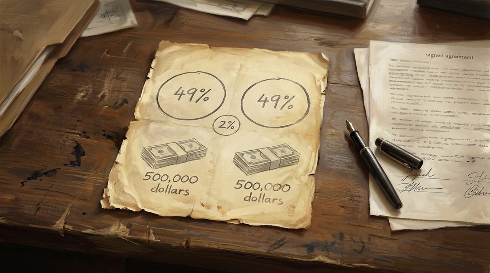<figcaption>In 1984, each man invested five hundred thousand dollars. Forty-nine percent, forty-nine percent, and two.</figcaption></figure>

## The Drink Nobody Believed In

The new drink had bubbles, and came in a tall, slim can with blue and silver panels. Dietrich also wanted it to cost more than a regular soda. That was a risk. Customers could already choose drinks they knew, including [Coca-Cola](/stories/history-of-coca-cola/) and [Pepsi](/stories/history-of-pepsi/). Why would they pay more for a smaller can with an unfamiliar name?

Before the launch, he tested the drink with customers. The results were terrible. People disliked the taste. They even questioned the name and the logo. Almost everything about the new drink seemed wrong to them. But Dietrich refused to give up. If there was no market for Red Bull, he would try to create one himself.

<figure>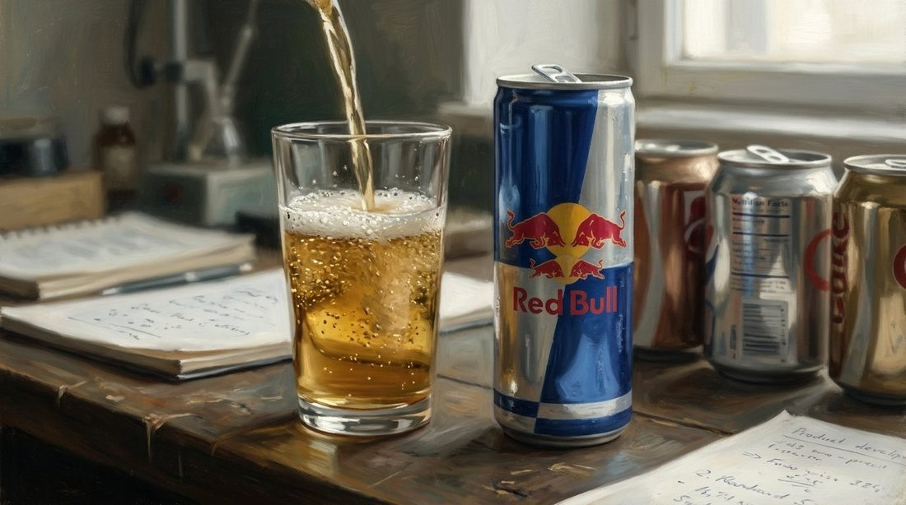<figcaption>The taste tests were terrible. People disliked the taste, and even questioned the name and the logo.</figcaption></figure>

On April 1, 1987, Red Bull finally went on sale in Austria. In its first year, the company sold around one million cans, yet still lost around one million dollars. So Dietrich let people try the drink for themselves, instead of relying only on large advertisements: free cans at student parties and in bars, and support for young athletes and unusual sporting events. Sales grew in the second and third years, and the company slowly recovered its losses.

Dietrich had not proved that everyone liked the taste of Red Bull. He had proved something more useful: enough people liked the drink, and the world around it, to buy another can.

<figure>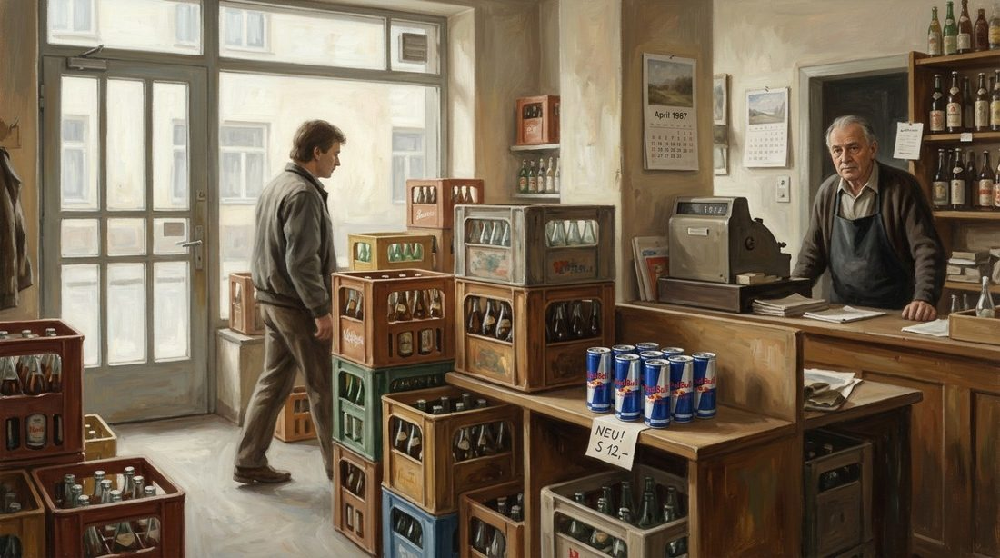<figcaption>April 1987. Red Bull goes on sale in Austria, in small shops like this one.</figcaption></figure>

## From Austria to the World

After Austria came nearby countries, including Hungary. Later, Red Bull teams even drove small cars with giant cans on top, stopping near campuses and busy places, handing out cold drinks for people to try.

Then came Germany in 1994, and something unexpected happened. Demand grew so quickly that the company could not make enough cans, and for a time the drink disappeared from German shelves. A drink that people once disliked in taste tests was now selling faster than the company could supply it.

Not every country welcomed Red Bull. For years, France restricted sales of the original formula, until the restriction was lifted in 2008. In 1997, Red Bull entered the United States. Dietrich never tried to make it cheaper than other soft drinks. It remained a small, expensive can, sold where people might need extra energy during work, study, or a night out. From college campuses to petrol stations, the little blue and silver can was becoming familiar around the world.

## More Than an Energy Drink

The journey into sports had begun in 1989, when Red Bull sponsored Austrian Formula One driver Gerhard Berger. But Dietrich wanted to do more than put his brand beside a sport.

In 1992, Red Bull held its first Flugtag in Vienna. Teams built strange flying machines and pushed them from a platform over water. Some flew a little way. Many fell straight in with a splash. The crowd came to watch people attempt something unusual, and Red Bull was behind the event. The company was no longer only supporting someone else's event. It was creating its own.

In 2004, Red Bull bought Jaguar Racing from Ford, and the following year Red Bull Racing entered Formula One under its own name. Owning a team did not mean winning races, but the team improved, race by race. In 2009, Sebastian Vettel gave Red Bull Racing its first Formula One victory. One year later, the team won both world championships. A company known for energy drinks had beaten teams with long racing histories.

## The Day the World Watched Red Bull

One project took that idea higher than anyone expected. Red Bull Stratos would take a man almost thirty-nine kilometers above the Earth. And from there, he planned to jump.

Felix Baumgartner, an Austrian skydiver known for dangerous jumps, spent years preparing with engineers, doctors, and a special capsule and suit. But one of the biggest problems came from Felix himself: he felt trapped inside the tight pressure suit, and at one point he left the project. A specialist, Michael Gervais, helped him face his fear, and Joe Kittinger, who had made a famous parachute jump back in 1960, guided him from the ground.

On October 14, 2012, a huge balloon rose above New Mexico. Felix stood at the open door of the capsule, with the curve of the Earth beneath him. Then he jumped. As he fell, his body began to spin. He fought to regain control, the spinning slowed, and he landed safely. During the fall, he had traveled faster than the speed of sound, and millions had watched it live.

But earlier that same year, far away in Thailand, the man who created the original drink had passed away.

## The Two Men Are Gone

Chaleo Yoovidhya died in March 2012. He had begun with a small business in Bangkok, and by the time he died, his family owned the larger share of a company known around the world. Yet he never seemed interested in becoming famous. He rarely gave interviews and preferred a quiet life.

In Austria, Dietrich was much the same: a brand famous for daring adventures and huge crowds, built by a man who kept his own life private. In October 2022, Dietrich Mateschitz died at the age of seventy-eight. Chaleo had created the original drink in Thailand. Dietrich had taken it around the world. Now, both founders were gone. But the company they built still had a future to face.

<figure>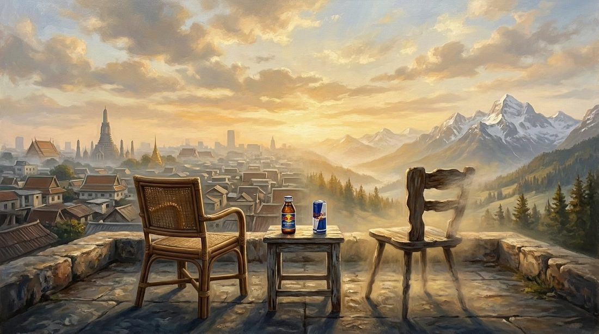<figcaption>Two chairs, now empty. One man from Thailand, one from Austria.</figcaption></figure>

## The Legacy Lives On

After Dietrich's death, his forty-nine percent stake passed to his son, Mark Mateschitz. The Yoovidhya family remained a major owner, and in 2025 the family moved its extra two percent stake into a trust company in Switzerland, while control of the company stayed much the same. A new leadership team was introduced, and life at Red Bull continued.

<figure>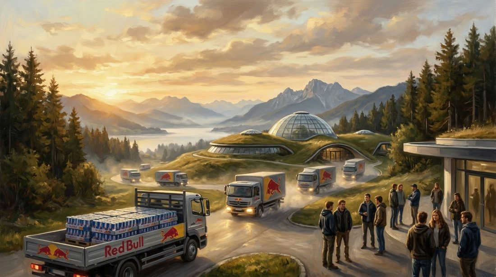<figcaption>After the founders, life at Red Bull continued, from its home beside the lake in Fuschl.</figcaption></figure>

In 2025, the company sold almost fourteen billion cans in 178 countries, and nearly twenty-two thousand people worked for Red Bull. And in 2026, working with Ford, Red Bull Powertrains began supplying engines for its own racing teams. Years earlier, Red Bull had started by sponsoring a single racing driver. Now it was helping build the engines inside its cars.

<figure>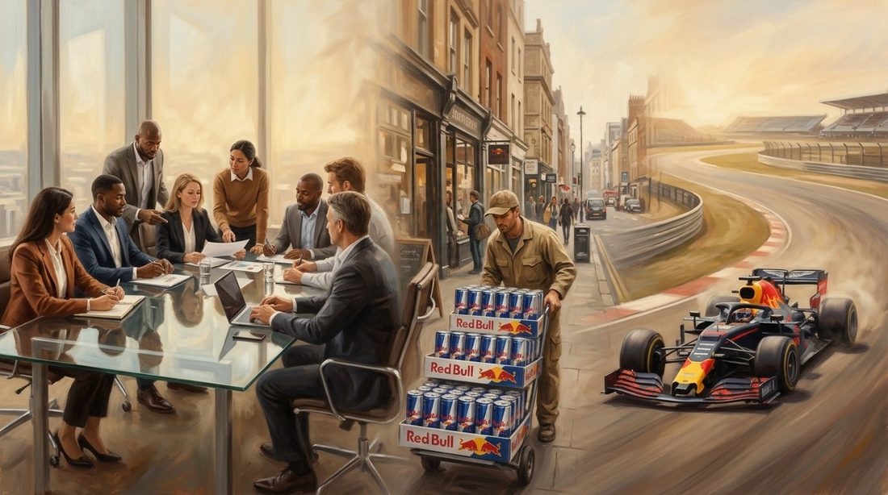<figcaption>Today the drink sits inside a much bigger world: offices, deliveries, and its own Formula One engines.</figcaption></figure>

## What This Story Teaches Us

- **A small beginning can change the world.** Red Bull did not start in a giant factory. It started as a little glass bottle, made for tired truck drivers in Thailand.
- **A failed test is not always the truth.** People disliked the taste, the name, and the logo. Dietrich let them discover the drink in real life instead, and enough of them came back for another can.
- **Do not only sponsor the show. Create it.** Flugtag, a Formula One team, and a jump from the edge of space: Red Bull stopped standing beside the action and began creating the action itself.

## The Bottle That Is Still There

The drink has changed. The company has changed. And the two men who built it are no longer here. But look at a can of Red Bull today. Those two red animals are still there, facing each other in front of the sun. They first appeared on a small glass bottle in Thailand, on a drink made for people who were tired and still had far to go.

Maybe somewhere in your life, there is a small bottle like that too. Something simple you made for the people near you, something the world has not noticed yet.

<figure>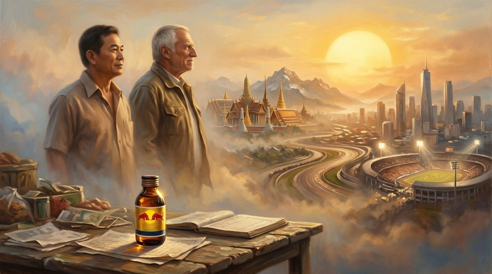<figcaption>Two quiet men, and the small bottle that outlived them both.</figcaption></figure>

<figure>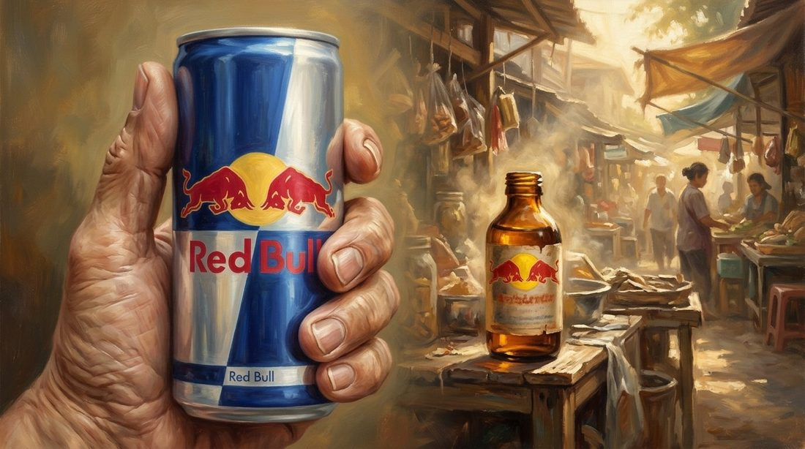<figcaption>The can the world knows today, and the little glass bottle where it all began.</figcaption></figure> Chaleo's bottle waited years for its second man, the one who would carry it across the world. Small things do not stay small forever. Sometimes they only need time, and someone who believes in them.

And it all began with that little glass bottle. And now, my friend, tell me: what small thing are you building today, that nobody believes in yet?
