What would you do if you had to start a new life in a new country? That is how the story of Jensen Huang begins — with a nine-year-old boy who had to leave his parents behind.

He was sent to America, a country where everything felt new and unfamiliar. Life was not easy for the young immigrant. He cleaned bathrooms at school, and later he washed dishes at a restaurant. He was simply trying to find his place in a new world. He had no idea that, years later, that same boy would help build NVIDIA into one of the most valuable companies on Earth.

<figure>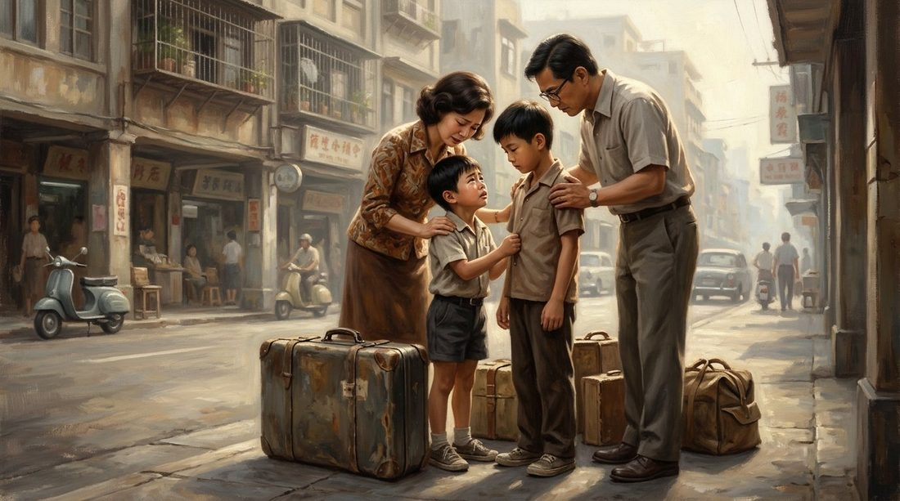<figcaption>The hardest goodbye: two parents send their sons across the ocean, hoping to follow one day.</figcaption></figure>

## A Boy Far From Home

Jensen Huang was born in Taiwan in 1963. When he was young, his family moved to Thailand. His father was an engineer, and his parents believed education could give their children a better future. So they made a difficult decision: they sent Jensen and his older brother to the United States, hoping to join them later.

<figure><figcaption>Taiwan, where Jensen was born in 1963 — the island he would one day leave behind.</figcaption></figure>

The brothers first stayed with relatives in Washington state.

<figure><figcaption>Two brothers arrive in America with their suitcases — a new country, a new language, a new life.</figcaption></figure> But they soon found themselves at Oneida Baptist Institute, a school in rural Kentucky. Their parents were far away. Everything around the boys was new — the language, the people, the rules of school life.

Jensen was among the youngest children there. He shared a room with a boy of about seventeen, and something unusual grew between them: Jensen helped the older boy learn to read, and in return, the boy taught him how to lift weights.

<figure>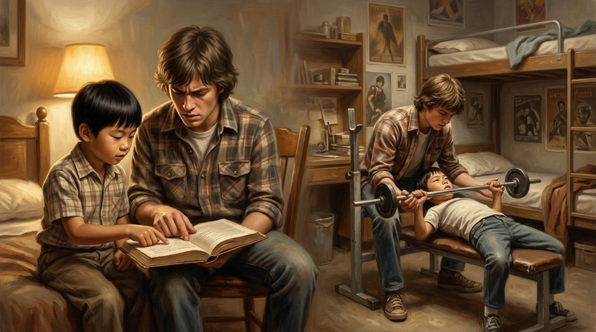<figcaption>At school in Kentucky, Jensen taught an older boy to read — and the boy taught him to lift weights.</figcaption></figure> Two children, very different in age, found a way to help each other. Jensen also had work to do. He cleaned the bathrooms in the boys' dormitory.

<figure><figcaption>Work that nobody noticed: scrubbing floors at school in Kentucky — and, a few years later, washing dishes at Denny's.</figcaption></figure> Life there was not easy for a child so far from home — but years later, he remembered not only the difficult moments. He remembered the people he met, and the things he learned.

<figure><figcaption>Far from his parents, the young Jensen learned to carry on alone.</figcaption></figure>

## Washing Dishes at Denny's

After some time, the family came together again in Oregon. Jensen made friends, enjoyed mathematics and electronics, played arcade games, and became a strong junior table-tennis player. As a teenager, he got a job at Denny's, an American restaurant. He started by washing dishes, and later he cleared tables.

<figure>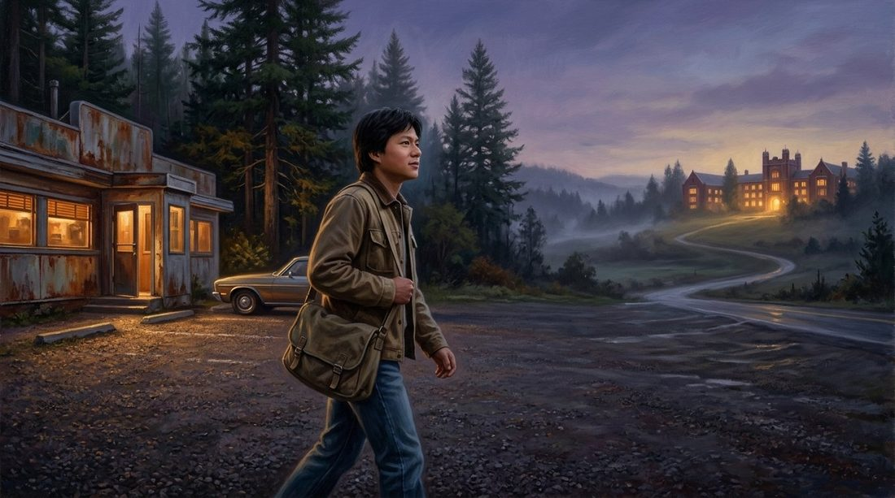<figcaption>Between the restaurant and school: the young Jensen walks home through the Oregon dusk.</figcaption></figure>

It was busy work, and much of it went unnoticed. But Jensen took it seriously. He planned his movements around the restaurant so he would work faster and never waste time walking back and forth. Even a simple job, he learned, could be done with care.

<figure>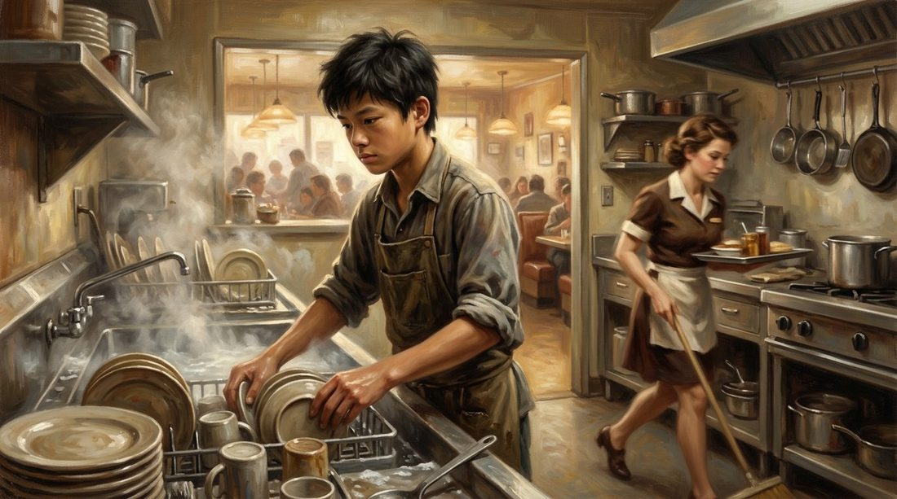<figcaption>At Denny's, Jensen washed dishes — and planned every step so he would never waste a moment.</figcaption></figure> Years later, when people asked him about success, he still remembered those long hours at the sink.

## The Girl in the Engineering Lab

Jensen entered Oregon State University when he was only sixteen, to study electrical engineering. In a classroom there, he met a young woman named Lori Mills.

<figure>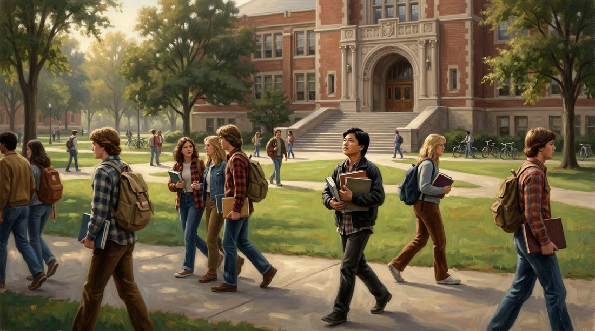<figcaption>Oregon State University. Jensen arrived at sixteen, carrying his books among older students.</figcaption></figure> They studied together, worked on assignments together, and grew closer over time. Lori would later become his wife.

In 1984, Jensen graduated and joined AMD, then moved to LSI Logic. He saw how much work stands between an idea and a finished product. And he kept studying: while working and raising a family, he took classes at Stanford University, earning a master's degree in 1992.

<figure>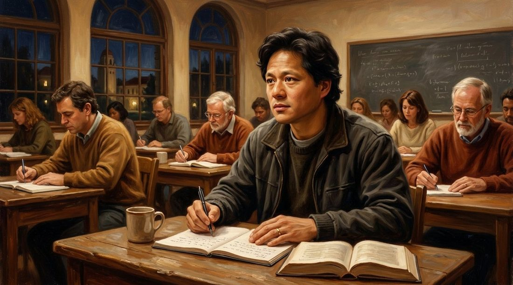<figcaption>Years later, he was still studying — evening classes at Stanford, between work and family.</figcaption></figure> By then, he had a stable career, an education, and a family. He could have stayed on that path. Instead, two other engineers were about to offer him a very different future.

## Founded in a Restaurant Booth

Chris Malachowsky and Curtis Priem believed new graphics chips could change what personal computers could do, especially in games. The three men met at a Denny's restaurant in California to talk about starting a company of their own. Years earlier, Jensen had washed dishes at another Denny's. Now he was sitting in one, planning to build something.

<figure>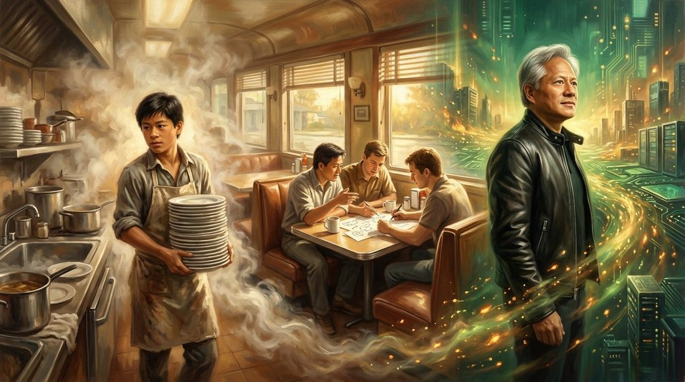<figcaption>The same restaurant, two moments: the boy who washed the dishes, and the men planning a company at a booth.</figcaption></figure>

On April 5, 1993, they founded NVIDIA, and Jensen became its chief executive.

<figure>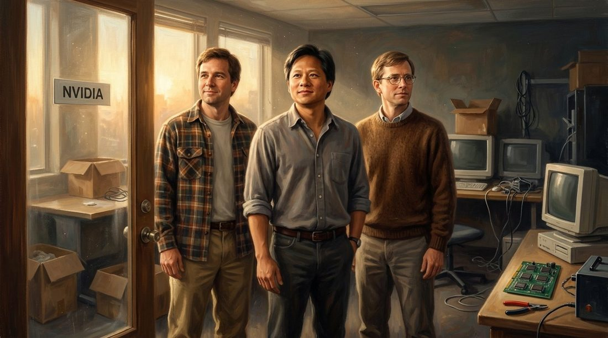<figcaption>April 5, 1993. Three founders, one small office, and a name on the door: NVIDIA.</figcaption></figure> For Jensen, it meant leaving a safe career behind, with a family to care for and no promise of success. But he chose to take the chance.

## When the Dream Almost Ended

NVIDIA's first major chip, the NV1, was built with hard work — but the gaming industry moved toward a different technology, and the chip was left behind. A project with the Japanese game company Sega was also going badly.

<figure>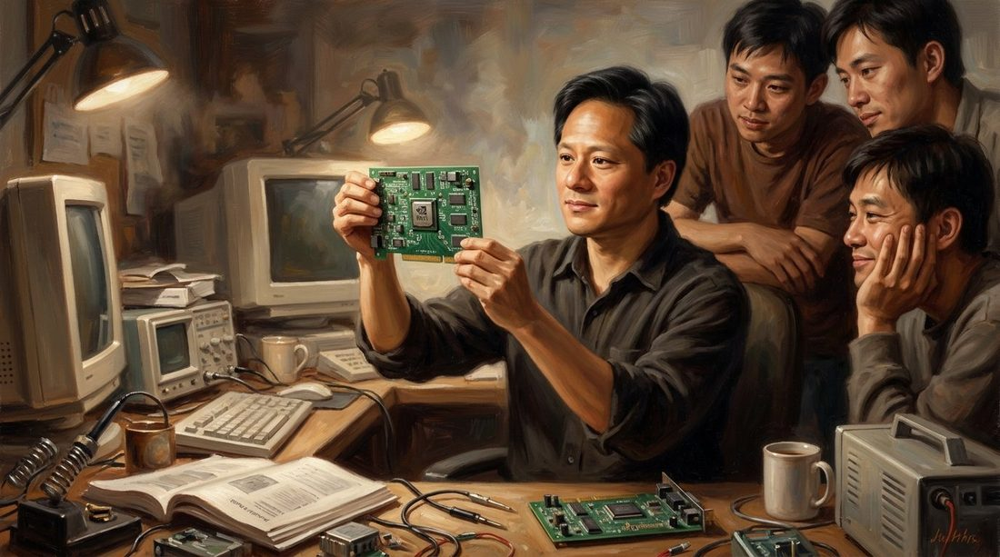<figcaption>The first big chip, the NV1 — built with pride, in a market that was moving another way.</figcaption></figure> For a young company, this could have been the end.

Jensen went to the Sega executive, Shoichiro Irimajiri, and told him the truth: NVIDIA could not continue on the old path. The relationship did not end with a closed door. Sega invested five million dollars in NVIDIA, and the company changed direction. In 1997, its new chip, RIVA 128, was the success it needed. In 1999, NVIDIA went public and introduced the GeForce 256, which it called the first GPU.

<figure>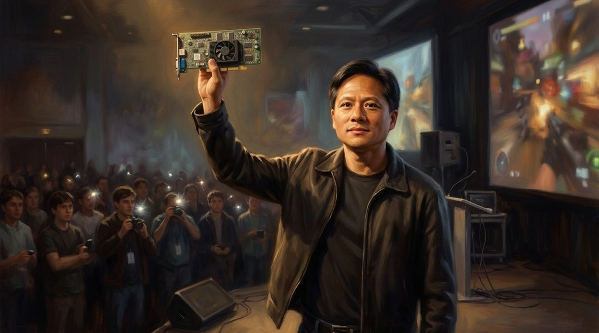<figcaption>1999. Jensen holds up the GeForce 256 — the chip NVIDIA called the first GPU.</figcaption></figure> Jensen had learned something important: leading a company does not mean pretending every decision was right. Sometimes you have to face a mistake, ask for help, and change course.

<figure>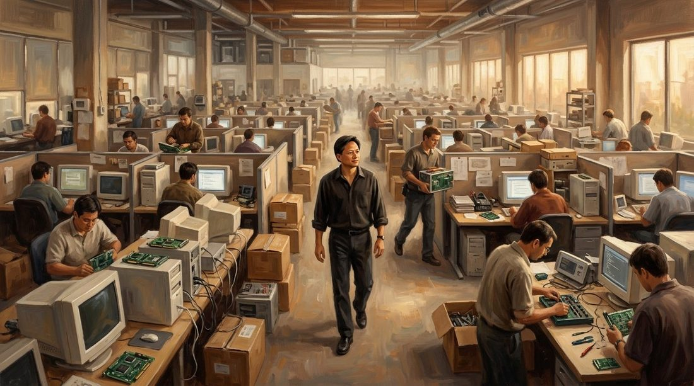<figcaption>By the end of 1999, the small team had become a company of hundreds.</figcaption></figure>

## The Bet That Took Years

By the 2000s, NVIDIA had a clear, successful business: gamers bought its chips for faster, more beautiful games.

<figure>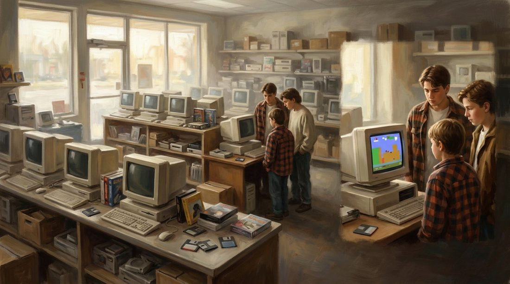<figcaption>Personal computers were everywhere now — but their pictures were still simple. That gap was NVIDIA's chance.</figcaption></figure> So why spend money on something very different?

Inside a graphics chip, millions of tiny parts of a picture are drawn at the same time. Jensen saw that scientists also needed computers to do many calculations at once. In 2006, NVIDIA introduced CUDA, which let programmers use graphics chips for far more than games.

<figure>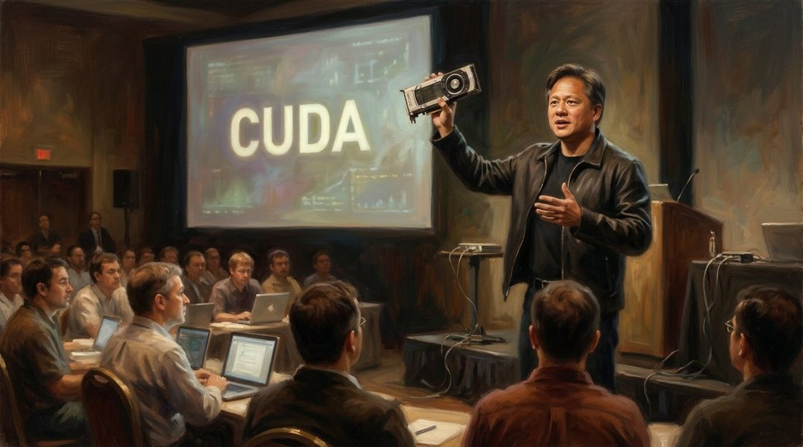<figcaption>CUDA. Jensen's bet that a graphics chip could do far more than draw games.</figcaption></figure> NVIDIA worked with universities and researchers for years, building software and teaching people to use it.

It cost a great deal of money, and for years CUDA made almost none. Some shareholders questioned the decision. But Jensen had seen researchers solve real problems with these chips, and he believed their work could lead to something much bigger. So he kept investing, without knowing when it would pay off.

<figure>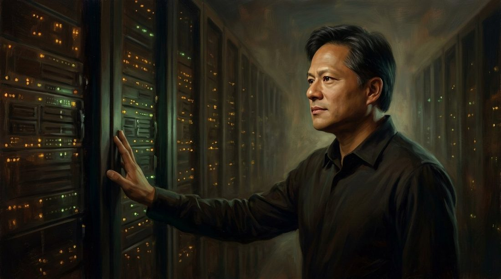<figcaption>For years, the bet made almost no money. Jensen stayed with it.</figcaption></figure>

## The Day the Future Became Real

In 2012, three researchers — Alex Krizhevsky, Ilya Sutskever, and Geoffrey Hinton — built a system called AlexNet, trained on NVIDIA graphics chips, and it achieved a remarkable result in a famous competition.

<figure>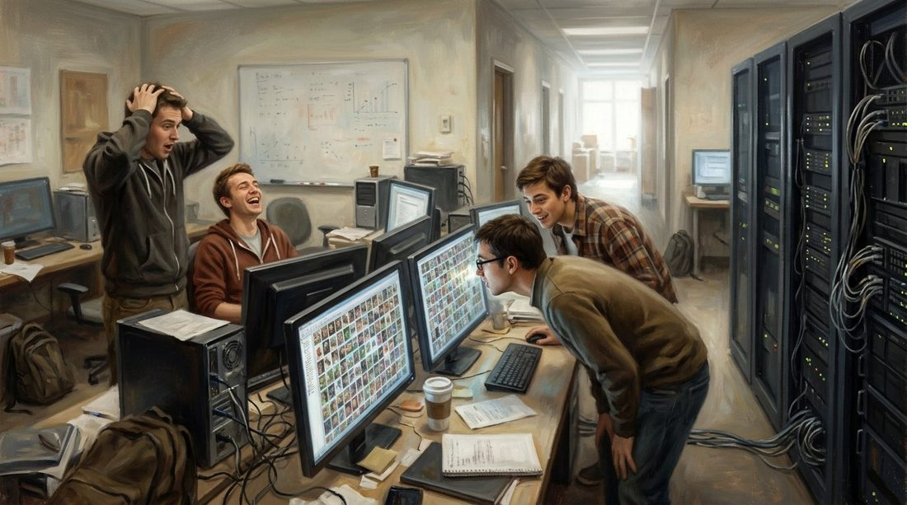<figcaption>2012. In a university lab, researchers celebrate — their system, trained on NVIDIA chips, has just beaten the world.</figcaption></figure> The discovery belonged to the researchers. But it showed the world what GPUs could do for a new kind of computing.

<figure>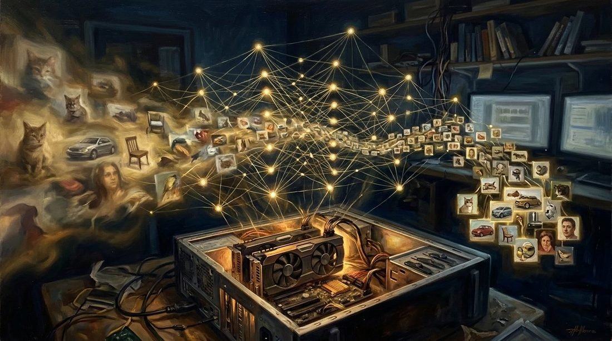<figcaption>Inside the machine: thousands of pictures flow in, and the network learns to see.</figcaption></figure>

NVIDIA kept building. In 2016, Jensen personally delivered a DGX-1, a powerful computer made for AI research, to a young organization called OpenAI.

<figure>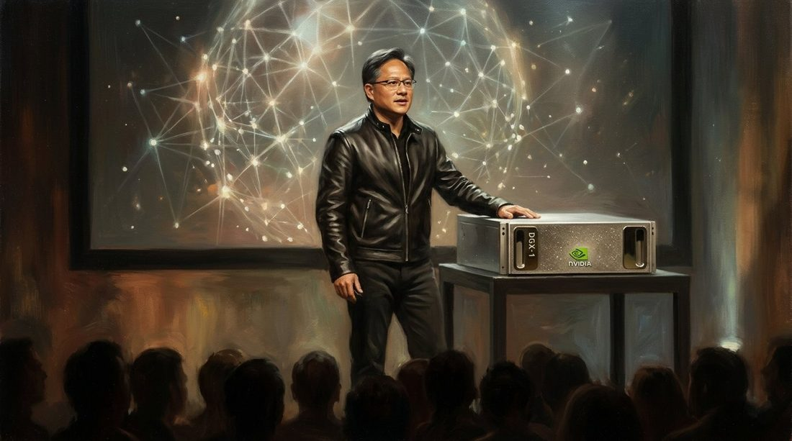<figcaption>2016. Jensen presents the DGX-1, a computer built only for AI.</figcaption></figure> And because one powerful chip was no longer enough, NVIDIA bought Mellanox, whose technology helps thousands of chips work together as one enormous system — the kind of system that companies like [Amazon](/stories/history-of-amazon/) would one day need in their giant data centers.

Then, in late 2022, ChatGPT brought artificial intelligence to millions of people. Behind it stood years of work by many researchers and companies — and a great need for exactly the technology Jensen had believed in. He stood before large crowds in his familiar black leather jacket, showing them what NVIDIA had built

<figure>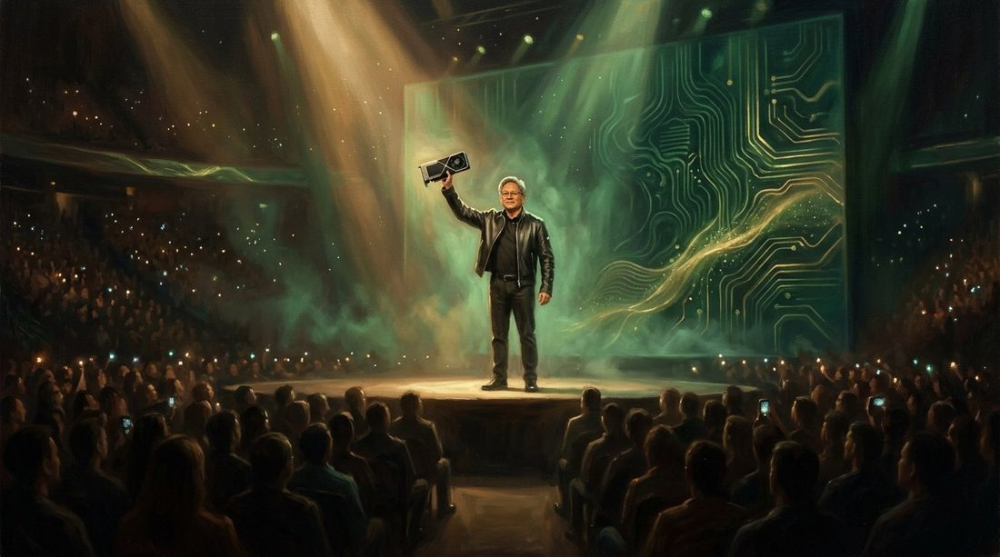<figcaption>The boy from the Denny's sink, on the biggest stages in technology.</figcaption></figure>, much as [Elon Musk](/stories/history-of-elon-musk/) — another boy who once sold something small he had made — had stood behind his own impossible bets. In 2024 came Blackwell, a new generation of NVIDIA technology, and later the next one, called Vera Rubin.

By 2026, Jensen was leading one of the world's most important technology companies. Yet after all those years, he still spoke proudly about the ordinary jobs he had done when he was young.

## What This Story Teaches Us

- **Small work, done with care, is never wasted.** The boy who planned his steps around a restaurant sink was already learning how to run a company: see the whole system, waste nothing, take the work seriously.
- **Admitting a mistake can save the dream.** With the NV1, Jensen told Sega the truth and changed direction. With CUDA, he did the opposite — he stayed. Wisdom is knowing which moment you are in.
- **A bet on the future is paid for in quiet years.** CUDA cost money for years before AlexNet, and a decade before ChatGPT. The world called it a success only at the end. He had to believe during all the years when nobody could see it yet.

## The Boy Behind the Legend

Long before NVIDIA, Jensen was a young man washing dishes at Denny's — a job few people noticed. His journey was never easy.

<figure>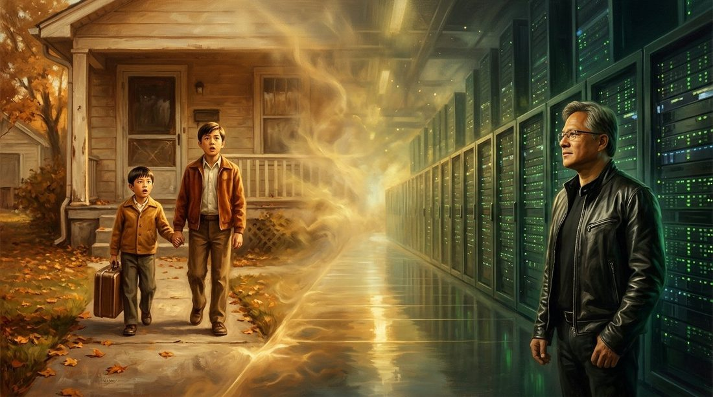<figcaption>From a relative's small house in Washington to endless halls of servers — one life, joined by light.</figcaption></figure> He made mistakes, faced doubt, and spent years building something he believed in, without knowing where it would lead.

When this story was researched in late 2026, there was a lot of personal news about Jensen out there. But that is his personal life, and it is not ours to judge. Fairly speaking, Jensen Huang is an outstanding person — one of the finest that American education has ever produced.

Maybe your dream also feels far away today. Jensen's story reminds us that great things can begin with small steps, hard work, and the courage to dream bigger. And you — what do you think about him?

<figure>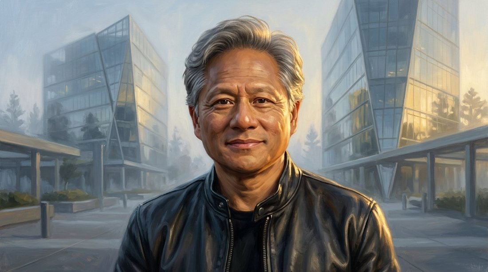<figcaption>Jensen Huang today, outside the glass towers of NVIDIA — still in the black leather jacket.</figcaption></figure>
