Imagine spending five years building a store with your own hands. The customers are coming. The sales are growing. Your future finally looks bright. Then one day, you learn that you have to walk away from it all — because the building was never yours.

That is what happened to Sam Walton in 1950. He lost the store he had built. But he did not lose what he had learned inside it. Twelve years later, he opened the first Walmart. This is his story, from the very beginning.

<figure>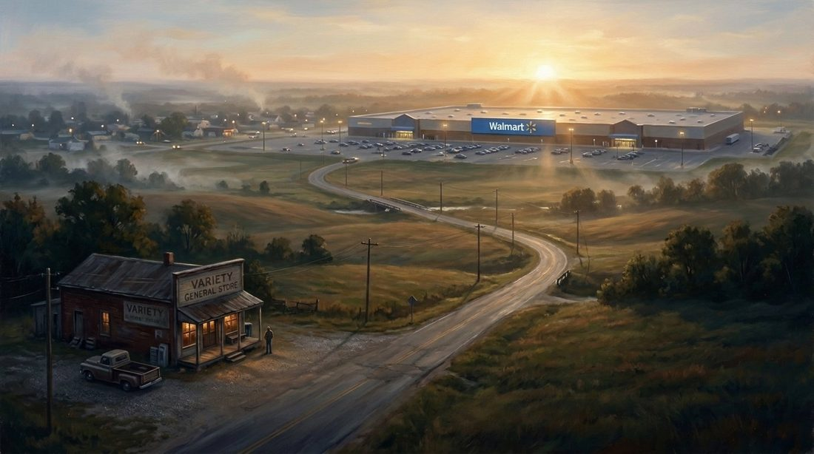<figcaption>One small store, one long road: the whole journey of Walmart in a single picture.</figcaption></figure>

## A Young Man From Oklahoma

Samuel Moore Walton was born in Oklahoma in 1918, far from the world of big business. His father worked at different jobs, the family moved often, and much of Sam's childhood was spent in Missouri, in years when families had to be careful with every coin.

<figure>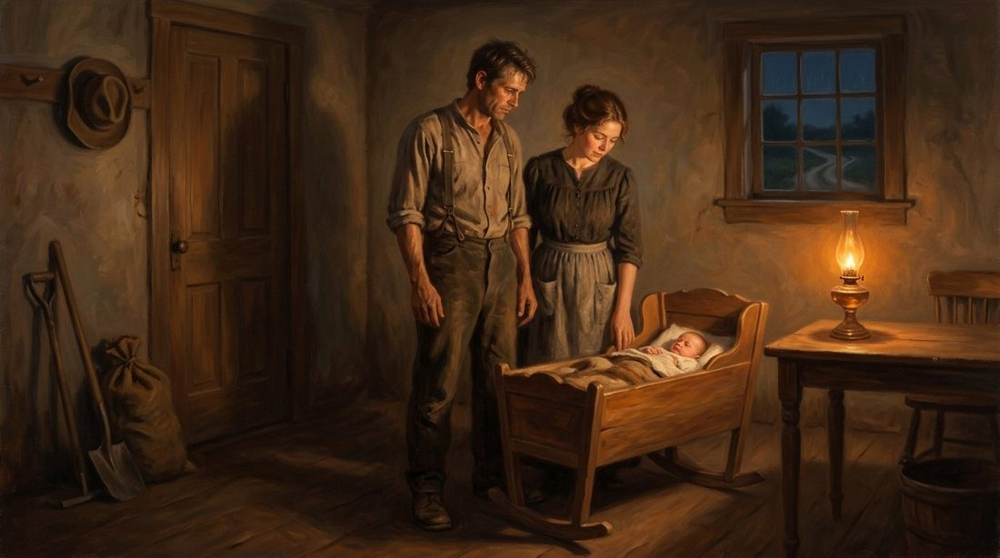<figcaption>Sam Walton was born in 1918, in a family that had to be careful with every coin.</figcaption></figure>

As a boy, Sam went to school and took small jobs to earn money. He learned to work hard, to meet people, and to take responsibility. They were simple lessons, but they stayed with him for the rest of his life.

<figure>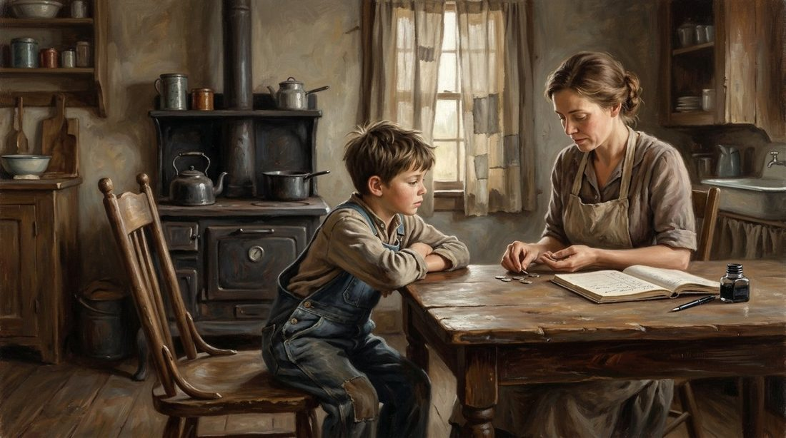<figcaption>At his mother's table, young Sam learned how much a few coins can matter.</figcaption></figure>

In 1940, he finished his studies at the University of Missouri and went to work for J.C. Penney. There, he saw retail from the inside: customers, products, prices, and small problems to solve every day. A store could look simple from the street. Running one well was another matter.

<figure>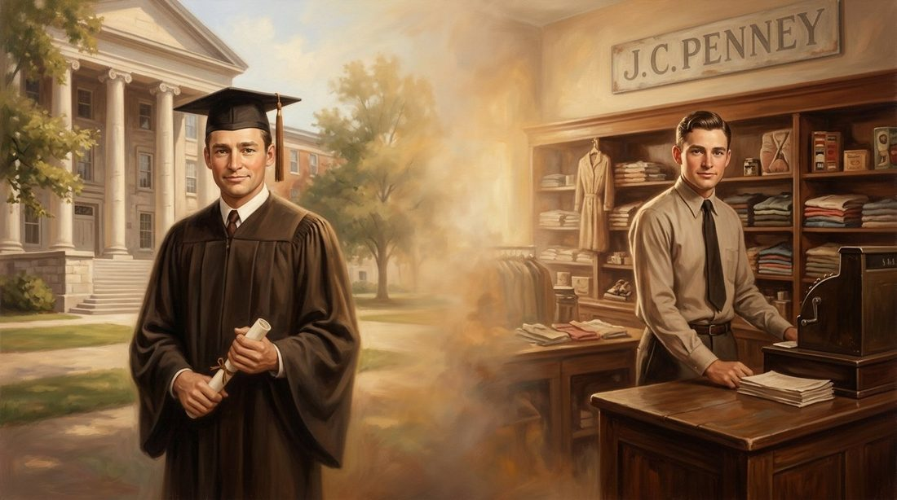<figcaption>From university to J.C. Penney: in 1940, Sam saw retail work from the inside for the first time.</figcaption></figure>

Then World War II changed his plans. Sam worked at a military supply plant and served in the Army. In 1943, he married Helen Robson, who dreamed of raising a family in a small community. That wish would quietly shape everything that came next.

<figure>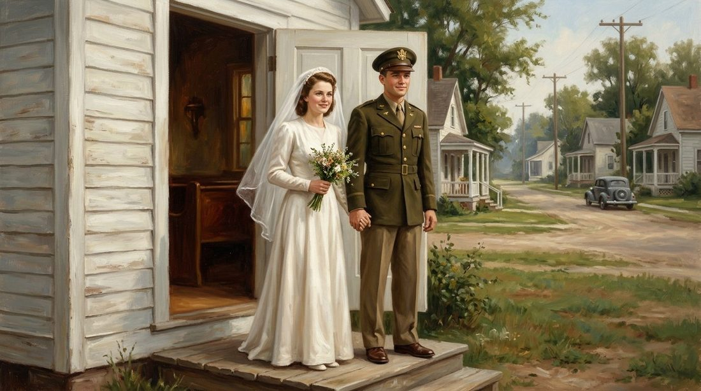<figcaption>In 1943, Sam married Helen Robson — the partner beside him for everything that came next.</figcaption></figure>

## The Store He Lost

When the war ended, Sam wanted a store of his own. In 1945, he and Helen moved to Newport, Arkansas, where he took over a Ben Franklin variety store. It sold ordinary things people needed at home. Nothing about it looked like the beginning of a famous company.

<figure>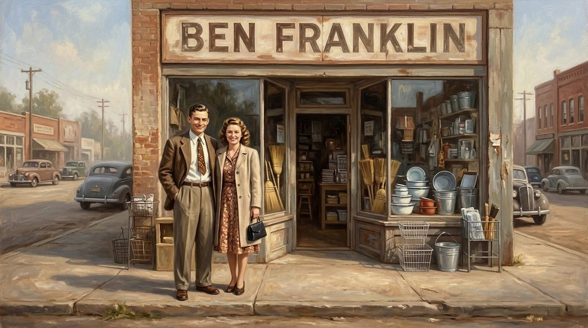<figcaption>Newport, 1945: Sam and Helen in front of the little store that started everything.</figcaption></figure>

But behind its counter, Sam began testing the idea of his life. He studied what other shops charged, searched for ways to buy goods for less, and passed the savings to his customers as lower prices. He earned less on each item — so he had to sell more items. The customers came. In his first full year, the store sold about 105 thousand dollars of goods. By the fifth year, sales had risen to around 250 thousand dollars.

<figure>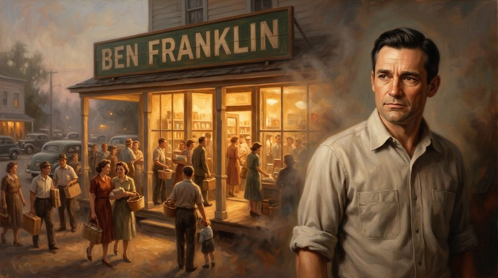<figcaption>The store was winning — customers, sales, life. But the building was never his.</figcaption></figure>

Then came the problem he could not solve. Sam did not own the building. He was only renting it. When the lease ended, the landlord refused to renew it — he wanted the location for his own son. Sam had to leave the store he had spent five years building.

<figure>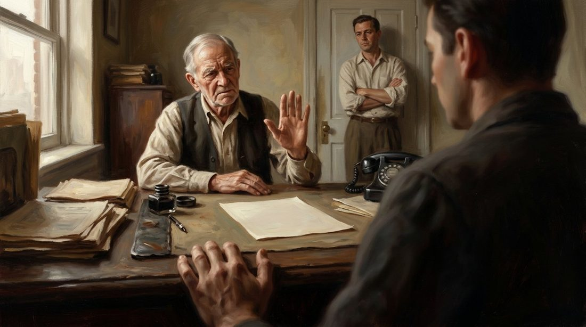<figcaption>The landlord said no. The lease would not be renewed — his son would take the store.</figcaption></figure>

<figure>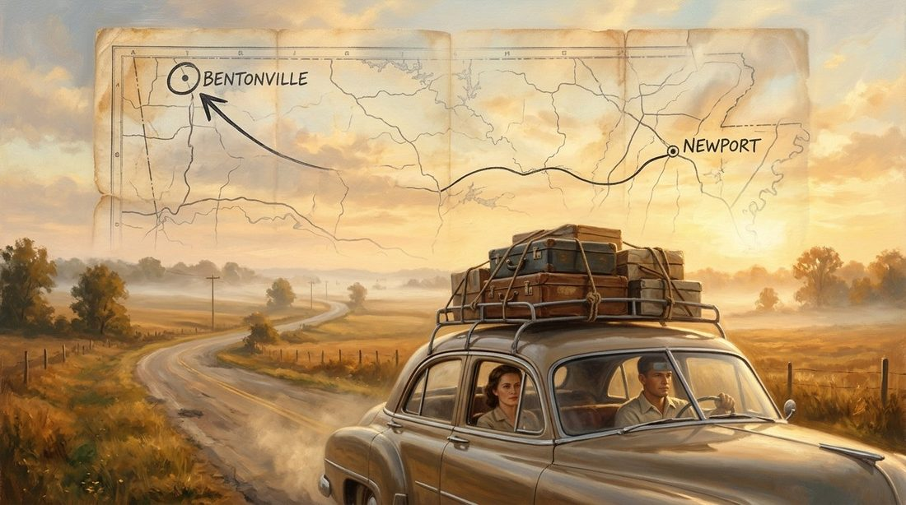<figcaption>In 1950, the family drove across Arkansas — from Newport in the east to Bentonville in the far northwest.</figcaption></figure>

## Starting Again in Bentonville

In 1950, Sam and Helen moved to Bentonville, Arkansas, and Sam opened a variety store called Walton's 5&10 on the town square. He did not arrive empty-handed. Newport had given him years of practice, and he kept visiting other stores, studying their ideas, and hunting for better prices.

That little store is still standing today. It is the Walmart Museum now — and people still walk through its doors, free, to stand where Sam stood.

<figure>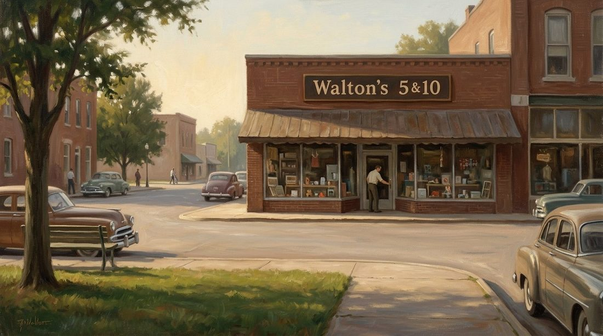<figcaption>Walton's 5&10 on the Bentonville square: a very small store in a very quiet town.</figcaption></figure>

<figure>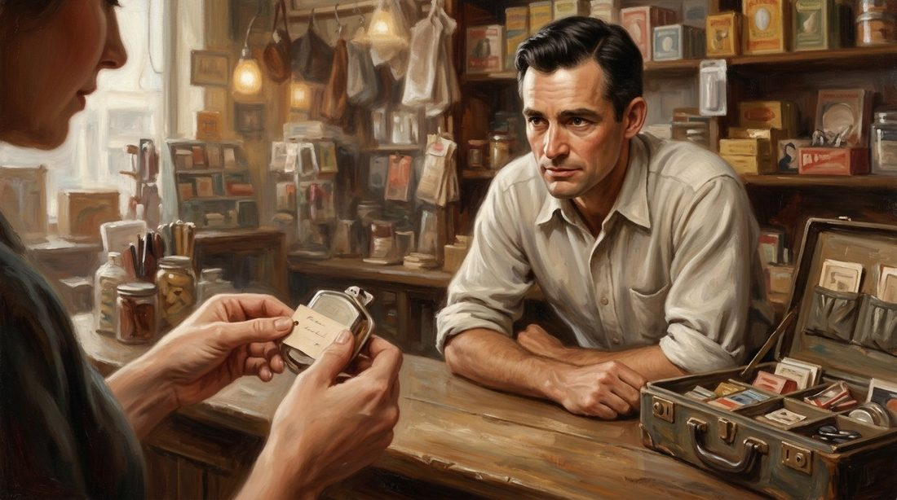<figcaption>Sam watched how carefully customers studied every price. Newport had taught him that.</figcaption></figure>

As the 1950s passed, he added more stores. America was changing: families were driving more, roads were improving, and large discount stores were opening — mostly in big cities. Sam saw something different. Families in small towns wanted good prices too, but they had few stores to choose from. What if a large discount store could work in a place like that?

<figure>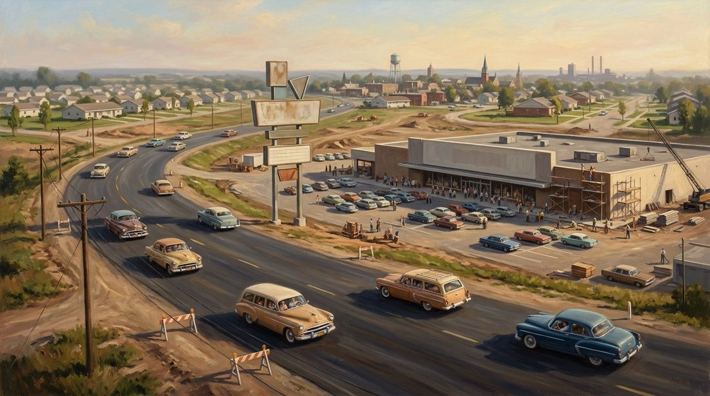<figcaption>America was changing: better roads, more cars — and big discount stores, mostly near big cities.</figcaption></figure>

Ben Franklin would not support his plan. So Sam decided to build the store under his own name.

## 1962: The First Walmart

On July 2, 1962, Sam Walton opened the first Walmart Discount City in Rogers, Arkansas. He was 44 years old. It was not a beautiful luxury store. That was never the point. Sam wanted families to feel that coming there would save them money.

He was not alone. Kmart and Target opened their first stores that same year, with more money and larger organizations, looking toward bigger markets. Sam took discount shopping into smaller communities instead — harder work, because a large store needed enough customers every week, and products had to arrive on time.

<figure>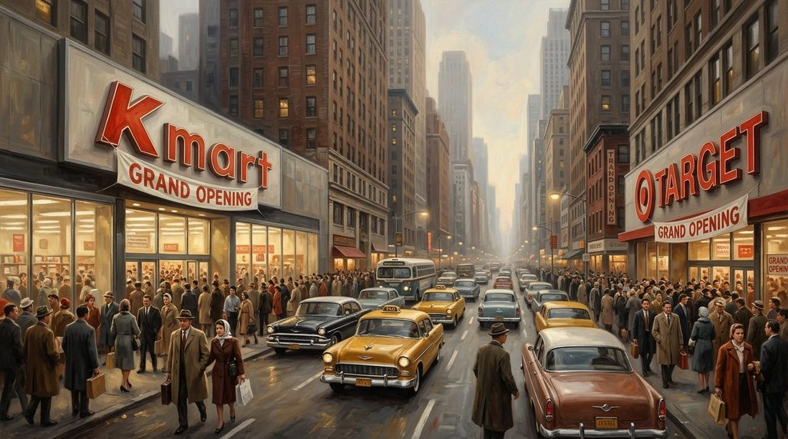<figcaption>Sam was not alone: Kmart and Target opened their first stores in 1962 too — in the big cities.</figcaption></figure>

The first stores were far from perfect, but Sam and his team learned as they went. Five years later, the Walton family had 24 stores, selling more than 12 million dollars of goods in one year.

<figure>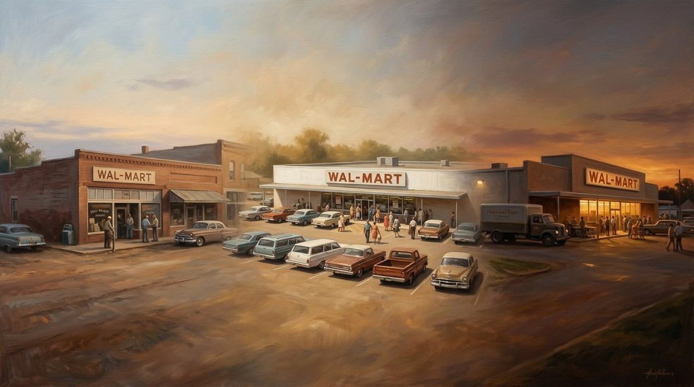<figcaption>Town by town, the stores grew: five years after the first one, the family had 24.</figcaption></figure>

## The Price That Changed America

Walmart's way grew from the lesson of Newport: make less money on one item, sell more items, and give people a reason to return. Many stores offered short sales. Walmart built a promise called Everyday Low Prices — low prices on ordinary days, not just during a big sale.

<figure>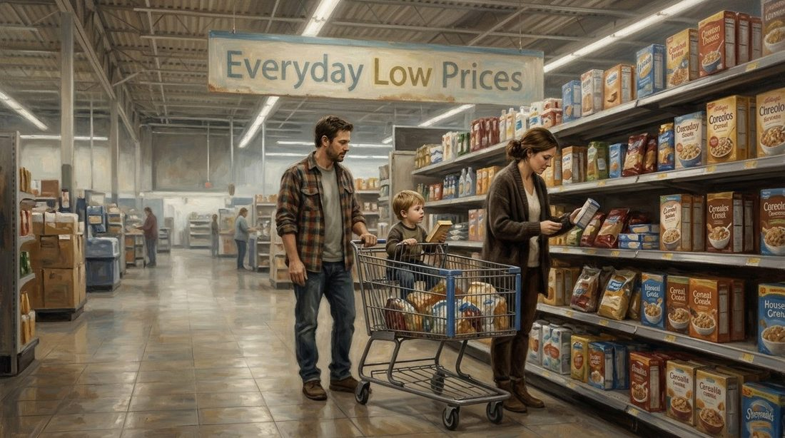<figcaption>Everyday Low Prices: not a short sale, but a promise for ordinary days.</figcaption></figure>

A low price on a shelf was only the beginning. Walmart grouped its stores so trucks could bring products from one central place to several stores at once, and it invested in computers to track sales and plan deliveries. The family at the checkout never saw any of this. They only saw food, clothes, and household goods at prices they could afford. The whole company worked so that the low price was possible.

<figure><figcaption>The family never saw the trucks and computers. They only saw prices they could afford.</figcaption></figure>

## The Return to Newport

In 1969, nearly twenty years after Sam had been forced to leave, Walmart opened Store Number 18 in Newport. He said he had no revenge in mind. But returning to the town where his first dream ended, now with a growing company of his own, was a remarkable moment.

<figure>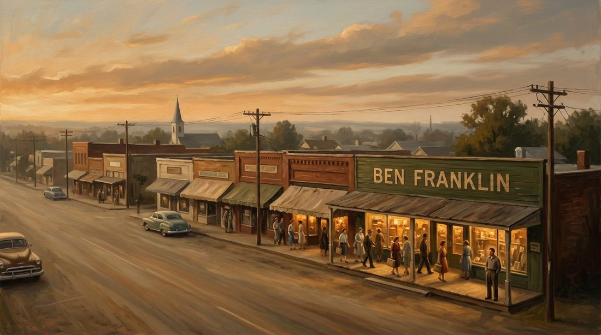<figcaption>Newport — the town where the first dream ended, and where Walmart returned in 1969.</figcaption></figure>

The business moved quickly after that. Walmart became a corporation in 1969, offered shares to the public in 1970, and joined the New York Stock Exchange in 1972. A distribution center and home office grew in Bentonville, and Sam kept visiting stores, asking questions, and carrying good ideas from one town to the next. By 1980, Walmart had 276 stores, sales passed 1 billion dollars, and about 21 thousand people worked for the company.

<figure>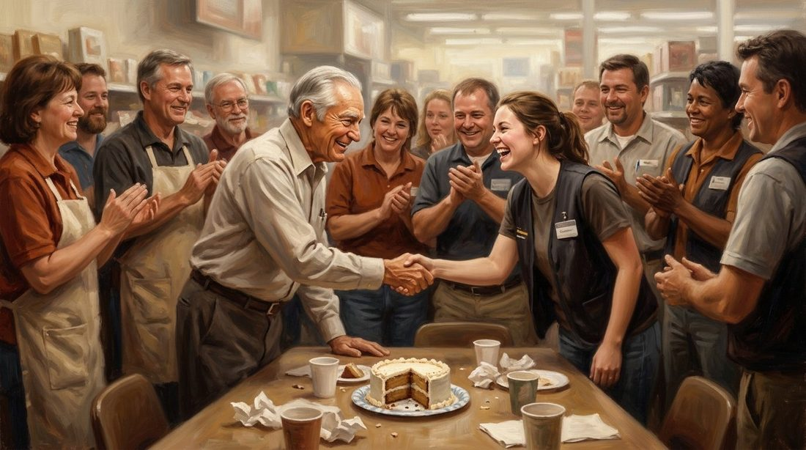<figcaption>Even as the company grew serious, Sam still celebrated results with his people, face to face.</figcaption></figure>

## Hula Dances, Satellites and Supercenters

In 1983, Walmart opened its first Sam's Club, where members could buy larger amounts at low prices, and computers arrived at the checkout counters. That same playful founder once promised his employees that if they reached a big profit goal, he would dance the hula on Wall Street. They reached it — and in 1984, Sam danced in public in a grass skirt.

<figure>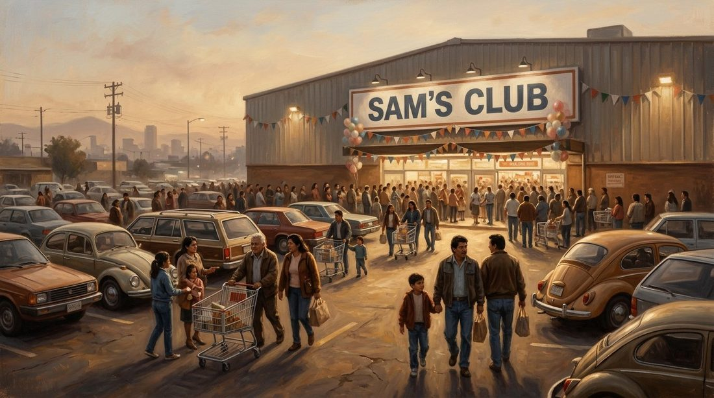<figcaption>In 1983, the first Sam's Club opened — bigger amounts, the same low prices.</figcaption></figure>

In 1987, Walmart built its own satellite network to share information between stores. In 1988 came the first Supercenter, bringing a discount store and a full grocery supermarket together under one roof. By 1990, Walmart was the largest retailer in the United States.

<figure>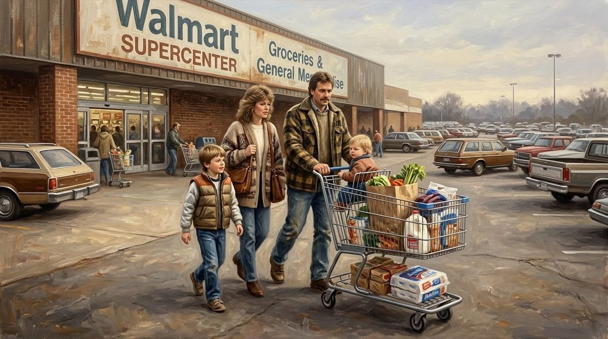<figcaption>The Supercenter, 1988: a discount store and a full supermarket under one roof.</figcaption></figure>

## The Last Years of Sam Walton

In 1991, Walmart entered Mexico, its first big step into the world. In 1992, Sam received the Presidential Medal of Freedom, one of America's highest civilian honors. But he was very ill. On April 5, 1992, Sam Walton died at the age of 74. The man who once lost a small shop in Newport had lived to see his company become America's largest retailer.

<figure>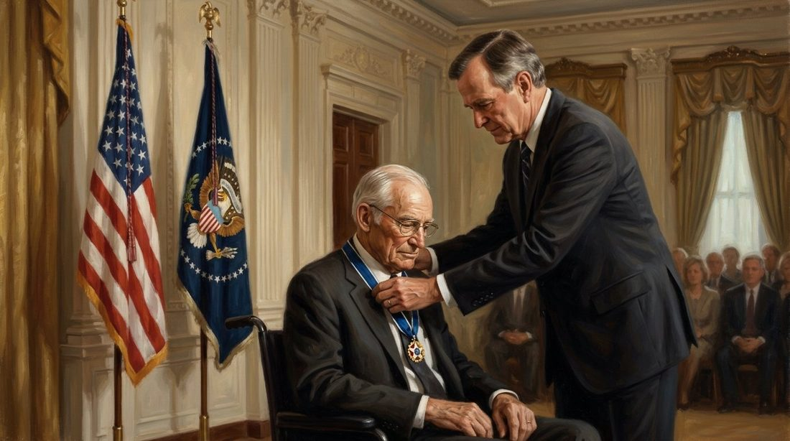<figcaption>In 1992, Sam received the Presidential Medal of Freedom, one of America's highest honors.</figcaption></figure>

What he left behind was more than stores. It was a way of working: listen to customers, watch the prices, and always look for a better way. Now Walmart had to carry those lessons forward without him.

## Walmart After Sam

The company kept growing — into Canada, China, the United Kingdom, and beyond — but not every country worked, and some stores were later sold. Its low prices helped millions of families save money, while smaller stores struggled to compete, and workers and suppliers faced growing pressure.

Then shopping itself changed. People began buying from their living rooms, and [Amazon](/stories/history-of-amazon/) reached customers without opening a single store in their town. Walmart answered by investing in its people — raising pay and training from 2015 — and by moving hard into online shopping and delivery. In 2018, it even changed its name from Wal-Mart Stores to Walmart Inc., because a customer no longer had to walk into a store at all. When COVID-19 arrived in 2020, pickup and home delivery became part of everyday life.

<figure>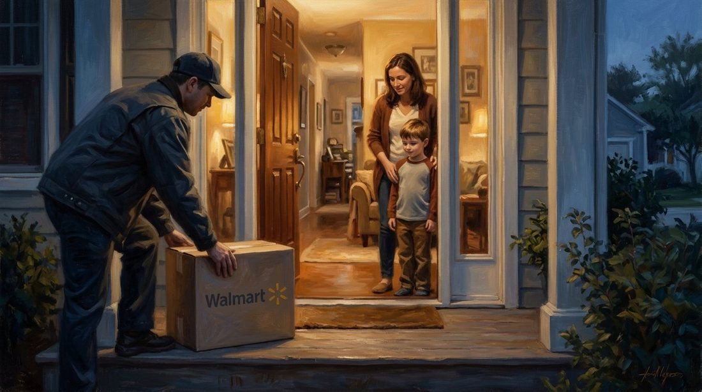<figcaption>Shopping changed: the store learned to come to the customer's door.</figcaption></figure>

In February 2026, John Furner became Walmart's new CEO. That year, the company reported about 713 billion dollars in revenue — far beyond anything Sam could have imagined behind that little counter in Newport.

## What This Story Teaches Us

- **Losing the place is not losing the lesson.** Sam lost his Newport store, but he kept the experience, the habits, and the idea of low prices. Twelve years later, those things built Walmart.
- **A low price is a promise the whole company must keep.** Everyday Low Prices only worked because buying, trucks, computers, and thousands of people worked together behind one simple number on a shelf.
- **Small towns are not small dreams.** Big retailers looked at large cities. Sam looked at the families everyone else had passed over — and built one of the biggest companies in the world among them.

## The Door That Opened Again

Sam Walton's journey reminds us of something simple and true. Sometimes, the place where one dream ends is not the place where your journey ends. Newport took his store. It could not take what the store had taught him.

Maybe you have lost something you built, too — a job, a business, a plan you believed in. Sam's story says the ending you did not choose can still become a beginning, if you carry the lesson with you and start again.

<figure><figcaption>The place where one dream ends can still become a beginning.</figcaption></figure>

And it all began with a store he could not keep. And now, my friend, tell me: if you had to begin again, what would you build this time?
