This page is the companion to our story of Jensen Huang. Scroll down and walk through his life, year by year — from a small boy looking out of a window in Taiwan, to the man who waited decades for his idea's time to come.

Every moment below carries an illustration from the story. And at the end of the timeline, we come to the question the whole world is asking now: after his shock resignation in 2026, who could ever replace him? For the full story, read [the complete article](/stories/history-of-jensen-huang/) — the video is waiting at the bottom of this page.

1963Age 0

Born in Tainan, Taiwan. His family later moves to Thailand — the first of many moves in his young life.

1972Age 9

Sent to America with his older brother. They stay with relatives, then enter a boarding school in Kentucky.

1973Age 10

Bullied at the boarding school, and put in charge of cleaning the bathrooms. Nobody imagines this boy will become a giant of world technology.

1979Age 16

Graduates from high school in America — and as a teenager, he is one of the country's top junior table tennis players.

1984Age 21

Graduates from Oregon State University in electrical engineering, then starts work at AMD.

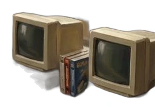
1985Age 22

Joins LSI Logic, and begins years of deep experience in chip design and the semiconductor industry.

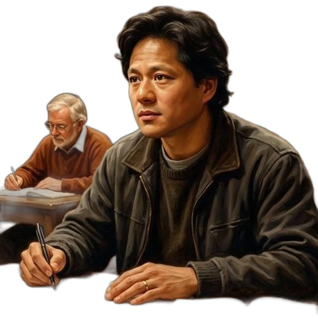
1992Age 29

Earns a master's degree in electrical engineering from Stanford University.

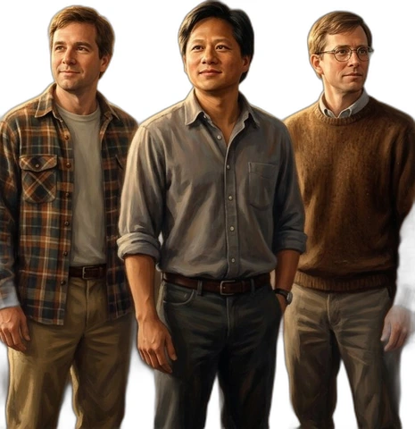
1993Age 30

In a Denny's restaurant booth, he and two engineer friends decide to start a company. NVIDIA is born.

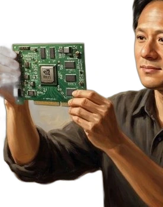
1995Age 32

NVIDIA's first product, the NV1, fails in the market. The young company faces a fight for survival.

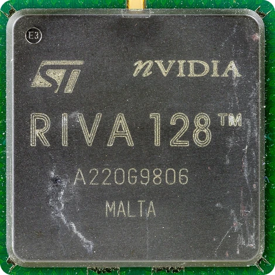
1997Age 34

The RIVA 128 graphics card succeeds. NVIDIA finally stands on solid ground.

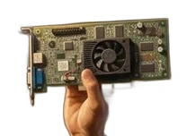
1999Age 36

NVIDIA goes public and launches the GeForce 256. The GPU era officially begins.

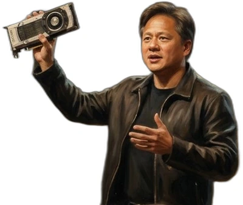
2006Age 43

CUDA arrives. Graphics chips can now carry scientific computing too — planting the seed of the AI revolution.

2012Age 49

AlexNet wins a breakthrough in deep learning, powered by NVIDIA GPUs. The bet Jensen held for years begins to show its value.

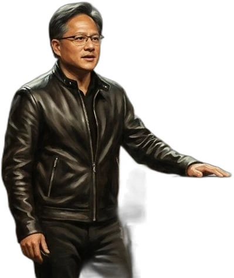
2016Age 53

Jensen personally delivers the DGX-1 supercomputer to OpenAI, and NVIDIA keeps investing in AI infrastructure.

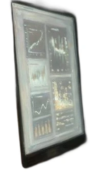
2022Age 59

ChatGPT appears, and the world's demand for AI computing explodes. NVIDIA becomes one of the great winners of the revolution.

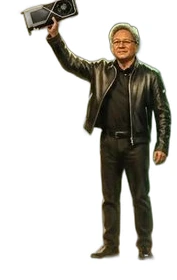
2023Age 60

NVIDIA's market value passes 1 trillion dollars. The black leather jacket becomes one of the most recognisable symbols in technology.

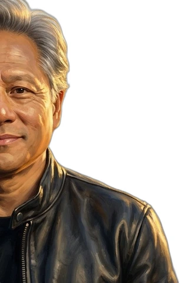
2024Age 61

NVIDIA passes 3 trillion dollars. Jensen stands at the very centre of the global technology stage.

2026Age 63

After 33 years, Jensen steps down as NVIDIA's CEO — one of the most influential figures of the AI computing era.

**63 years of life. 33 years building one company.**

From a boy cleaning bathrooms at a boarding school, to the man standing at the centre of the global AI wave. His story proves one thing: sometimes, the technology that truly changes the world must be pursued patiently for decades, before its time finally comes.

## Who Will Replace Jensen Huang?

Jensen stepped down in November 2026, after 33 years at the top of NVIDIA. For now, the company is in the hands of Colette Kress, its finance chief.

And already, the world is asking one question: who can sit in his chair?

Online, people are guessing names. Even Tim Cook — the man who leads Apple — has been mentioned. Nobody knows. These are only guesses.

Many people, it seems, do not want a replacement at all. A petition asking NVIDIA to bring Jensen back is spreading fast. And it has reached the most famous name of all. Elon Musk [wrote on X](https://x.com/elonmusk/status/2121345211959804234): "A petition is underway to reinstate Jensen, and I'm signing it too." Millions of people read his words in a few hours.

Maybe that is the real answer to the question. Some leaders can be replaced. But a man who began by cleaning bathrooms, and then waited thirty years for his idea's time to come — a CEO like Jensen may be impossible to replace.

And you — who do you think could take his chair?

Read the full story here: [The True Story of Jensen Huang — From Dishwasher to NVIDIA CEO](/stories/history-of-jensen-huang/). And for the company he built, see [The Entire History of NVIDIA](/stories/history-of-nvidia/).

**Watch his full story:**

  
  

<noscript>
<iframe src="https://www.youtube.com/embed/nXrJUFqDcDQ" title="The True Story of Jensen Huang" frameborder="0" allowfullscreen></iframe>
</noscript>

<a class="btn" href="https://www.youtube.com/watch?v=nXrJUFqDcDQ" target="_blank" rel="noopener">Watch on YouTube</a>

