Imagine a cold, quiet morning in Kentucky in 1956. An old man stands outside his empty restaurant. At sixty-five, he is about to lose the business he spent years building. At his age, most people were thinking about retirement. But the greatest chapter of his life was still ahead.

<figure>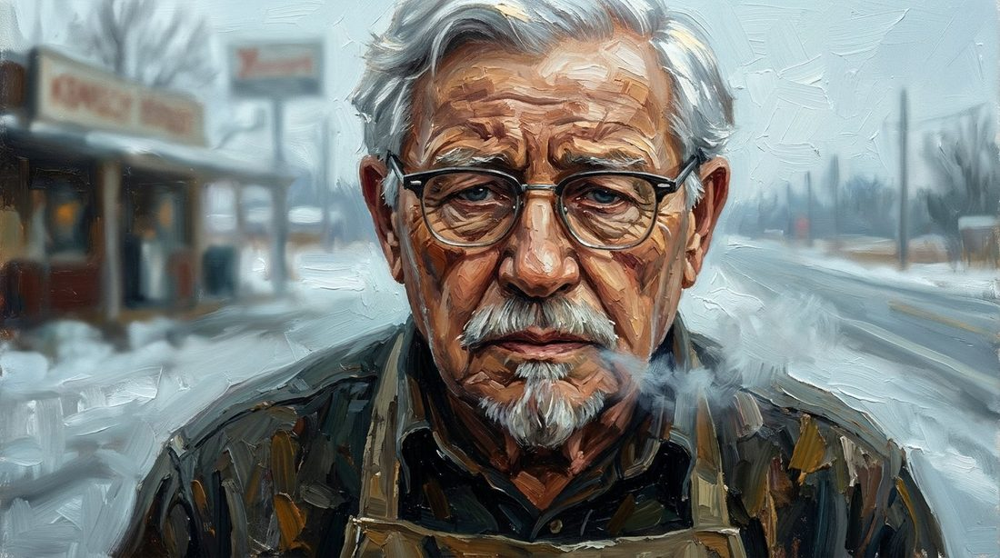<figcaption>Kentucky, 1956. At sixty-five, Harland Sanders was about to lose the restaurant he had spent years building.</figcaption></figure>

He still had one thing: his recipe for fried chicken. That recipe would change his life. And the man who lost his restaurant would become the face of thousands of restaurants around the world. This is the entire history of KFC, from the very beginning.

<figure>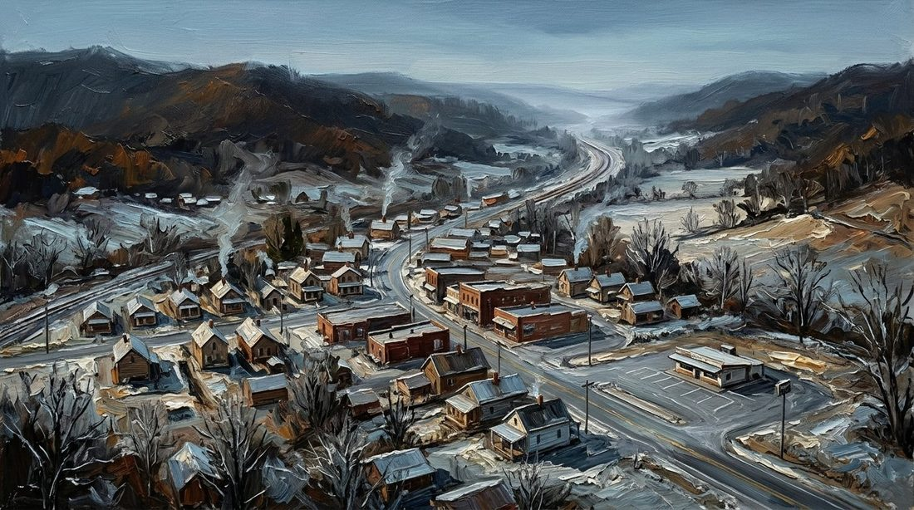<figcaption>Corbin, Kentucky: a small town in the hills, and one little restaurant by the road.</figcaption></figure>

## A Boy Who Had to Grow Up Fast

Our story begins in Indiana in 1890, where Harland Sanders was born. When Harland was only five, his father died, and everything at home changed. His mother needed to earn money, so she took work outside the home. Harland was the oldest child, and while she was away, he helped care for his younger brother and sister.

Other children were out playing, but Harland was learning how to cook. He did not dream of becoming a great cook. He simply needed to feed his little brother and sister. Before he learned how to cook for customers, he learned how to cook for the people he loved.

<figure>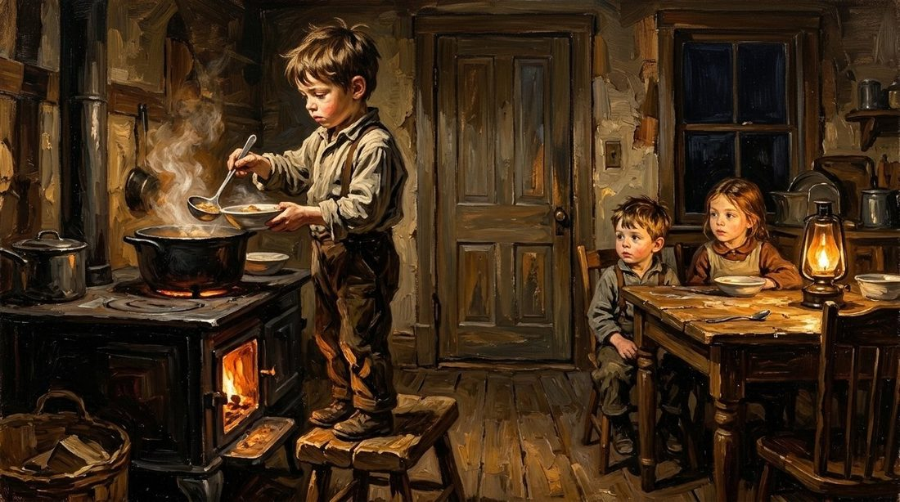<figcaption>Before he cooked for customers, Harland learned to cook for the people he loved.</figcaption></figure>

As a young man, Sanders traveled from place to place looking for work. He worked on farms, on railroads, and even sold insurance. He was a hard worker, but he also had a bad temper, and some jobs ended badly. Each time one plan failed, he had to look for another. His life did not follow a straight road toward success.

<figure>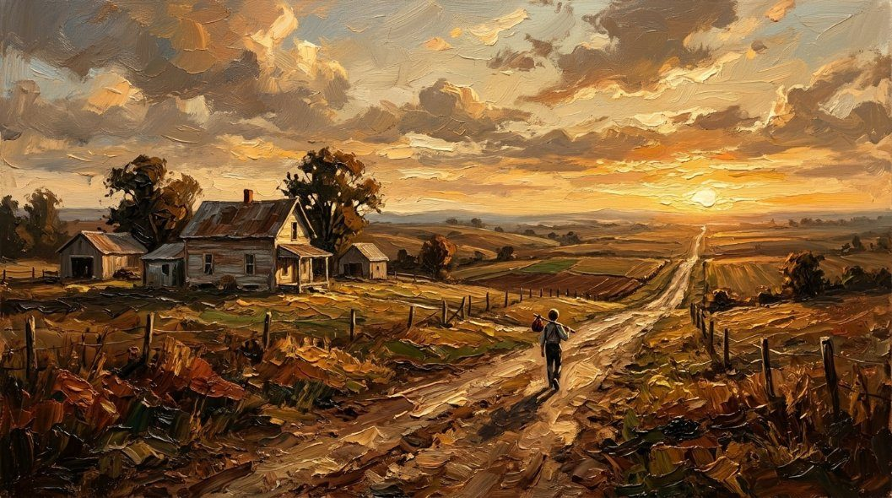<figcaption>He left home while he was still very young, and the road became his teacher.</figcaption></figure>

<figure>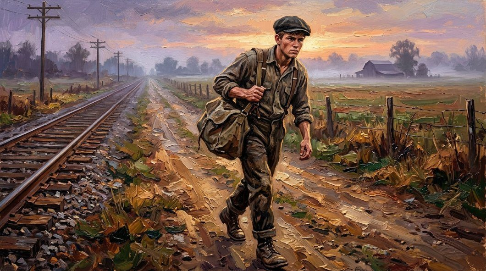<figcaption>Farms, railroads, insurance: he tried job after job, and many of them ended badly.</figcaption></figure>

## The Little Café by the Road

Around 1930, a new opportunity took Sanders to Corbin, Kentucky, where an oil company gave him the chance to run a gas station. Sanders noticed something simple: it was not just the cars that needed attention. The people inside them were hungry. And Sanders knew how to cook.

<figure>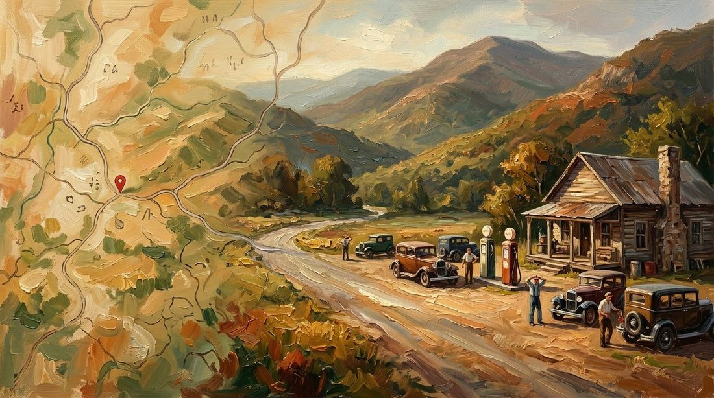<figcaption>Around 1930, the road brought Sanders to Corbin, Kentucky.</figcaption></figure>

<figure>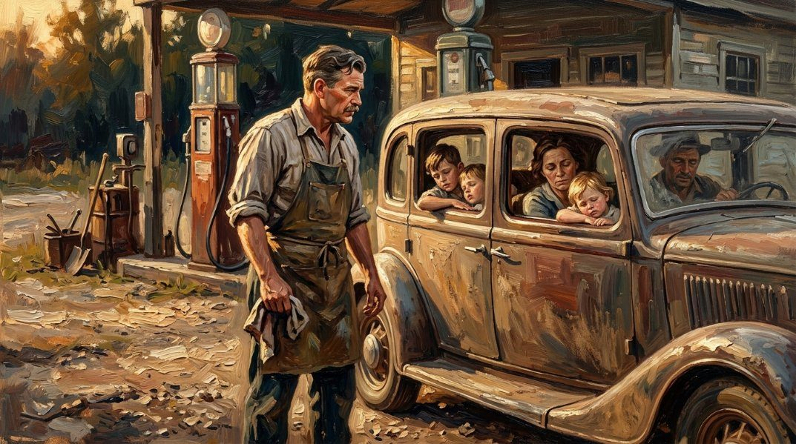<figcaption>At the gas station, Sanders saw that it was not just the cars that needed care. The people inside them were hungry.</figcaption></figure>

He began cooking for travelers in a small space beside the station. In time, his business became known as Sanders Court and Café, with a restaurant and rooms for travelers. His cooking became so well known that even a popular American restaurant guide recommended his café. After many years of changing jobs, Sanders had finally built something that people came back for.

<figure>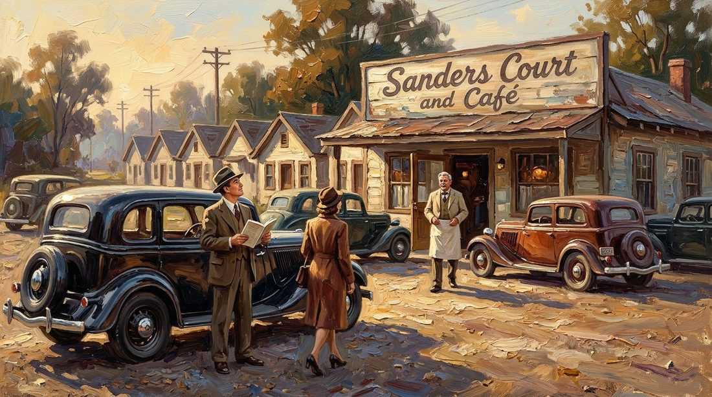<figcaption>Sanders Court and Café: the little roadside restaurant that travelers began to talk about.</figcaption></figure>

<figure>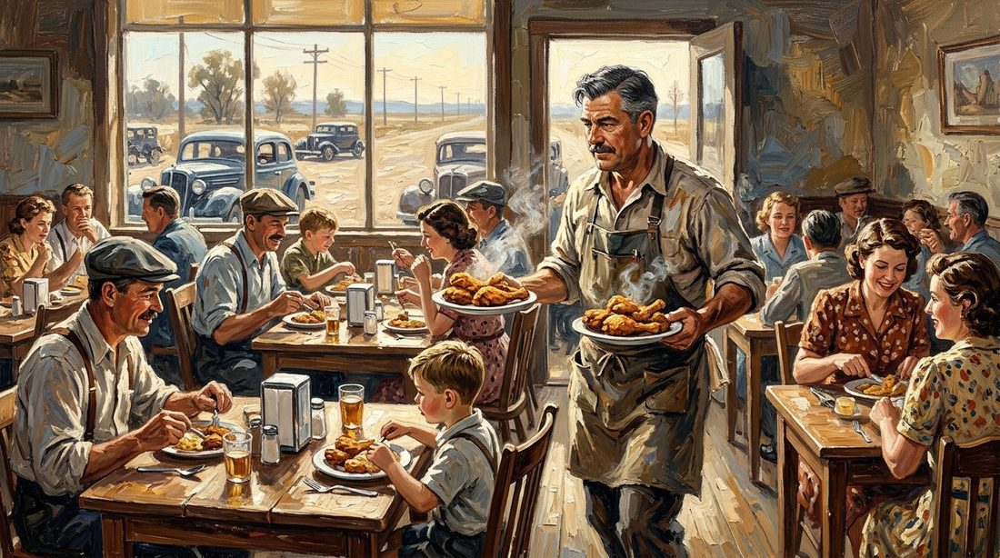<figcaption>His kitchen grew faster, and soon he was serving far more people than one small café should hold.</figcaption></figure>

But fried chicken was one of the hardest meals to prepare quickly. Frying chicken in a pan could take about thirty minutes, and travelers with a long journey ahead could not wait that long. Sanders needed a better answer.

## The Chicken That Changed Everything

By the late 1930s, Sanders knew how he wanted his chicken to taste. He worked with a mix of seasonings that became famous as eleven herbs and spices. Then he turned to a pressure cooker, a special pot that could cook food faster. Around 1939, he found a method that worked: his chicken was ready in just eight or nine minutes instead of thirty, still juicy inside, with the crispy outside he wanted.

<figure>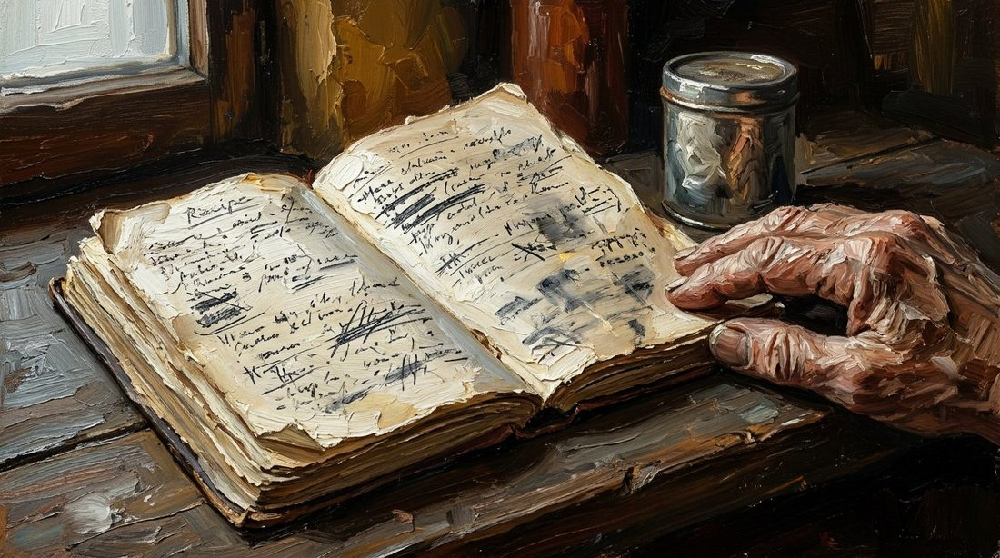<figcaption>The recipe: a mix of seasonings that became famous as eleven herbs and spices.</figcaption></figure>

<figure>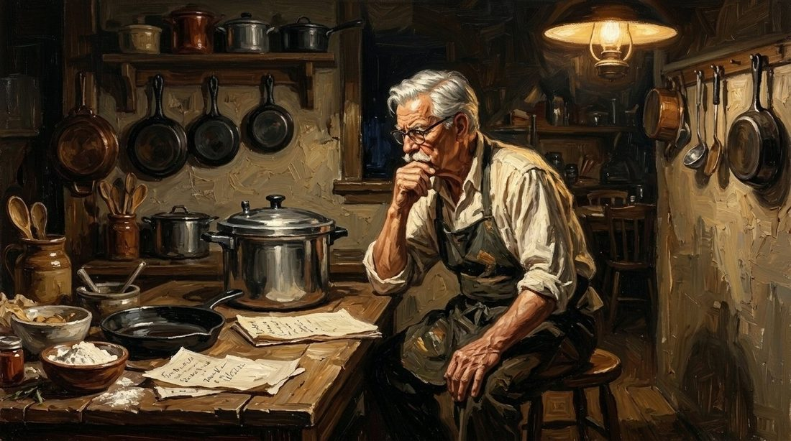<figcaption>With a pressure cooker, his chicken was ready in eight or nine minutes instead of thirty.</figcaption></figure>

Until then, people had to come to Corbin to taste his chicken. But what if his chicken could go to them? In 1952, Sanders made an agreement with Pete Harman, a restaurant owner near Salt Lake City, Utah. Harman would sell Sanders's chicken, and Sanders would receive a small payment for each chicken sold. Harman also helped give the dish a name people could remember: Kentucky Fried Chicken. Sanders had received the title of Kentucky Colonel, and with his white suit, black tie, and friendly smile, he was becoming as recognizable as the chicken itself.

<figure>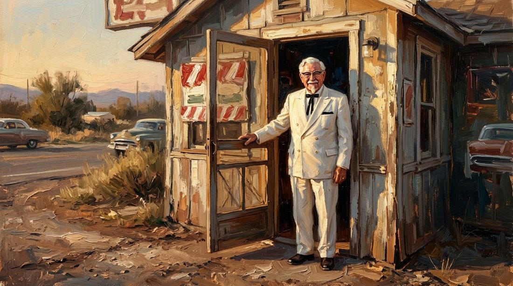<figcaption>In 1952, Pete Harman said yes, and Kentucky Fried Chicken was born.</figcaption></figure>

## When the Road Went Away

For years, Sanders's restaurant had depended on people traveling along the highway. Then the roads changed. In the early 1950s, fewer cars began passing his door, and plans came for a new highway that would take travelers around Corbin instead of through it. In 1956, he sold the restaurant and motel, at a serious loss.

Sanders was sixty-five. He had lost jobs and businesses before, but this time was different: in that little café, his childhood skill had become his life's work. And now that place was gone.

<figure>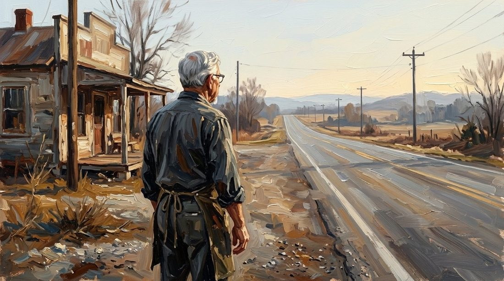<figcaption>The new highway took the travelers away, and one morning the road outside his café was empty.</figcaption></figure>

But something important had happened before the sale. Pete Harman and a few other restaurant owners were already selling his chicken, far away from Corbin. So Sanders chose a different road. He packed his car with cooking tools and seasoning and set off. At each restaurant, he asked for a chance to cook his chicken. Sometimes he slept in his car. A few owners said yes. Then a few more.

<figure>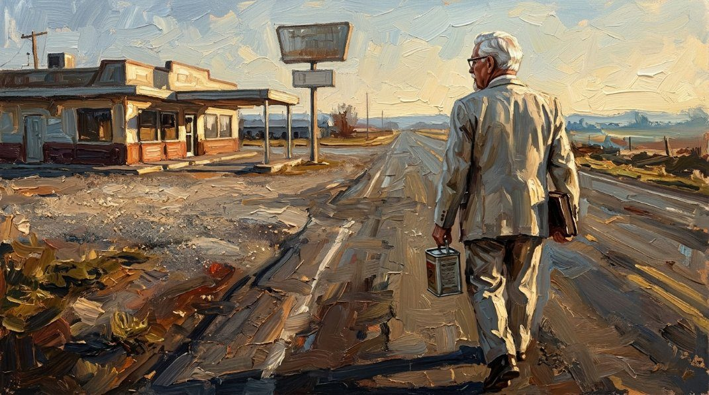<figcaption>At sixty-five, he packed his cooking tools into his car and took his recipe on the road.</figcaption></figure>

In 1964, at the age of seventy-three, Sanders sold Kentucky Fried Chicken to investors for two million dollars. He would continue to advise the company and remain the face of KFC. Eight years earlier, he had lost one restaurant. Now, he was selling a business built across hundreds of kitchens.

<figure>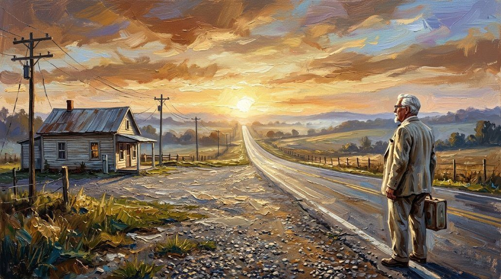<figcaption>He had lost his restaurant, but not his recipe. The greatest journey of his life was just beginning.</figcaption></figure>

## What This Story Teaches Us

- **A skill learned in hard times can feed a whole life.** Young Harland learned to cook because his family needed him, and that childhood skill became his life's work.
- **Losing the place is not the same as losing the gift.** The highway took Sanders's restaurant, but his recipe could travel from kitchen to kitchen, and it did.
- **It is not too late to begin again.** At sixty-five, when most people retire, Sanders put his recipe in his car and started the greatest journey of his life.

## The Company He Could No Longer Control

After the sale, KFC kept growing, and the Colonel's face appeared in more advertisements. But Sanders could no longer control everything the restaurants served. He complained about the company's new gravy, and about the way some restaurants cooked his chicken. In 1974, he demanded 122 million dollars in a legal fight with the owners. The man whose face helped sell KFC chicken was now fighting the company behind that face.

<figure>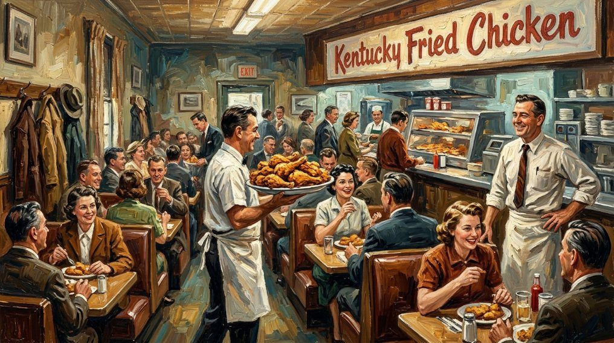<figcaption>KFC kept growing, and the Colonel’s face was everywhere. But the kitchens were no longer his to control.</figcaption></figure>

Cooking had never been just a business for Sanders. On December 16, 1980, Harland Sanders died at the age of ninety. His journey had ended, but his recipe was beginning a new life in the hands of people around the world.

## The Colonel's Chicken Travels the World

KFC opened its first restaurant in Japan in 1970, and four years later the company began promoting fried chicken as a Christmas meal. Over time, many Japanese families began ordering KFC for Christmas dinner. A meal from Kentucky had become part of a family tradition thousands of miles away.

<figure>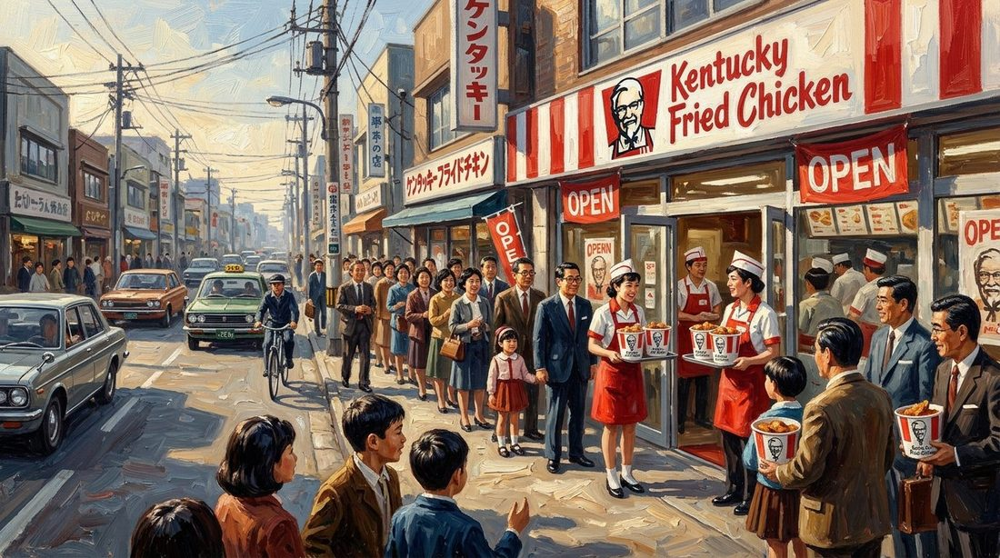<figcaption>Japan, 1970: families lined up for a taste of Kentucky, and soon made it part of their Christmas.</figcaption></figure>

In 1986, [PepsiCo](/stories/history-of-pepsi/) bought KFC, which is why you often see Pepsi served with fried chicken at KFC today. In 1987, KFC opened its first restaurant in China, near Tiananmen Square in Beijing. By September 2026, KFC had more than 13 thousand restaurants in China, and more than 34 thousand across the world. Those numbers are hard to imagine beside the little café that Sanders once ran in Corbin.

<figure>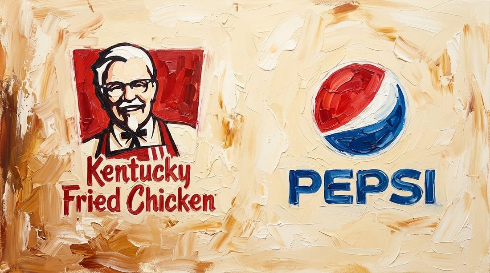<figcaption>In 1986, PepsiCo bought KFC. That is why you so often see Pepsi served with the chicken today.</figcaption></figure>

<figure>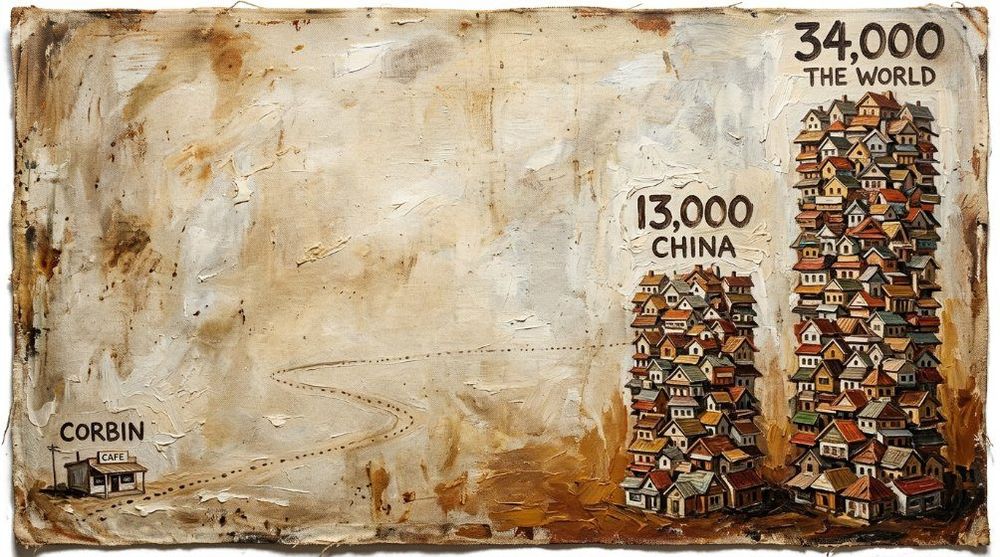<figcaption>From one café in Corbin to more than 34,000 restaurants around the world.</figcaption></figure>

Sanders could not control everything KFC became. Yet every day, people around the world still gather around a bucket of fried chicken, sharing something that began in his small Kentucky kitchen. And the Colonel's face remains on the sign.

<figure>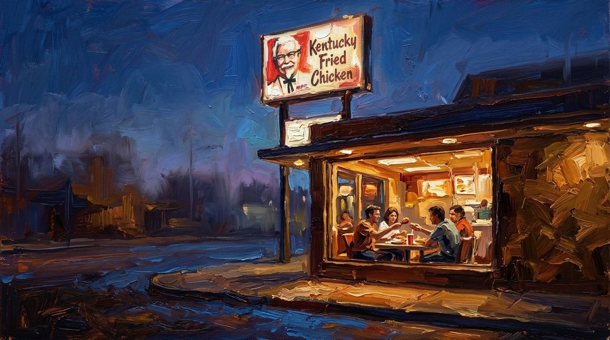<figcaption>The world changed, the menus changed, the owners changed. The Colonel’s face remained on the sign.</figcaption></figure>

<figure>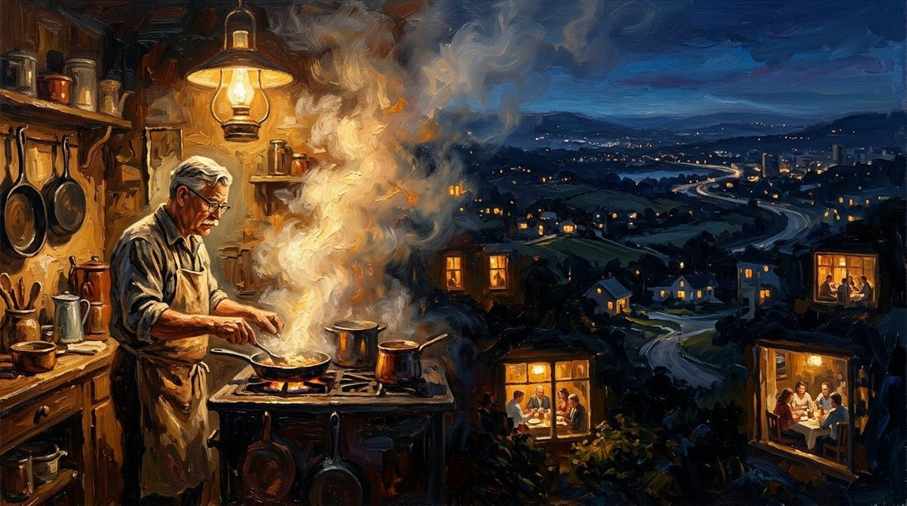<figcaption>It began in one small Kentucky kitchen. Today, people share his chicken all over the world.</figcaption></figure>

The next time you see a KFC bucket, look at the old man's smiling face. Behind that smile is the story of a man who refused to believe his best years were behind him. If you ever feel that your best years are behind you, remember the old man from Kentucky. Sometimes, the road you thought was ending is only taking you somewhere new.

<figure>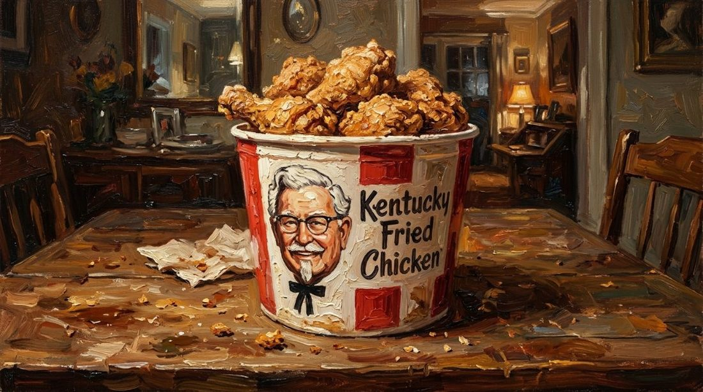<figcaption>The next time you see a KFC bucket, look at the old man’s smiling face.</figcaption></figure>

<figure>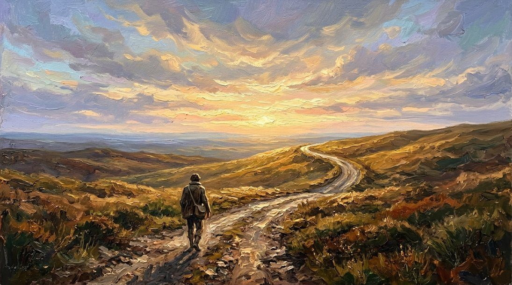<figcaption>Sometimes, the road you thought was ending is only taking you somewhere new.</figcaption></figure>