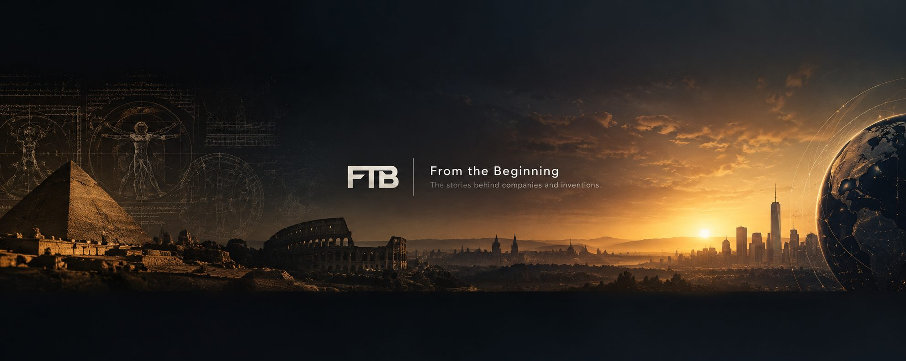

# About From The Beginning

Every great company and invention has a beginning.

**From The Beginning (FTB)** is a YouTube channel that tells the stories of how famous companies were built, how their founders began, and how important inventions came to life. Every story starts from the very first day - a small workshop, a kitchen, a garage - and follows the long road to the brand the whole world knows today.

All stories are told **slowly, warmly, and in simple, clear English**, so anyone in the world can follow them, enjoy them, and learn from them.

**Watch the stories:** [From The Beginning on YouTube](https://www.youtube.com/@FromTheBeginning9)

## What You Will Find on From The Beginning

### Company History - How Companies Started

How did the world's biggest brands really begin? We tell the entire history of famous companies, year by year: the first product, the first customer, the near failures, and the ideas that changed everything.

### Founder Stories

Behind every company, there is a person. A pharmacist with a bad back. Two brothers who stopped speaking to each other. A young man selling books from his garage. Our founder stories follow the real people behind the brands - what they wanted, what they lost, and why they did not give up.

### Invention History - Who Invented It?

Some stories are not about companies, but about things: the football boot, famous drinks, and the everyday inventions that changed how we live. We ask the simple question: *who invented it, and how?*

## Stories on the Channel

From The Beginning tells the entire history of the brands you see every day. Stories already told and coming soon include:

**Drinks & Food:** Coca-Cola, Pepsi, Fanta, 7UP, Heinz, Starbucks, KFC, McDonald's, Pizza Hut, Red Bull, Monster, Nestlé

**Sport & Fashion:** Nike, Adidas, Puma, the Football Boot, Levi's, Lululemon

**Cars & Technology:** Toyota, Honda, Amazon, YouTube, TikTok, eBay, TSMC, and the story of Elon Musk

**Everyday Brands:** Walmart

Browse the stories that are ready to read here: [Read the Stories](/stories/)

New stories are on the way all the time. The best way to never miss one is to subscribe on YouTube.

## Learn English With Real Stories

From The Beginning is also made for English learners:

- **Slow, clear narration** - every story is told at a calm speed you can follow.
- **Simple English (A2-B1 level)** - real history, told with easy words and short sentences.
- **Listening practice with meaning** - you learn new words inside a true story, so they stay in your memory.
- **Read first, then watch** - every video has a companion article on this website with the key facts and the lesson of the story.

If you want English listening practice that does not feel like a lesson, these stories are for you.

## Frequently Asked Questions

### What is From The Beginning?

From The Beginning (FTB) is a storytelling YouTube channel about company history, brand history, founder stories, and invention history - how famous companies started and how great inventions were made.

### What kind of stories does From The Beginning tell?

Each video tells the entire history of one company, founder, or invention, from the beginning to today - for example, how Coca-Cola started in a backyard in Atlanta in 1886, or how Nike began with shoes sold from the trunk of a car.

### Is From The Beginning good for learning English?

Yes. Every story is narrated slowly in simple A2-B1 English, which makes the channel a gentle way to practise English listening while learning real business and world history.

### Where can I watch From The Beginning?

On YouTube: [youtube.com/@FromTheBeginning9](https://www.youtube.com/@FromTheBeginning9). Companion articles for the videos live here on [fromthebeginning.xyz](/).

