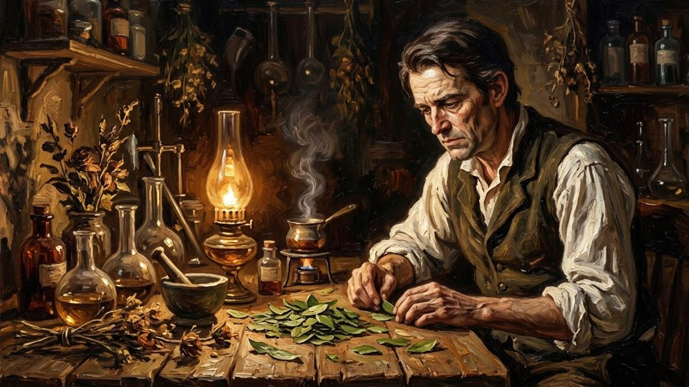

# Stories by Topic

Every story we tell is one of three kinds: the history of a company, the story of its founder, or the history of an invention. Most stories are two at once, a company and the person who began it. Choose the kind you love most, and begin where it began.



Topic &middot; 1 story{{ n }} stories
<h3>Company History</h3>
How famous companies were built, from the very first day: Coca-Cola, Nike, Amazon, Toyota, KFC and many more.



Topic &middot; 1 story{{ n }} stories
<h3>Founder Stories</h3>
The founders and dreamers behind the brands: Elon Musk, Jensen Huang, Harland Sanders and many more.



Topic &middot; 1 story{{ n }} stories
<h3>Invention History</h3>
How famous things were invented, and the hands that made them real. More invention stories are coming.

Or simply browse [all the stories](/stories/) in one long list.

